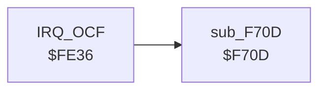
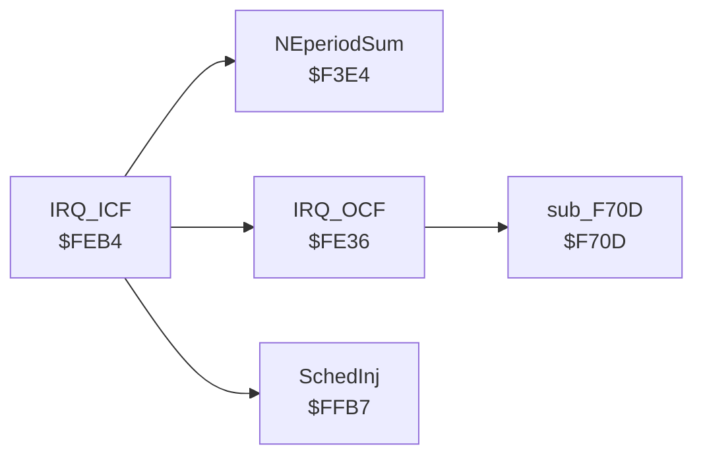

# Cross-references: MR2 AW11 ECU 89661-17140 (D151801-7110), $F000-$FFFF

Generated by `analysis/pcmre/xref.py`. **Do not edit by hand**; regenerate with
`PYTHONPATH=analysis uv run python -m pcmre.xref --write`. A test fails if this file is stale.

The analyser follows the code from the interrupt vectors and tracks the X register when it holds a
constant, so it resolves Denso's indexed calls (`ldx #$FFCF` / `jsr $14,x`) and indexed accesses that
wrap past `$FFFF` into RAM. Accesses marked † were resolved that way. IDA's own `XREF` comments in
`cap.asm` are checked against this analysis by `tests/test_xref.py`.

## Summary

| Item | Count |
|---|---|
| Routines (vector entries + call targets) | 48 |
| Instructions reached | 1877 |
| Call edges (unique caller → callee) | 108 |
| Memory accesses resolved | 1702 |
| Indirect calls/jumps not resolved | 23 |
| Indexed data sites reached with X unknown, wholly or after a loop's first pass | 21 |
| Listing code lines never reached | 0 |
| Reached instructions the listing calls data | 0 |

## Vectors

| Vector | Address | Handler |
|---|---|---|
| TRAP | `$FFEE` | `$523D` outside ROM (not code) |
| SCI | `$FFF0` | `$F2BE` Reset |
| TOF | `$FFF2` | `$F2BE` Reset |
| OCF | `$FFF4` | `$FE36` IRQ_OCF |
| ICF | `$FFF6` | `$FEB4` IRQ_ICF |
| IRQ1 | `$FFF8` | `$F2BE` Reset |
| SWI | `$FFFA` | `$F2BE` Reset |
| NMI | `$FFFC` | `$F2BE` Reset |
| RES | `$FFFE` | `$F2BE` Reset |

## Routines

Instruction counts include code shared with other routines (fall-through tails).

| Entry | Routine | Instrs | Called by | Calls |
|---|---|---|---|---|
| `$F01E` | sub_F01E | 14 | SvcAdc, SvcEvents, SvcIgnition | – |
| `$F027` | sub_F027 | 13 | SvcIgnition | – |
| `$F11D` | Lookup1D_a | 22 | SvcAdc, SvcEvents, SvcIgnition | sub_F15B |
| `$F11E` | Lookup1D_a+1 | 21 | sub_F9F0 | sub_F15B |
| `$F11F` | Lookup1D_a+2 | 20 | SvcEvents, SvcIgnition | sub_F15B |
| `$F120` | Lookup1D_a+3 | 19 | Reset | sub_F15B |
| `$F124` | Lookup1D_a+7 | 29 | Reset | – |
| `$F126` | Lookup1D_a+9 | 28 | SvcAdc, SvcEvents, SvcIgnition | – |
| `$F12A` | Lookup1D_a+13 | 29 | Reset, SvcEvents, SvcIgnition | – |
| `$F12C` | Lookup1D_a+15 | 28 | Reset, SvcAdc, SvcEvents, SvcIgnition, sub_F58D | – |
| `$F130` | sub_F130 | 27 | SvcAdc, SvcEvents, SvcIgnition, sub_F8C2, sub_F8CB | – |
| `$F132` | sub_F132 | 26 | Reset, SvcAdc, SvcEvents, SvcIgnition | – |
| `$F13D` | sub_F13D | 17 | Lookup2D, Reset | – |
| `$F159` | sub_F159 | 12 | Lookup2D | – |
| `$F15A` | sub_F15A | 11 | Lookup2D | – |
| `$F15B` | sub_F15B | 10 | Lookup1D_a, Lookup1D_a+1, Lookup1D_a+2, Lookup1D_a+3 | – |
| `$F16A` | Lookup2D | 39 | SvcAdc, SvcEvents, SvcIgnition | sub_F13D, sub_F159, sub_F15A |
| `$F2BE` | Reset (SCI, TOF, IRQ1, SWI, NMI, RES vector) | 525 | – | Lookup1D_a+13, Lookup1D_a+15, Lookup1D_a+3, Lookup1D_a+7, NEperiodSum, SchedInj, SvcEvents, SvcIgnition, sub_F132, sub_F13D, sub_F58D, sub_F593, … (+7) |
| `$F3E4` | NEperiodSum | 7 | IRQ_ICF, Reset | – |
| `$F58D` | sub_F58D | 3 | Reset, sub_F593 | Lookup1D_a+15 |
| `$F593` | sub_F593 | 5 | Reset | sub_F58D |
| `$F6E6` | sub_F6E6 | 44 | SvcAdc, SvcEvents, SvcIgnition | – |
| `$F70D` | sub_F70D | 23 | IRQ_OCF, Reset | – |
| `$F716` | sub_F716 | 18 | SvcAdc, SvcEvents, SvcIgnition | – |
| `$F717` | sub_F717 | 17 | SvcAdc, SvcEvents, SvcIgnition | – |
| `$F7EC` | SvcIgnition | 893 | Reset | Lookup1D_a, Lookup1D_a+13, Lookup1D_a+15, Lookup1D_a+2, Lookup1D_a+9, Lookup2D, Mul16, SchedInj, SvcAdc, SvcAdc+14, SvcAdc+15, SvcAdc+5, … (+18) |
| `$F84D` | SvcEvents | 840 | Reset, SvcIgnition | Lookup1D_a, Lookup1D_a+13, Lookup1D_a+15, Lookup1D_a+2, Lookup1D_a+9, Lookup2D, SchedInj, SvcAdc, SvcAdc+14, SvcAdc+15, SvcAdc+5, sub_F01E, … (+15) |
| `$F8C2` | sub_F8C2 | 12 | SvcEvents, SvcIgnition | sub_F130 |
| `$F8CB` | sub_F8CB | 8 | SvcEvents, SvcIgnition | sub_F130 |
| `$F9D3` | sub_F9D3 | 8 | SvcEvents, SvcIgnition | – |
| `$F9D4` | sub_F9D4 | 7 | Reset | – |
| `$F9D5` | sub_F9D5 | 6 | SvcAdc, SvcEvents, SvcIgnition | – |
| `$F9D7` | sub_F9D7 | 4 | Reset, SvcEvents, SvcIgnition | – |
| `$F9DD` | sub_F9DD | 8 | SvcEvents, SvcIgnition | – |
| `$F9DE` | sub_F9DE | 7 | Reset | – |
| `$F9DF` | sub_F9DF | 6 | Reset, SvcAdc, SvcEvents, SvcIgnition | – |
| `$F9E0` | sub_F9E0 | 5 | SvcEvents, SvcIgnition | – |
| `$F9E4` | sub_F9E4 | 1 | Reset | – |
| `$F9E5` | sub_F9E5 | 7 | Reset, SvcAdc, SvcEvents, SvcIgnition | – |
| `$F9F0` | sub_F9F0 | 14 | SvcEvents, SvcIgnition | Lookup1D_a+1 |
| `$FB23` | SvcAdc | 495 | SvcEvents, SvcIgnition | Lookup1D_a, Lookup1D_a+15, Lookup1D_a+9, Lookup2D, SchedInj, SvcAdc+5, sub_F01E, sub_F130, sub_F132, sub_F6E6, sub_F716, sub_F717, … (+3) |
| `$FB28` | SvcAdc+5 | 9 | SvcAdc, SvcEvents, SvcIgnition | Mul16 |
| `$FB31` | SvcAdc+14 | 28 | SvcEvents, SvcIgnition | – |
| `$FB32` | SvcAdc+15 | 27 | SvcEvents, SvcIgnition | – |
| `$FB33` | Mul16 | 26 | SvcAdc+5, SvcIgnition | – |
| `$FE36` | IRQ_OCF (OCF vector) | 65 | IRQ_ICF | sub_F70D |
| `$FEB4` | IRQ_ICF (ICF vector) | 135 | – | IRQ_OCF, NEperiodSum, SchedInj |
| `$FFB7` | SchedInj | 29 | IRQ_ICF, Reset, SvcAdc, SvcEvents, SvcIgnition | – |

## Routines with non-standard returns

`inline` = bytes of parameters placed after the call, skipped on return; `pops` = bytes of the
caller's stack removed besides the return address.

| Entry | Routine | Inline bytes | Pops |
|---|---|---|---|

## RAM and I/O registers

`$00`–`$1F` are the HD6301 on-chip registers; `$80`–`$FF` is on-chip RAM; `$40`–`$7F` is external
RAM on this board. Read-modify-write instructions (`inc`, `aim` …) count as both, and a 16-bit
access (`ldd`, `std`, `ldx` …) is listed on both of its bytes.

**These lists are not complete.** A dash means no access was *resolved*, not that none exists:

- indexed accesses with an unknown X (for example the ADC result store at `$54` + channel) are not
  attributed;
- in a loop that walks X, only the first pass is attributed. For example, reset's RAM clear
  (`clr $4B,x` / `dex` loop at `$F02B`) shows up only on `$FF`, and the RAM and ROM self-tests only on
  their first address.

Both kinds are counted in the summary; the sites are: `$F146`, `$F148`, `$F150`, `$F301`, `$F316`, `$F31D`, `$F322`, `$F336`, `$F3D8`, `$F3F8`, `$F40D`, `$F5EC`, `$F806`, `$F837`, `$F9E5`, `$F9E9`, `$FA87`, `$FA8D`, `$FCBA`, `$FDF8`, `$FF31`.

| Address | Name | Width | Read by | Written by |
|---|---|---|---|---|
| `$00` | DDR1 | 2 | SvcAdc, SvcEvents, SvcIgnition | Reset |
| `$01` | DDR2 | 2 | – | Reset |
| `$02` | PORT1 | 2 | IRQ_OCF, Reset, SvcAdc, SvcEvents, SvcIgnition, sub_F6E6, sub_F70D, sub_F716, sub_F717 | IRQ_OCF, Reset, SvcAdc, SvcEvents, SvcIgnition |
| `$03` | PORT2 | 2 | IRQ_OCF, Reset, SchedInj, SvcAdc, SvcEvents, SvcIgnition, sub_F6E6, sub_F70D, sub_F716, sub_F717 | Reset, SvcAdc, SvcEvents, SvcIgnition |
| `$04` | DDR3 | 2 | – | Reset |
| `$05` | DDR4 | 2 | – | Reset |
| `$06` | PORT3 | 1 | IRQ_ICF, IRQ_OCF, Reset, SvcAdc, SvcEvents, SvcIgnition, sub_F6E6, sub_F70D | Reset |
| `$07` | PORT4 | 2 | SvcAdc, SvcEvents, SvcIgnition | Reset, SvcAdc, SvcEvents, SvcIgnition |
| `$08` | TCSR | 2 | IRQ_OCF, Reset, SvcAdc, SvcEvents, SvcIgnition | IRQ_OCF, Reset, SchedInj |
| `$09` | FRCH | 2 | IRQ_OCF, SchedInj | Reset |
| `$0A` | FRCL | 2 | IRQ_OCF, SchedInj | Reset |
| `$0B` | OCRH | 2 | IRQ_OCF | IRQ_OCF, SchedInj |
| `$0C` | OCRL | 2 | IRQ_OCF | IRQ_OCF, SchedInj |
| `$0D` | ICRH | 2 | Reset, SvcAdc, SvcEvents, SvcIgnition | – |
| `$0E` | ICRL | 2 | Reset, SvcAdc, SvcEvents, SvcIgnition | – |
| `$0F` | P3CSR | 1 | IRQ_OCF | Reset |
| `$10` | RMCR | 2 | – | Reset |
| `$11` | TRCSR | 2 | Reset | Reset |
| `$12` | RDR | 1 | Reset | – |
| `$13` | TDR | 1 | – | Reset |
| `$14` | RAMCR | 1 | – | Reset |
| `$18` | TCSR2 | 1 | IRQ_ICF, IRQ_OCF, Reset | IRQ_ICF, IRQ_OCF, Reset |
| `$1B` | OCR2H | 2 | IRQ_ICF | IRQ_ICF, IRQ_OCF |
| `$1C` | OCR2L | 2 | IRQ_ICF | IRQ_ICF, IRQ_OCF |
| `$1D` | ICR2H | 2 | IRQ_ICF, Reset | – |
| `$1E` | ICR2L | 2 | IRQ_ICF | – |
| `$40` | SelfTestMark | 2 | Reset, SvcAdc, SvcEvents, SvcIgnition, sub_F6E6, sub_F70D, sub_F716, sub_F717 | Reset, sub_F6E6, sub_F70D, sub_F716, sub_F717 |
| `$41` | – | 2 | sub_F6E6, sub_F70D, sub_F716, sub_F717 | Reset, sub_F6E6, sub_F70D, sub_F716, sub_F717 |
| `$42` | FaultBits2 | 2 | Reset†, SvcAdc, SvcEvents, SvcIgnition, sub_F6E6, sub_F70D, sub_F716, sub_F717 | Reset†, sub_F6E6, sub_F70D, sub_F716, sub_F717 |
| `$43` | – | 2 | Reset†, sub_F6E6, sub_F70D, sub_F716, sub_F717 | Reset†, sub_F6E6, sub_F70D, sub_F716, sub_F717 |
| `$44` | – | 2 | Reset, SvcAdc, SvcEvents, SvcIgnition | Reset, SvcAdc, SvcEvents, SvcIgnition |
| `$45` | – | 2 | SvcAdc, SvcEvents, SvcIgnition | Reset, SvcAdc, SvcEvents, SvcIgnition |
| `$46` | – | 2 | SvcAdc, SvcEvents, SvcIgnition, sub_F9F0 | SvcAdc, SvcEvents, SvcIgnition |
| `$47` | – | 2 | SvcAdc, SvcEvents, SvcIgnition, sub_F9F0 | SvcAdc, SvcEvents, SvcIgnition |
| `$48` | – | 2 | SvcEvents, SvcIgnition | SvcEvents, SvcIgnition |
| `$49` | – | 2 | SvcEvents, SvcIgnition | SvcEvents, SvcIgnition |
| `$4A` | – | 1 | Reset, SvcAdc, SvcEvents, SvcIgnition, sub_F593 | SvcAdc, SvcEvents, SvcIgnition |
| `$4B` | – | 2 | Reset, SvcAdc, SvcEvents, SvcIgnition | Reset, SvcAdc, SvcEvents, SvcIgnition |
| `$4C` | – | 2 | Reset, SvcAdc, SvcEvents, SvcIgnition | Reset, SvcAdc, SvcEvents, SvcIgnition |
| `$4D` | – | 1 | SvcEvents, SvcIgnition | SvcAdc, SvcEvents, SvcIgnition |
| `$4E` | – | 1 | SvcEvents, SvcIgnition | SvcEvents, SvcIgnition |
| `$4F` | – | 1 | SvcEvents, SvcIgnition | SvcEvents, SvcIgnition |
| `$50` | – | 1 | SvcAdc, SvcEvents, SvcIgnition | SvcAdc, SvcEvents, SvcIgnition |
| `$51` | – | 1 | SvcEvents, SvcIgnition | Reset |
| `$52` | – | 1 | SvcEvents, SvcIgnition | Reset |
| `$53` | Coolant | 2 | Lookup1D_a+13, Lookup1D_a+7, Reset, SvcAdc, SvcEvents, SvcIgnition | Reset, SvcAdc, SvcEvents, SvcIgnition |
| `$54` | – | 2 | Reset | Reset |
| `$55` | – | 1 | SvcAdc, SvcEvents, SvcIgnition | SvcAdc, SvcEvents, SvcIgnition |
| `$56` | – | 2 | SvcEvents, SvcIgnition | Reset |
| `$57` | – | 2 | SvcEvents, SvcIgnition | Reset |
| `$58` | – | 1 | SvcEvents, SvcIgnition | Reset |
| `$59` | InjFlags | 2 | SvcAdc, SvcEvents, SvcIgnition | Reset, SvcAdc, SvcEvents, SvcIgnition |
| `$5A` | StateFlags | 2 | Reset, SvcAdc, SvcEvents, SvcIgnition | Reset, SvcAdc, SvcEvents, SvcIgnition |
| `$5B` | – | 2 | IRQ_ICF, Reset | IRQ_ICF, Reset |
| `$5C` | – | 2 | Reset, SvcEvents, SvcIgnition | Reset |
| `$5D` | – | 2 | SvcEvents, SvcIgnition | SvcEvents, SvcIgnition |
| `$5E` | – | 1 | SvcEvents, SvcIgnition | SvcAdc, SvcEvents, SvcIgnition |
| `$5F` | – | 1 | Reset | SvcAdc, SvcEvents, SvcIgnition |
| `$60` | – | 1 | SvcEvents, SvcIgnition | Reset, SvcEvents, SvcIgnition |
| `$61` | – | 1 | SvcEvents, SvcIgnition | Reset |
| `$62` | – | 1 | Reset | Reset |
| `$63` | – | 1 | Reset | Reset |
| `$64` | – | 2 | Reset, SvcAdc, SvcEvents, SvcIgnition, sub_F9E5† | IRQ_ICF, Reset, sub_F9E5† |
| `$65` | – | 2 | IRQ_ICF | IRQ_ICF, Reset |
| `$66` | – | 1 | SvcAdc, SvcEvents, SvcIgnition | SvcAdc, SvcEvents, SvcIgnition |
| `$67` | – | 1 | Reset | Reset |
| `$68` | – | 2 | SvcAdc, SvcEvents, SvcIgnition | SvcAdc, SvcEvents, SvcIgnition |
| `$69` | – | 2 | SvcAdc, SvcEvents, SvcIgnition | SvcAdc, SvcEvents, SvcIgnition |
| `$6A` | – | 1 | Reset | Reset |
| `$6B` | – | 1 | IRQ_OCF, Reset | – |
| `$6C` | – | 1 | Reset, sub_F9E5† | IRQ_ICF, Reset, sub_F9E5† |
| `$6D` | – | 2 | sub_F6E6 | sub_F6E6 |
| `$6E` | – | 2 | SvcAdc, SvcEvents, SvcIgnition, sub_F6E6 | SvcAdc, SvcEvents, SvcIgnition |
| `$6F` | – | 1 | Reset, SvcEvents, SvcIgnition, sub_F9E5† | Reset, sub_F9E5† |
| `$70` | – | 1 | Reset | Reset |
| `$71` | – | 1 | Reset | Reset |
| `$72` | – | 1 | SvcAdc, SvcEvents, SvcIgnition | SvcAdc, SvcEvents, SvcIgnition |
| `$73` | RpmIndex | 1 | Reset, SvcAdc, SvcEvents, SvcIgnition, sub_F58D | Reset |
| `$74` | – | 2 | SvcEvents, SvcIgnition | SvcEvents, SvcIgnition |
| `$75` | – | 2 | Reset, SvcEvents, SvcIgnition, sub_F8C2 | SvcEvents, SvcIgnition |
| `$76` | – | 1 | sub_F8C2 | SvcEvents, SvcIgnition |
| `$77` | CrankPeriod | 2 | Reset, SvcAdc, SvcEvents, SvcIgnition, sub_F9F0 | Reset |
| `$78` | – | 2 | Reset, SvcAdc, SvcEvents, SvcIgnition, sub_F9F0 | Reset |
| `$79` | – | 2 | SvcAdc, SvcEvents, SvcIgnition | SvcAdc, SvcEvents, SvcIgnition |
| `$7A` | – | 2 | SvcAdc, SvcEvents, SvcIgnition | SvcAdc, SvcEvents, SvcIgnition |
| `$7B` | – | 1 | SvcAdc, SvcEvents, SvcIgnition | SvcAdc, SvcEvents, SvcIgnition |
| `$7C` | NEperiod0 | 2 | IRQ_ICF, NEperiodSum, SvcIgnition | – |
| `$7D` | – | 2 | IRQ_ICF, NEperiodSum, SvcIgnition | – |
| `$7E` | NEperiod1 | 2 | NEperiodSum, SvcIgnition | – |
| `$7F` | – | 2 | NEperiodSum, SvcIgnition | – |
| `$80` | NEperiod2 | 2 | NEperiodSum | – |
| `$81` | – | 2 | NEperiodSum | – |
| `$82` | – | 2 | SvcEvents, SvcIgnition | IRQ_ICF |
| `$83` | – | 2 | SvcEvents, SvcIgnition | IRQ_ICF |
| `$84` | LastNEtime | 2 | IRQ_ICF | IRQ_ICF |
| `$85` | – | 2 | IRQ_ICF | IRQ_ICF |
| `$88` | InjPulse | 2 | IRQ_ICF | SvcEvents, SvcIgnition |
| `$89` | – | 2 | IRQ_ICF | SvcEvents, SvcIgnition |
| `$8A` | – | 2 | SchedInj | SvcAdc, SvcEvents, SvcIgnition |
| `$8B` | – | 2 | SchedInj | SvcAdc, SvcEvents, SvcIgnition |
| `$8C` | – | 2 | SvcAdc, SvcEvents, SvcIgnition | SvcAdc, SvcEvents, SvcIgnition |
| `$8D` | OC1next | 2 | IRQ_OCF, SchedInj, SvcEvents, SvcIgnition | SchedInj |
| `$8E` | – | 2 | IRQ_OCF, SchedInj | SchedInj |
| `$8F` | – | 1 | SvcAdc, SvcEvents, SvcIgnition | SvcAdc, SvcEvents, SvcIgnition |
| `$90` | AdcStart | 2 | SvcAdc, SvcEvents, SvcIgnition | IRQ_OCF |
| `$91` | – | 2 | SvcAdc, SvcEvents, SvcIgnition | IRQ_OCF |
| `$92` | OC1period | 2 | IRQ_OCF | IRQ_OCF |
| `$93` | – | 2 | IRQ_OCF | IRQ_OCF |
| `$94` | – | 2 | SvcEvents, SvcIgnition | SvcEvents, SvcIgnition |
| `$95` | – | 2 | SchedInj, SvcEvents, SvcIgnition | Reset, SvcEvents, SvcIgnition |
| `$96` | – | 2 | IRQ_ICF | IRQ_ICF, Reset |
| `$97` | NEcount | 2 | IRQ_ICF, SvcIgnition | IRQ_ICF, Reset |
| `$98` | – | 2 | Reset | IRQ_ICF, Reset |
| `$99` | ModeFlags | 2 | IRQ_ICF, IRQ_OCF, Reset, SvcAdc, SvcEvents, SvcIgnition | Reset |
| `$9A` | – | 2 | Reset | Reset |
| `$9B` | – | 1 | Reset | Reset |
| `$9C` | – | 2 | IRQ_ICF | IRQ_ICF, SvcIgnition |
| `$9D` | – | 2 | IRQ_ICF | IRQ_ICF, SvcIgnition |
| `$9E` | IgnEdge | 1 | IRQ_ICF, SvcIgnition | SvcIgnition |
| `$9F` | IgnDelay | 2 | IRQ_ICF | SvcIgnition |
| `$A0` | – | 2 | IRQ_ICF | SvcIgnition |
| `$A1` | – | 1 | SvcAdc, SvcEvents, SvcIgnition | SvcAdc, SvcEvents, SvcIgnition, sub_F6E6, sub_F70D |
| `$A2` | – | 2 | SvcAdc, SvcEvents, SvcIgnition | SvcAdc, SvcEvents, SvcIgnition |
| `$A3` | – | 2 | SvcAdc, SvcEvents, SvcIgnition | SvcAdc, SvcEvents, SvcIgnition |
| `$A4` | – | 1 | IRQ_ICF, SvcAdc, SvcEvents, SvcIgnition, sub_F6E6 | sub_F6E6 |
| `$A5` | – | 2 | SvcAdc, SvcEvents, SvcIgnition | Reset, SvcAdc, SvcEvents, SvcIgnition |
| `$A6` | – | 2 | SvcAdc, SvcEvents, SvcIgnition | SvcAdc, SvcEvents, SvcIgnition |
| `$A7` | StartCount | 1 | IRQ_OCF, SchedInj | IRQ_OCF |
| `$A8` | – | 1 | SvcIgnition | SvcAdc, SvcEvents, SvcIgnition |
| `$A9` | – | 1 | – | Reset |
| `$AA` | – | 1 | – | SvcEvents, SvcIgnition |
| `$AB` | – | 2 | Lookup2D, Lookup2D†, SvcAdc, SvcEvents, SvcIgnition, SvcIgnition† | Lookup2D, SvcAdc, SvcEvents, SvcIgnition |
| `$AC` | – | 2 | Lookup2D†, Mul16, SvcAdc, SvcAdc+14, SvcAdc+15, SvcEvents, SvcIgnition | Lookup2D, Mul16, SvcAdc, SvcAdc+14, SvcAdc+15, SvcEvents, SvcIgnition |
| `$AD` | – | 2 | Lookup2D, Mul16, SvcAdc, SvcAdc+14, SvcAdc+15, SvcEvents, SvcIgnition | Lookup2D, Mul16, SvcAdc, SvcAdc+14, SvcAdc+15, SvcEvents, SvcIgnition |
| `$AE` | – | 2 | Lookup2D, Mul16, SvcAdc, SvcAdc+14, SvcAdc+15, SvcEvents, SvcIgnition | Lookup2D, Mul16, SvcAdc, SvcAdc+14, SvcAdc+15, SvcEvents, SvcIgnition |
| `$AF` | – | 2 | Lookup2D, Mul16, SvcAdc+14, SvcAdc+15, SvcEvents, SvcIgnition | Mul16, SvcAdc, SvcAdc+14, SvcAdc+15, SvcEvents, SvcIgnition |
| `$B0` | – | 2 | Lookup2D, Mul16, SvcAdc+14, SvcAdc+15 | Lookup2D, Mul16, SvcAdc, SvcAdc+14, SvcAdc+15, SvcEvents, SvcIgnition |
| `$B1` | – | 2 | Lookup2D, Mul16, SvcAdc+14, SvcAdc+15 | Lookup2D, Mul16, SvcAdc+14, SvcAdc+15 |
| `$B2` | – | 2 | SvcEvents, SvcIgnition | SvcEvents, SvcIgnition |
| `$B3` | – | 2 | SvcEvents, SvcIgnition | SvcEvents, SvcIgnition |
| `$B4` | – | 1 | Reset, SvcAdc, SvcEvents, SvcIgnition, sub_F8C2, sub_F8CB | Reset |
| `$B5` | – | 2 | Reset, SvcAdc, SvcEvents, SvcIgnition | Reset, SvcAdc, SvcEvents, SvcIgnition |
| `$B6` | – | 2 | Reset, SvcAdc, SvcEvents, SvcIgnition | Reset, SvcAdc, SvcEvents, SvcIgnition |
| `$B7` | – | 1 | IRQ_ICF, Reset | IRQ_ICF, Reset |
| `$B8` | – | 1 | SvcEvents, SvcIgnition | Reset, SvcEvents, SvcIgnition |
| `$B9` | – | 2 | SvcEvents, SvcIgnition | SvcEvents, SvcIgnition |
| `$BA` | – | 2 | SvcEvents, SvcIgnition | SvcEvents, SvcIgnition |
| `$BB` | – | 1 | SvcEvents, SvcIgnition | SvcEvents, SvcIgnition |
| `$BC` | – | 2 | SvcEvents, SvcIgnition | SvcEvents, SvcIgnition |
| `$BD` | – | 2 | SvcEvents, SvcIgnition | SvcEvents, SvcIgnition |
| `$BE` | – | 1 | SvcAdc, SvcEvents, SvcIgnition | SvcAdc, SvcEvents, SvcIgnition |
| `$BF` | – | 1 | IRQ_OCF, SvcAdc, SvcEvents, SvcIgnition | IRQ_OCF |
| `$C0` | NEtime | 2 | IRQ_ICF | IRQ_ICF |
| `$C1` | – | 2 | IRQ_ICF | IRQ_ICF |
| `$C2` | – | 1 | IRQ_ICF | IRQ_ICF |
| `$C3` | – | 2 | IRQ_ICF | IRQ_ICF |
| `$C4` | – | 2 | IRQ_ICF | IRQ_ICF |
| `$C5` | OC2next | 2 | IRQ_ICF, IRQ_OCF | IRQ_ICF |
| `$C6` | – | 2 | IRQ_ICF, IRQ_OCF | IRQ_ICF |
| `$C7` | EvLoad | 1 | SvcEvents, SvcIgnition | IRQ_ICF, SvcEvents, SvcIgnition |
| `$C8` | EvRpm | 1 | SvcEvents, SvcIgnition | IRQ_ICF, SvcEvents, SvcIgnition |
| `$C9` | EvCoolant | 1 | SvcAdc, SvcEvents, SvcIgnition | IRQ_ICF, SvcAdc, SvcEvents, SvcIgnition |
| `$CA` | EvEdge2 | 1 | SvcEvents, SvcIgnition | IRQ_ICF, SvcEvents, SvcIgnition |
| `$CB` | – | 1 | SvcAdc, SvcEvents, SvcIgnition | Reset†, SvcAdc, SvcEvents, SvcIgnition |
| `$CC` | DiagFlags | 2 | Reset, SvcAdc, SvcEvents, SvcIgnition | Reset, SvcAdc, SvcEvents, SvcIgnition |
| `$CD` | – | 2 | Reset, SvcEvents, SvcIgnition | – |
| `$FE` | – | 2 | – | Reset† |
| `$FF` | – | 2 | – | Reset† |

## ROM data and tables

Direct reads of ROM, and 16-bit immediates that point into ROM (`ptr`, usually a table base or an
X base for an indexed call). Code addresses that are only used as call or jump targets are not listed.

| Address | Name | How | Used by |
|---|---|---|---|
| `$F000` | Tables | ptr/r | Reset, Reset† |
| `$F001` | – | r | Reset† |
| `$F002` | – | r | sub_F01E† |
| `$F003` | – | ptr/r | SvcAdc, SvcEvents, SvcIgnition, sub_F01E† |
| `$F004` | – | r | sub_F01E† |
| `$F005` | – | r | sub_F01E† |
| `$F006` | – | r | sub_F01E† |
| `$F007` | – | r | sub_F01E† |
| `$F008` | – | r | sub_F01E† |
| `$F009` | – | ptr | SvcAdc, SvcEvents, SvcIgnition |
| `$F00C` | – | r | sub_F01E† |
| `$F00D` | – | ptr/r | SvcAdc, SvcEvents, SvcIgnition, sub_F01E† |
| `$F00E` | – | r | sub_F01E† |
| `$F00F` | – | ptr/r | SvcEvents, SvcEvents†, SvcIgnition, SvcIgnition† |
| `$F010` | – | r | SvcEvents†, SvcIgnition† |
| `$F011` | – | r | SvcEvents†, SvcIgnition† |
| `$F012` | – | r | SvcEvents†, SvcIgnition† |
| `$F013` | – | ptr/r | SvcIgnition, sub_F027† |
| `$F014` | – | r | sub_F027† |
| `$F015` | – | r | sub_F027† |
| `$F016` | – | r | sub_F027† |
| `$F017` | – | ptr/r | SvcIgnition, sub_F027† |
| `$F018` | – | r | sub_F027† |
| `$F019` | – | r | sub_F027† |
| `$F01A` | – | ptr/r | SvcAdc, SvcEvents, SvcIgnition, sub_F027† |
| `$F031` | – | ptr | Reset |
| `$F044` | – | ptr/r | SvcAdc, SvcEvents, SvcIgnition, sub_F15B† |
| `$F045` | – | r | sub_F15B† |
| `$F046` | – | r | sub_F15B† |
| `$F056` | – | ptr/r | Lookup1D_a+13†, Reset |
| `$F057` | – | r | Lookup1D_a+13† |
| `$F058` | – | r | Lookup1D_a+13† |
| `$F05F` | – | ptr/r | Lookup1D_a+13†, SvcEvents, SvcIgnition |
| `$F060` | – | r | Lookup1D_a+13† |
| `$F061` | – | r | Lookup1D_a+13† |
| `$F069` | – | ptr/r | Lookup1D_a+13†, Reset |
| `$F06A` | – | r | Lookup1D_a+13† |
| `$F06B` | – | r | Lookup1D_a+13† |
| `$F072` | – | ptr/r | Lookup1D_a+15†, SvcEvents, SvcIgnition |
| `$F073` | – | r | Lookup1D_a+15† |
| `$F074` | – | r | Lookup1D_a+15† |
| `$F077` | – | ptr/r | Lookup1D_a+7†, Reset |
| `$F078` | – | r | Lookup1D_a+7† |
| `$F079` | – | r | Lookup1D_a+7† |
| `$F07D` | – | ptr/r | Lookup1D_a+7†, Reset |
| `$F07E` | – | r | Lookup1D_a+7† |
| `$F07F` | – | r | Lookup1D_a+7† |
| `$F083` | – | ptr/r | Lookup1D_a+9†, SvcAdc, SvcEvents, SvcIgnition |
| `$F084` | – | r | Lookup1D_a+9† |
| `$F085` | – | r | Lookup1D_a+9† |
| `$F089` | – | ptr/r | Lookup1D_a+15†, SvcEvents, SvcIgnition |
| `$F08A` | – | r | Lookup1D_a+15† |
| `$F08B` | – | r | Lookup1D_a+15† |
| `$F090` | – | ptr/r | SvcAdc, SvcEvents, SvcIgnition, sub_F132† |
| `$F091` | – | r | sub_F132† |
| `$F092` | – | r | sub_F132† |
| `$F095` | – | ptr/r | sub_F130†, sub_F8C2 |
| `$F096` | – | r | sub_F130† |
| `$F097` | – | r | sub_F130† |
| `$F099` | – | ptr/r | SvcEvents, SvcIgnition, sub_F130† |
| `$F09A` | – | r | sub_F130† |
| `$F09B` | – | r | sub_F130† |
| `$F09E` | – | ptr/r | Lookup1D_a+7†, Reset |
| `$F09F` | – | r | Lookup1D_a+7† |
| `$F0A0` | – | r | Lookup1D_a+7† |
| `$F0A4` | – | ptr/r | Lookup1D_a+15†, SvcAdc, SvcEvents, SvcIgnition |
| `$F0A5` | – | r | Lookup1D_a+15† |
| `$F0A6` | – | r | Lookup1D_a+15† |
| `$F0AB` | – | ptr/r | SvcAdc, SvcEvents, SvcIgnition, sub_F132† |
| `$F0AC` | – | r | sub_F132† |
| `$F0AD` | – | r | sub_F132† |
| `$F0B1` | – | ptr/r | SvcAdc, SvcEvents, SvcIgnition, sub_F132† |
| `$F0B2` | – | r | sub_F132† |
| `$F0B3` | – | r | sub_F132† |
| `$F0B9` | – | ptr/r | SvcAdc, SvcEvents, SvcIgnition, sub_F132† |
| `$F0BA` | – | r | sub_F132† |
| `$F0BB` | – | r | sub_F132† |
| `$F0BD` | – | ptr/r | Lookup1D_a+15†, SvcEvents, SvcIgnition |
| `$F0BE` | – | r | Lookup1D_a+15† |
| `$F0BF` | – | r | Lookup1D_a+15† |
| `$F0C4` | – | ptr/r | Lookup1D_a+7†, Reset |
| `$F0C5` | – | r | Lookup1D_a+7† |
| `$F0C6` | – | r | Lookup1D_a+7† |
| `$F0CA` | – | ptr/r | Reset, Reset† |
| `$F0CB` | – | r | Reset† |
| `$F0CC` | – | r | Reset† |
| `$F0CD` | – | r | Reset† |
| `$F0CE` | – | ptr/r | Lookup1D_a+15†, Reset |
| `$F0CF` | – | r | Lookup1D_a+15† |
| `$F0D0` | – | r | Lookup1D_a+15† |
| `$F0D2` | – | ptr/r | Lookup1D_a+15†, sub_F593 |
| `$F0D3` | – | r | Lookup1D_a+15† |
| `$F0D4` | – | r | Lookup1D_a+15† |
| `$F0DB` | – | ptr/r | Lookup1D_a+15†, Reset |
| `$F0DC` | – | r | Lookup1D_a+15† |
| `$F0DD` | – | r | Lookup1D_a+15† |
| `$F0E2` | – | ptr | Reset |
| `$F0EC` | – | ptr/r | Lookup1D_a+15†, Reset |
| `$F0ED` | – | r | Lookup1D_a+15† |
| `$F0EE` | – | r | Lookup1D_a+15† |
| `$F0F2` | – | ptr/r | Reset, sub_F132† |
| `$F0F3` | – | r | sub_F132† |
| `$F0F4` | – | r | sub_F132† |
| `$F0F6` | – | ptr/r | SvcEvents, SvcIgnition, sub_F130† |
| `$F0F7` | – | r | sub_F130† |
| `$F0F8` | – | r | sub_F130† |
| `$F0FA` | – | ptr/r | SvcAdc, SvcEvents, SvcIgnition, sub_F130† |
| `$F0FB` | – | r | sub_F130† |
| `$F0FC` | – | r | sub_F130† |
| `$F0FF` | – | ptr/r | SvcEvents, SvcIgnition, sub_F15B† |
| `$F100` | – | r | sub_F15B† |
| `$F101` | – | r | sub_F15B† |
| `$F10B` | – | r | sub_F15B† |
| `$F10C` | – | r | sub_F15B† |
| `$F10D` | – | r | sub_F15B† |
| `$F117` | – | ptr/r | Reset, sub_F15B† |
| `$F118` | – | r | sub_F15B† |
| `$F119` | – | r | sub_F15B† |
| `$F196` | – | ptr/r | SvcEvents, SvcIgnition, sub_F15B† |
| `$F197` | – | r | sub_F15B† |
| `$F198` | – | r | sub_F15B† |
| `$F1A2` | – | r | sub_F15B† |
| `$F1A3` | – | r | sub_F15B† |
| `$F1A4` | – | r | sub_F15B† |
| `$F1AE` | – | ptr/r | SvcEvents, SvcIgnition, sub_F15B† |
| `$F1AF` | – | r | sub_F15B† |
| `$F1B0` | – | r | sub_F15B† |
| `$F1BA` | – | ptr/r | SvcEvents, SvcIgnition, sub_F15B† |
| `$F1BB` | – | r | sub_F15B† |
| `$F1BC` | – | r | sub_F15B† |
| `$F1C5` | – | ptr | SvcEvents, SvcIgnition |
| `$F1C8` | – | r | SvcEvents†, SvcIgnition† |
| `$F1C9` | – | r | SvcEvents†, SvcIgnition† |
| `$F1D7` | – | ptr | SvcEvents, SvcIgnition |
| `$F1EF` | – | ptr/r | SvcAdc, SvcEvents, SvcIgnition, sub_F15A† |
| `$F1F0` | – | r | sub_F15A† |
| `$F1F1` | – | r | Lookup2D†, sub_F15A† |
| `$F1F2` | – | r | sub_F159† |
| `$F1F3` | – | r | sub_F159† |
| `$F1F4` | – | r | sub_F159† |
| `$F25D` | – | ptr/r | SvcAdc, SvcEvents, SvcIgnition, sub_F15A† |
| `$F25E` | – | r | sub_F15A† |
| `$F25F` | – | r | Lookup2D†, sub_F15A† |
| `$F260` | – | r | sub_F159† |
| `$F261` | – | r | sub_F159† |
| `$F262` | – | r | sub_F159† |
| `$F9E4` | – | ptr | Reset |
| `$FA80` | – | ptr | SvcAdc, SvcEvents, SvcIgnition |
| `$FDF7` | – | ptr | SvcEvents, SvcIgnition |
| `$FF01` | – | ptr | SvcAdc, SvcEvents, SvcIgnition |
| `$FF20` | – | ptr | Reset |
| `$FF80` | – | ptr | SvcEvents, SvcIgnition |
| `$FFF3` | – | ptr | Reset |
| `$FFFF` | – | ptr | Mul16, NEperiodSum, SvcAdc+14, SvcAdc+15 |

## Unresolved indirect calls and jumps

A site listed here may also have resolved calls from paths where X was still known (see Routines).

| Site | Routine | Instruction |
|---|---|---|
| `$F44A` | Reset | `jsr $00,x` |
| `$F7EB` | SvcIgnition | `rts` |
| `$F7EB` | SvcEvents | `rts` |
| `$FB27` | SvcIgnition | `rts` |
| `$FB27` | SvcEvents | `rts` |
| `$FC5B` | SvcIgnition | `rts` |
| `$FC5B` | SvcEvents | `rts` |
| `$FC98` | SvcIgnition | `rts` |
| `$FC98` | SvcEvents | `rts` |
| `$FD67` | SvcIgnition | `rts` |
| `$FD67` | SvcEvents | `rts` |
| `$FDAD` | SvcIgnition | `rts` |
| `$FDAD` | SvcEvents | `rts` |
| `$FDBD` | SvcIgnition | `rts` |
| `$FDBD` | SvcEvents | `rts` |
| `$FDFF` | SvcIgnition | `rts` |
| `$FDFF` | SvcEvents | `rts` |
| `$FE13` | SvcIgnition | `rts` |
| `$FE13` | SvcEvents | `rts` |
| `$FE1E` | SvcIgnition | `rts` |
| `$FE1E` | SvcEvents | `rts` |
| `$FE35` | SvcIgnition | `rts` |
| `$FE35` | SvcEvents | `rts` |

## Coverage against the IDA listing

Listing code lines never reached from a vector (dead code, or reached only through an unresolved
indirect jump):

None.

Reached instructions that the listing marks as data. These are Denso skip tricks: a one-byte opcode
(`ldx #`, `brn`) whose operand bytes hide the next instruction, so one path executes the hidden
instruction and the other skips it:

None.

Analysis warnings:

- stack depth differs where paths join at $F6FA in sub_F6E6
- stack depth differs where paths join at $F6FD in sub_F6E6
- stack depth differs where paths join at $FAB9 in SvcEvents
- stack depth differs where paths join at $FAB9 in SvcIgnition
- stack depth differs where paths join at $FB19 in SvcEvents
- stack depth differs where paths join at $FB19 in SvcIgnition
- stack pointer reloaded at $F2CA in Reset
- stack pointer reloaded at $F371 in Reset

## Call graphs

One graph per vector. Tail calls (`jmp` into another routine) count as calls.

### SCI, TOF, IRQ1, SWI, NMI, RES: Reset

```mermaid
flowchart LR
  rF2BE["Reset<br/>$F2BE"]
  rF120["Lookup1D_a+3<br/>$F120"]
  rF124["Lookup1D_a+7<br/>$F124"]
  rF12A["Lookup1D_a+13<br/>$F12A"]
  rF12C["Lookup1D_a+15<br/>$F12C"]
  rF132["sub_F132<br/>$F132"]
  rF13D["sub_F13D<br/>$F13D"]
  rF3E4["NEperiodSum<br/>$F3E4"]
  rF58D["sub_F58D<br/>$F58D"]
  rF593["sub_F593<br/>$F593"]
  rF70D["sub_F70D<br/>$F70D"]
  rF7EC["SvcIgnition<br/>$F7EC"]
  rF84D["SvcEvents<br/>$F84D"]
  rF9D4["sub_F9D4<br/>$F9D4"]
  rF9D7["sub_F9D7<br/>$F9D7"]
  rF9DE["sub_F9DE<br/>$F9DE"]
  rF9DF["sub_F9DF<br/>$F9DF"]
  rF9E4["sub_F9E4<br/>$F9E4"]
  rF9E5["sub_F9E5<br/>$F9E5"]
  rFFB7["SchedInj<br/>$FFB7"]
  rF01E["sub_F01E<br/>$F01E"]
  rF11D["Lookup1D_a<br/>$F11D"]
  rF11F["Lookup1D_a+2<br/>$F11F"]
  rF126["Lookup1D_a+9<br/>$F126"]
  rF130["sub_F130<br/>$F130"]
  rF16A["Lookup2D<br/>$F16A"]
  rF6E6["sub_F6E6<br/>$F6E6"]
  rF716["sub_F716<br/>$F716"]
  rF717["sub_F717<br/>$F717"]
  rF8C2["sub_F8C2<br/>$F8C2"]
  rF8CB["sub_F8CB<br/>$F8CB"]
  rF9D3["sub_F9D3<br/>$F9D3"]
  rF9D5["sub_F9D5<br/>$F9D5"]
  rF9DD["sub_F9DD<br/>$F9DD"]
  rF9E0["sub_F9E0<br/>$F9E0"]
  rF9F0["sub_F9F0<br/>$F9F0"]
  rFB23["SvcAdc<br/>$FB23"]
  rFB28["SvcAdc+5<br/>$FB28"]
  rFB31["SvcAdc+14<br/>$FB31"]
  rFB32["SvcAdc+15<br/>$FB32"]
  rFB33["Mul16<br/>$FB33"]
  rF11E["Lookup1D_a+1<br/>$F11E"]
  rF15B["sub_F15B<br/>$F15B"]
  rF159["sub_F159<br/>$F159"]
  rF15A["sub_F15A<br/>$F15A"]
  rF027["sub_F027<br/>$F027"]
  rF2BE --> rF120
  rF2BE --> rF124
  rF2BE --> rF12A
  rF2BE --> rF12C
  rF2BE --> rF132
  rF2BE --> rF13D
  rF2BE --> rF3E4
  rF2BE --> rF58D
  rF2BE --> rF593
  rF2BE --> rF70D
  rF2BE --> rF7EC
  rF2BE --> rF84D
  rF2BE --> rF9D4
  rF2BE --> rF9D7
  rF2BE --> rF9DE
  rF2BE --> rF9DF
  rF2BE --> rF9E4
  rF2BE --> rF9E5
  rF2BE --> rFFB7
  rF120 --> rF15B
  rF58D --> rF12C
  rF593 --> rF58D
  rF7EC --> rF01E
  rF7EC --> rF027
  rF7EC --> rF11D
  rF7EC --> rF11F
  rF7EC --> rF126
  rF7EC --> rF12A
  rF7EC --> rF12C
  rF7EC --> rF130
  rF7EC --> rF132
  rF7EC --> rF16A
  rF7EC --> rF6E6
  rF7EC --> rF716
  rF7EC --> rF717
  rF7EC --> rF84D
  rF7EC --> rF8C2
  rF7EC --> rF8CB
  rF7EC --> rF9D3
  rF7EC --> rF9D5
  rF7EC --> rF9D7
  rF7EC --> rF9DD
  rF7EC --> rF9DF
  rF7EC --> rF9E0
  rF7EC --> rF9E5
  rF7EC --> rF9F0
  rF7EC --> rFB23
  rF7EC --> rFB28
  rF7EC --> rFB31
  rF7EC --> rFB32
  rF7EC --> rFB33
  rF7EC --> rFFB7
  rF84D --> rF01E
  rF84D --> rF11D
  rF84D --> rF11F
  rF84D --> rF126
  rF84D --> rF12A
  rF84D --> rF12C
  rF84D --> rF130
  rF84D --> rF132
  rF84D --> rF16A
  rF84D --> rF6E6
  rF84D --> rF716
  rF84D --> rF717
  rF84D --> rF8C2
  rF84D --> rF8CB
  rF84D --> rF9D3
  rF84D --> rF9D5
  rF84D --> rF9D7
  rF84D --> rF9DD
  rF84D --> rF9DF
  rF84D --> rF9E0
  rF84D --> rF9E5
  rF84D --> rF9F0
  rF84D --> rFB23
  rF84D --> rFB28
  rF84D --> rFB31
  rF84D --> rFB32
  rF84D --> rFFB7
  rF11D --> rF15B
  rF11F --> rF15B
  rF16A --> rF13D
  rF16A --> rF159
  rF16A --> rF15A
  rF8C2 --> rF130
  rF8CB --> rF130
  rF9F0 --> rF11E
  rFB23 --> rF01E
  rFB23 --> rF11D
  rFB23 --> rF126
  rFB23 --> rF12C
  rFB23 --> rF130
  rFB23 --> rF132
  rFB23 --> rF16A
  rFB23 --> rF6E6
  rFB23 --> rF716
  rFB23 --> rF717
  rFB23 --> rF9D5
  rFB23 --> rF9DF
  rFB23 --> rF9E5
  rFB23 --> rFB28
  rFB23 --> rFFB7
  rFB28 --> rFB33
  rF11E --> rF15B
```

### OCF: IRQ_OCF

### ICF: IRQ_ICF

