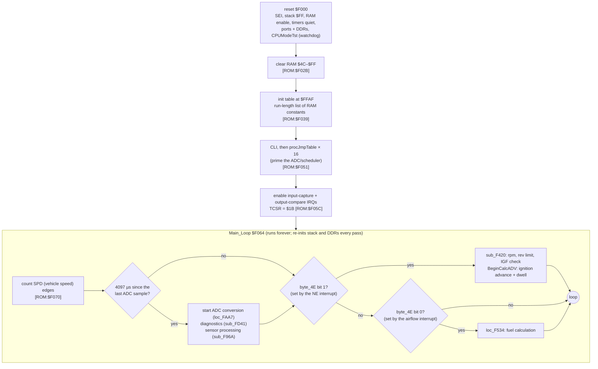
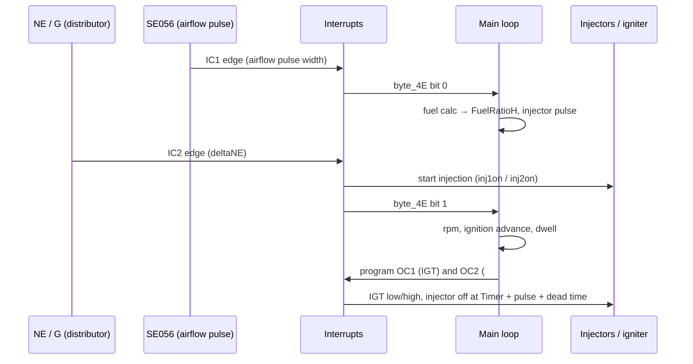

# Bluetop program architecture

## Summary

The Bluetop ROM (`cap.bin`, version 0642) runs on the CPU in mode 7. The interrupts measure the edges and set flags, and the main loop does the calculations when it sees a flag. An external serial ADC reads the analogue sensors, one channel each 4.1 ms. The 17140 ROM uses the same CPU family and the same Denso code conventions, so this page is the reference for the 17140 analysis.

Evidence and sources

- `[ROM:$addr]` tags come from the code. `[EMU:test]` tags come from the simulator ([simulation](simulation.md)).
- The labels come from the IDA listing [`cap.asm`](../../roms/bluetop/cap.asm) and the generated source [`cap.s`](../../roms/bluetop/cap.s).
- The readers and writers of each variable are in [`xref.md`](../../roms/bluetop/xref.md).
- The map data is in [`maps.md`](../../roms/bluetop/maps.md).

## Board

The Bluetop board schematic is in [`reference/ae86_board/`](../../reference/ae86_board/). The file `bluetop.sch` is in ExpressPCB format. The files `bluetopbig.PNG` and `bluetopsmall.PNG` are two renders of it.

## 1. Reset and the main loop

- **Watchdog:** `CPUModeTst` changes a Port 1 pin only when the mode bits read 1, 1, 1 (mode 7) [ROM:$FC6E]. Each path of the main loop calls it. CONFIRMED.
- **Event-driven work:** the interrupts only measure the edges and set flags in `byte_4E`. The main loop does the calculation when it sees a flag [ROM:$F0FD–$F116]. CONFIRMED.

## 2. Interrupts and timers

The free-running 16-bit timer counts the 1 MHz E clock. Thus each timing variable is in µs [ROM:$F168 CalcInjOffTime]. CONFIRMED.

| Vector | Handler | Function | Evidence |
|---|---|---|---|
| ICF (input capture) | `IRQinpcap` $F1B1 | **IC1** measures the `SE056` pulse, which is the airflow (load) measurement. The ROM clamps it between `SE056Mintime` and `SE056Maxtime` and sets `byte_4E` bit 0, which starts the fuel calculation. **IC2** gets the NE edges. It measures `deltaNE` and `NEhighWidth`, counts the edges from G+, and sets bits 1, 2 and 6, which start the rpm and ignition calculation. | [ROM:$F1B1–$F286] |
| OCF (output compare) | `IRQoutcmp` $F370 | **OC1** drives **IGT**: dwell start and spark. **OC2** switches injector group **#20** (P11). The software switches group **#10** on P47 when its off time is past. | [ROM:$F370–$F3DA, $F154, $F196] |
| SCI (serial) | `IRQSerial` $F3DB | Gets the result of the external ADC on the serial port and requests the next channel | [ROM:$F3DB, $FB18] |
| TOF, IRQ1, SWI, NMI, RES | `reset` | Not used. All point to reset | [ROM:$FFF2–$FFFE] |
| TRAP | `$C7BE` (outside the ROM) | The vector word makes the word sum `$AA55` | [cap.asm comment] |

## 3. Sensors and the ADC sequence

An **external ADC on the serial port** reads the analogue sensors, one channel each main-loop tick of about 4.1 ms [ROM:$F083 `NextADCsamptime` += 4097]. `ADCchanSelect` selects the channel from `ADCcontrol` [ROM:$FB2F]. `procJmpTable` sends the result through a jump table of 4 entries, `jmptable1`–`jmptable4`, with the index `ADCcontrol & 6` [ROM:$FA9B] [EMU: xref jump-table resolution].

| RAM | Variable | Sensor | Processing |
|---|---|---|---|
| $54 | `ADC_TPS` | throttle position | rate of change → acceleration enrichment, `byte_5D` [ROM:$FB99] |
| $55 | `ADC_12V` | battery (+B1 ÷ 5) | → injector dead-time table `$FEE9` (`InjDeadTime` = 8·v + 464 µs) and dwell table `$FF12` [ROM:$FC8F–$FCAF] |
| $56 | `ADC_ThA` | intake-air temperature | → `ThAcorr` through table `$FED9` [ROM:$FBF6] |
| $57 | `ADC_ThW` | coolant temperature | made linear by table `$FEF0` in **°F**, with a maximum of 241 [ROM:$FAD3] |
| $58 | `ADC_PWRr` | analogue option input (GUESS: a calibration resistor) | selects one of 8 steps of ignition trim (`$FF94`) and an O2-loop value (`$FF9C`), with no interpolation [ROM:$F8A5, $F7E7, $FFA4] |
| $59 | `ADC_Oxy` | oxygen sensor | → `word_76` (O2 trim; default $8000) [ROM:$F7BE Calc76] |

Outputs (from the DDRs and from each port write; the simulator records each one):

| Pin | Drives | Evidence |
|---|---|---|
| P11 | injector group #20 (OC2, low = open) | [ROM:$F138, $F3B9] [EMU:sim] |
| P47 | injector group #10 (software, low = open) | [ROM:$F154, $F17A] [EMU:sim] |
| P21 | /IGT (OC1; rising edge = spark) | [ROM:$F370] [EMU:sim] |
| P15 | idle-up output (LIKELY the V-ISC idle-up VSV of the 1988 repair manual). On from key-on until about 10 s after start, and at idle while the learned trim `word_42` is less than $42 | [ROM:$FCBB–$FCD4] [EMU:tests/ae86/test_sim.py::test_p1_5_output_on_for_ten_seconds_after_start, ::test_p1_5_stays_on_at_idle_while_learned_trim_is_low] |
| P16 | /TVIS | [ROM:$FC49–$FC6C] |
| P17 | /VF (diagnostic and feedback monitor) | [ROM:$F974–$F97C] |
| P13 | MIL (check-engine lamp) | [ROM:$FE1B–$FE24] |
| P12 | watchdog (`CPUModeTst`) | [ROM:$FC6E] |
| P40 | SE056 sync pulse at the G+ cylinder reset | [ROM:$F34A, $F36D] |
| P36 | ADC chip select (low) | [ROM:$FB27] |
| P35 | SE056 control (cleared at each ADC tick) | [ROM:$F091] |

Digital inputs:

- **IDL** on P42: **high = throttle closed** at the CPU pin. `byte_95` counts up while P42 is high and becomes negative after about 125 passes. That is the idle state of the ROM [EMU:sim] ([simulation](simulation.md)).
- **A/C** on P43: high = on.
- **STA** on P44: high while the engine cranks.
- **T** test terminal on P45: low = on.
- **SPD** on P46, **G+** on P37, **IGF** on /IS3.

## 4. RAM map (by function)

| Group | Variables (address) |
|---|---|
| Engine speed | `deltaNE` $66 (µs for each 180° of crank, LIKELY), `FullRPM` $62, `RPMish` $64 (map axis), `lilRPM` $65 (24 = 600 rpm, 255 = 6375 rpm), `IdleRPMs`, `IdleRPMfilt` |
| Load (airflow) | `SE056plstime` $6A, `SE056Maxtime` $6C, `SE056Mintime` $6E, `Load` $7F, `Loadfilt1` $8E, `Loadfilt2` $90 |
| Fuel | `word_72`, `word_70`, `word_76` (O2), `ThAcorr` $8A, `FuelRatioH` $74, `InCp2TrEg` $9F (the pulse), `InjDeadTime` $81, `Inj10OffTime`, `Inj20OffTime`, `DecelCutRPM` |
| Enrichments (fuel) | `byte_83`, `byte_84`, `byte_86`–`byte_89`, `byte_8B`, `word_8C` ([fuel chain](fuel_chain.md)) |
| Ignition | `BaseAdvance`, `IDLcompADV`, `ThW_tADV`, `AdvanceinUS`, `Dwell`, `TVIScounter` $99 |
| Flags | `byte_4C` (bit 7 stops injection), `byte_4D`, `byte_4E` (interrupt → main-loop events), `byte_95` (negative = throttle closed for some time), `unk_CD` |
| Saturating counters | `SatCount_*` (the shared helpers at $FFE1/$FFE3 change them) |
| Diagnostics | `FlagBadStuff` / `flagbadstuf3` set the fault bits that the T terminal shows |

The full list of readers and writers for each address is in [`xref.md`](../../roms/bluetop/xref.md#ram-and-io-registers).

## 5. Code conventions that the 17140 ROM also uses

The tools in `src/pcmre/` support each of these conventions:

- **Indexed calls through a constant X:**
  - the saturating counters (`ldx #$FFCF` / `jsr $14,x`);
  - the 1D table helper (`ldx #table` / `jsr $65,x`).

  [`xref.py`](../../src/pcmre/xref.py) resolves both. [`tables.py`](../../src/pcmre/tables.py) models the helper.
- **Inline parameters after a call** (`boundData`), **stack arguments** (`mulDbyStack`), and **skip tricks**, where one opcode hides the next instruction (`brn`, `cpx #`). The analyser decodes all three.
- **A run-length RAM init table** at the end of the ROM.
- **An interrupt-flag handshake:** the interrupts measure the edges, and the main loop does the calculation.
