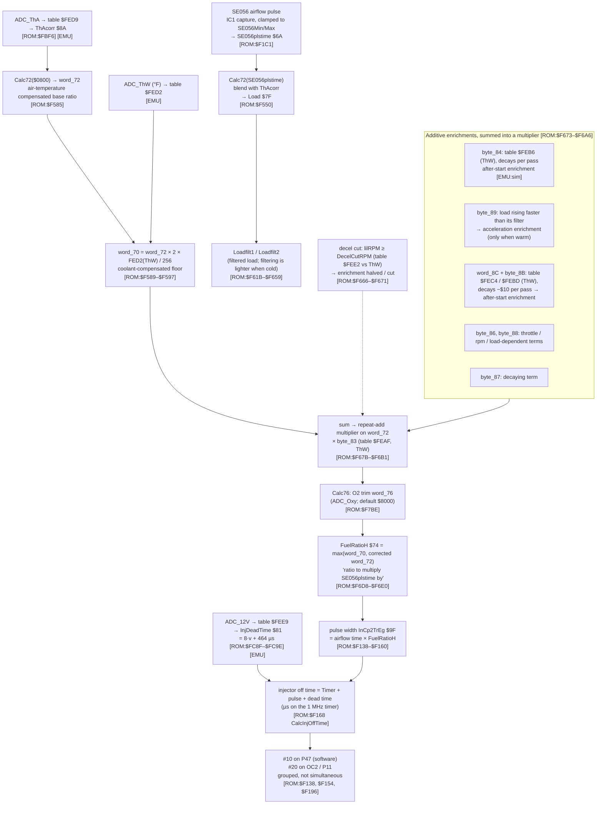
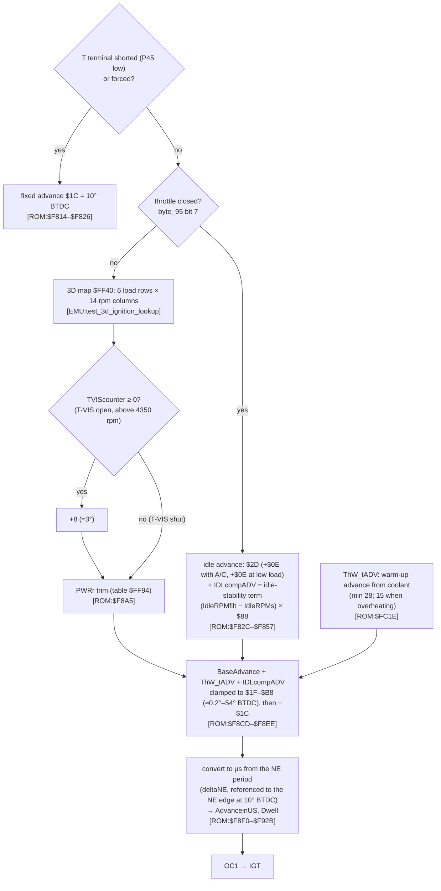

# Bluetop fuel and ignition chains

## Summary

The Bluetop calculates the injector pulse as the airflow pulse time multiplied by a ratio, `FuelRatioH`. All fuel corrections act on that ratio. The spark advance comes from a 3D map (rpm × load) off idle, and from a fixed value plus an idle-stability term at idle. The figures use the layout of the Ross 17030 diagrams ([Ross diagrams](../ross/diagrams.md)), so that you can compare them box by box with the 17140.

Confidence

- The structure (which variable goes into which) comes from the code [ROM].
- The simulator proves the table lookups and the helper arithmetic [EMU].
- Physical meanings are LIKELY or GUESS, as each item shows.
- The Bluetop is **L-type** (airflow meter). Thus its base fuel is an airflow pulse time, not a value from MAP.

## 1. Fuel chain

- **`Calc72` arithmetic** [ROM:$F6FC–$F709]: it stores the input in `word_72` and returns `(2·x·ThAcorr/256 + 3x) / 4`. This is a blend, not a pure multiplication: three quarters of the value goes through with no change. CONFIRMED [EMU:tests/ae86/test_fuel_chain.py::test_calc72_matches_emulator, ::test_calc72_is_a_blend_not_a_pure_multiply].
- **The multiplier loop** [ROM:$F6A8–$F6B1] adds `word_72` to itself `word_D3` times. `word_D3` is 1 plus the sum of the enrichments. Thus the enrichments are a **multiplier on the base ratio**. This agrees with Ross R-F02: each value after the base is a correction factor. CONFIRMED.
- **The coolant floor:** `FuelRatioH` is the larger of the corrected ratio and the coolant floor `word_70` [ROM:$F6D8–$F6DE]. Thus a cold engine never gets less fuel than the warm-up floor. CONFIRMED.

### Warm-up values

These values come from the whole-ROM simulator at 1000 rpm, after the after-start enrichment decays [EMU:tests/ae86/test_sim.py::test_warm_up_fuel_and_cold_advance]. CONFIRMED in the simulator.

- **Steady warm-up fuel:** 1.7 × the warm ratio at 0 °C. At 60 °C no warm-up fuel is left.
- **After-start enrichment:** an addition on top of the warm-up fuel. It decreases on each pass and is zero after 40 s at 0 °C.
- **Cold advance:** `ThW_tADV` is 56 at 0 °C and 28 warm. The difference of 28 raw is about +10°.

## 2. Ignition chain

**Raw → degrees:** the clamp comments and the T-terminal value give **degrees ≈ raw × 90/256** before the −$1C offset. The T-terminal value is $1C = 10° BTDC, the factory value "10° BTDC with T–E1 shorted". LIKELY. The [simulation](simulation.md) gives the full formula. A bench capture of IGT against the crank must confirm it (R-I06, [open items](../project/open_items.md) Q3).

### In tuning terms

- **Fuel:** the Bluetop calculates fuel as an airflow measurement multiplied by a ratio. The ratio contains all the corrections: air temperature, the coolant warm-up floor, after-start, acceleration and O2 trim. There is no rpm × load VE table, because the airflow meter does that work. The 17140 is speed-density, so it uses density and speed maps instead ([17140 program](../mr2/program.md)).
- **Ignition:** a conventional rpm × load map that applies only off idle. At idle the spark is a fixed value plus an idle-stability term. This term adds advance when the rpm decreases. The warm-up advance and a T-VIS step are added to the result. The idle-stability loop is the only active idle control of the ECU. Thus it is important for a cold idle with less idle air.
