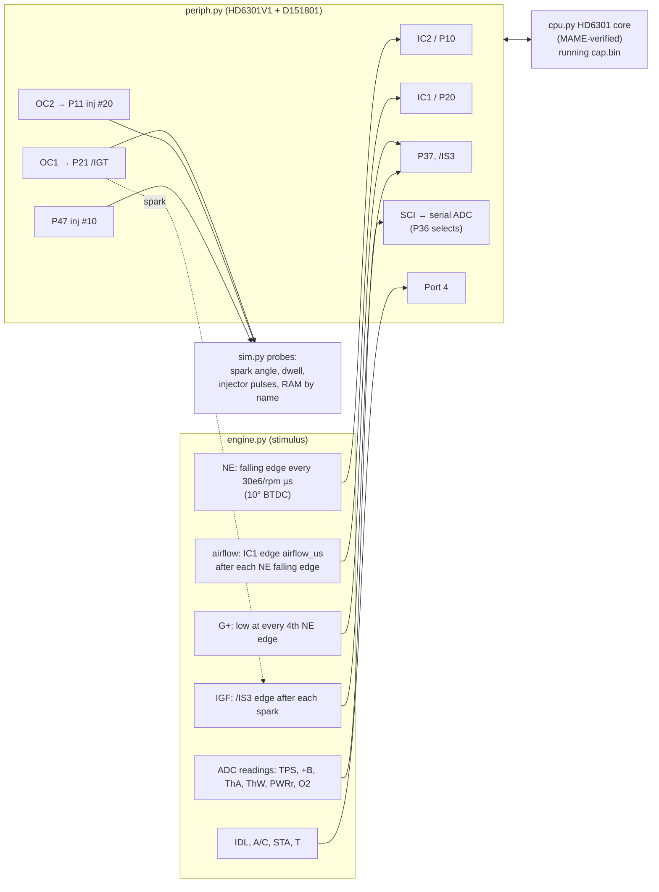

# Bluetop simulation

## Summary

The simulator runs the Bluetop ROM (`cap.bin`) from reset with no changes. A simulated engine drives its timers, its serial ADC and its interrupts. One simulated second takes about one second of CPU time. The tests compare the results with the ROM's own arithmetic. The same simulator also runs the 17140 ROM, with its own engine model.

## Code and tests

| Item | Location |
|---|---|
| On-chip peripherals | [`src/pcmre/emu/periph.py`](../../src/pcmre/emu/periph.py) |
| Engine and sensor stimulus | [`src/pcmre/emu/engine.py`](../../src/pcmre/emu/engine.py) |
| `Simulation` class and probes | [`src/pcmre/emu/sim.py`](../../src/pcmre/emu/sim.py) |
| Register tests | [`tests/emu/test_periph.py`](../../tests/emu/test_periph.py) |
| Whole-ROM tests | [`tests/ae86/test_sim.py`](../../tests/ae86/test_sim.py) |



## How to use it

Run the code with `uv run python` from the root of the repository.

```python
from pcmre.emu.sim import Simulation
sim = Simulation()                         # boots cap.bin from reset
sim.inputs.rpm = 900                       # engine turning at 900 rpm
sim.inputs.coolant_f = 50                  # coolant in °F, as the ROM sees it
sim.engine.update_sensors()                # apply input changes
sim.run_ms(1500)
sim.ram("FuelRatioH", 2)                   # any RAM variable by its cap.s name
sim.injector_pulses("#10")[-1]             # µs the injector was open
sim.spark_advance()[-1]                    # degrees BTDC
```

<details>
<summary>Other ECU wiring (profiles)</summary>

`Simulation(rom, profile=...)` selects how the inputs connect (`emu.engine.EcuProfile`):

- the sensor on each serial-ADC channel: `tps`, `batt`, `tha`, `thw`, `pwr`, `o2`, `pim`, `co`;
- the coolant table of the ROM;
- whether the SE056 airflow edge exists.

`BLUETOP` is the default profile. `mr2_dtype(adc, thw_table)` makes a MAP-sensor profile. `inputs.map_kpa` drives PIM through the factory vacuum-sensor curve: V = 0.6 + 0.03 × kPa, a straight line through the EWD points ([`sensors.py`](../../src/pcmre/emu/sensors.py)), LIKELY. `inputs.mixture_raw` drives a mixture-screw channel. A ROM larger than 4 KB loads so that it ends at `$FFFF` [EMU:tests/emu/test_profiles.py].

The 17140 has a timed ADC on IC1 and not a serial ADC. Thus it has its own engine model, [`engine17140.py`](../../src/pcmre/emu/engine17140.py) ([17140 program](../mr2/program.md)).

</details>

## What the simulator models

| Part | Model | Confidence |
|---|---|---|
| CPU | `cpu.py`, compared with MAME on more than 1.3 million cases | CONFIRMED |
| Timer 1, SCI, port 3 IS3 flag | HD6301 handbook §2.5–2.6: the TCSR flags and their two-step clear sequences, the FRC preset on writes, OLVL onto P21 at the compare cycle, edge-selected capture | CONFIRMED (handbook); [EMU:tests/emu/test_periph.py] |
| Second timer ($18–$1E) | The same layout as timer 1. IC2 on P10, OC2 on P11. It shares the ICF and OCF vectors. This comes from the use in the ROM [ROM:$F1B1, $F242, $F370] | LIKELY: the full ROM runs correctly on it |
| Serial ADC | The ROM sends the channel byte while P36 is low. The reply is the bit-reversed reading, 320 µs later. Channels 0–5 = TPS, +B, ThA, ThW, PWRr, O2 [ROM:$FAA7–$FB2E] | LIKELY (protocol); GUESS (real conversion time) |
| Timing resolution | Peripheral registers change between instructions. External edges are captured at the exact cycle | Correct to a few µs |
| NE | Falling edge = 10° BTDC, one for each 180° of crank, `deltaNE` = 30e6/rpm | LIKELY. The 10° reference comes from the factory T-terminal value. Thus the 10.3° T-terminal result is not an independent confirmation. The ROM's own rpm variables (`lilRPM`, `RPMish`) and the 7400 rpm limit constant confirm the 180° spacing |
| NE duty (high part of the period) | 50 % | GUESS. It sets the earliest dwell start at low rpm. Thus the **dwell values are not reliable** |
| G+ | Low across each 4th NE falling edge | LIKELY function, GUESS phase |
| Airflow | A delay after each NE falling edge (`SE056plstime`), set directly in µs | Mechanism CONFIRMED from the code. The relation from volts to µs is not known |
| IGF | One /IS3 edge 20 µs after each spark | LIKELY |
| Cranking spark | Made outside the CPU on each NE edge while the start mode of the ROM holds /IGT high (item 8 below) | LIKELY that it exists; GUESS for its timing |
| Thermistors | The ThW raw value comes from the inverse of the ROM's own $FEF0 table. ThA uses the same curve | LIKELY (ThW); GUESS (ThA) |
| Not modelled | Vehicle speed (SPD), T-VIS, VF and MIL outputs, watchdog, A/C | — |

<details>
<summary>Small differences from the handbook (no effect on this ROM)</summary>

- Only a port 3 read clears IS3. The handbook also permits a write.
- The model does not have the compare-inhibit cycle after an OCR or FRC write.
- The model does not have the TIE and TDRE interrupts.

</details>

## Results (Bluetop)

The tests in [`tests/ae86/test_sim.py`](../../tests/ae86/test_sim.py) assert items 1–6 and the cranking behaviour of item 8 [EMU:sim]. Item 7 is an input polarity that the simulator takes from the ROM code. The "same fuel per cycle" in item 2 comes from the pulse formulas.

1. **rpm scaling.** At 900, 2400 and 4800 rpm: `lilRPM` = rpm/25 and `RPMish` = rpm/25 − 32, with `deltaNE` = 30e6/rpm (the stimulus). This confirms the map axes in [`maps.md`](../../roms/bluetop/maps.md) [EMU:test_rpm_variables_match_the_stimulus].
2. **Injection.**
   - **Warm (above 80 °F / 27 °C):** grouped. Each group fires one time for each crank revolution, for 2 × `InjLoadPulse` + `InjDeadTime` [EMU:test_warm_injection_is_grouped_and_doubled].
   - **Cold (72 °F / 22 °C or less), and during start:** simultaneous. The two groups fire on each NE edge (4 times for each cycle), for `InjLoadPulse` + `InjDeadTime` [EMU:test_cold_injection_is_simultaneous_every_edge].
   - The fuel for each cycle is the same in the two modes [EMU:test_grouped_and_simultaneous_give_the_same_fuel_per_cycle]. The ROM adds the dead time to each pulse. Thus the grouped mode does **not double** the dead time. This agrees with Ross R-F24 ("dead time not doubled"). But on the Bluetop, the coolant temperature controls the change, not 6000 rpm.
   - `InjLoadPulse` = `SE056plstime` × `FuelRatioH`/256 [ROM:$F1F0–$F217].
3. **Ignition.**
   - Off idle, `BaseAdvance` is exactly the 3D-map value from `pcmre.tables.lookup_3d`. It is 8 more when T-VIS is open (above 4350 rpm) [ROM:$F8A3] [EMU:test_off_idle_advance_follows_the_3d_map].
   - The spark occurs where the ROM's own µs conversion puts it [ROM:$F8CD–$F90D], within 0.15°.
   - At idle the base is the fixed value $2D.
   - With the T terminal shorted, the spark is at **10.3° BTDC** at 900 rpm. The factory value is 10° [EMU:test_idle_advance_and_t_terminal_ten_degrees].
4. **Raw → degrees** (R-I06, [open items](../project/open_items.md) Q3):

   `BTDC = sum × 90/256 − 10.74° + 256 µs`, where `sum = BaseAdvance + ThW_tADV + IDLcompADV`, clamped to $1F–$B8 [ROM:$F8E6]. The result before the 10° edge has a maximum of `NEhighWidth` [ROM:$F905–$F90B].

   The 256 µs is a fixed time lead that the ROM adds (`inca` at $F900). It is 0.15° for each 100 rpm. When the engine is warm, `ThW_tADV` is 28 ($1C). Thus **a map cell value v gives about v × 90/256 − 0.9° BTDC, plus the 256 µs lead**. Example: idle $2D → 16.3° at 900 rpm. The cap.asm comment "raw/255 × 90" is correct to within about 1°.
5. **The rev limiter cuts only fuel.** After **6** consecutive NE passes above 7400 rpm (`deltaNE` < `$0FD6`), the two injector groups stop. The sparks continue. There is no hysteresis: fuel starts again on the first pass at or below 7400 rpm (simulated: cut at 7500 rpm, fuel at 7300 rpm). This is R-F26 for the Bluetop [EMU:test_rev_limiter_cuts_fuel_and_recovers_without_hysteresis, ::test_rev_limit_cut_takes_six_passes].
6. **No IGF cuts fuel.** After **4** consecutive NE passes (2 revolutions) with no IGF echo, `SatCount_98` gets to $80, and the two groups stop. This is R-I16 for the Bluetop [EMU:test_missing_igf_cuts_fuel]. The saturating-counter helper at $FFE1 increments `SatCount_97` and `SatCount_98` one time on each pass, also on the pass that reloads them. This sets the two counts.
7. **IDL polarity.** At the CPU pin, P42 is **high** when the throttle is closed. The cap.asm comment says the opposite. Evidence: the idle branches [ROM:$F814, $F1E0, $FA19]. The details are in `engine.py`. The conflict is in the [open items](../project/open_items.md).
8. **Cranking.** While `byte_C6` > 0 (start mode), the ROM does not drive /IGT low. But it cuts the fuel when IGF is missing [EMU:test_rom_makes_no_spark_while_cranking_but_keeps_fuelling, ::test_missing_igf_while_cranking_cuts_fuel]. Thus hardware outside the CPU must make the cranking spark, possibly the SE056 from NE. With this model, the ROM fuels on each NE edge during cranking (`InjLoadPulse` + dead time). The pulse is about 8 ms at 0 °C with the stand-in airflow signal.

Other ROM behaviour that the tests assert:

- The spare digital inputs (P30–P33, P14) select no other map [EMU:test_spare_input_pins_select_no_alternative_map].
- `ADC_PWRr` selects a staircase trim [EMU:test_pwr_input_selects_a_staircase_trim].
- The over-temperature retard applies only at high load [EMU:test_overheat_retard_only_at_high_load].
- P15 is on for about 10 s after start, and at idle while `word_42` is low [EMU:test_p1_5_output_on_for_ten_seconds_after_start, ::test_p1_5_stays_on_at_idle_while_learned_trim_is_low].
- The learned values stay in standby RAM after a restart [EMU:test_learned_values_survive_a_restart_in_standby_ram].

## Limits

- **The airflow signal is a stand-in.** Thus the fuel results are correct only as ratios between conditions.
- **Dwell depends on the NE duty GUESS.** The simulator does not report it.
- **The 256 µs lead can be a compensation** for a real delay (the igniter, or the NE filter of the SE056). Only a bench capture of IGT against the crank can show whether the true spark is at the calculated angle or 256 µs after it.
- **Instruction timing:** a register read sees the FRC at the start of its instruction. Thus interrupt timings can be a few µs wrong.
