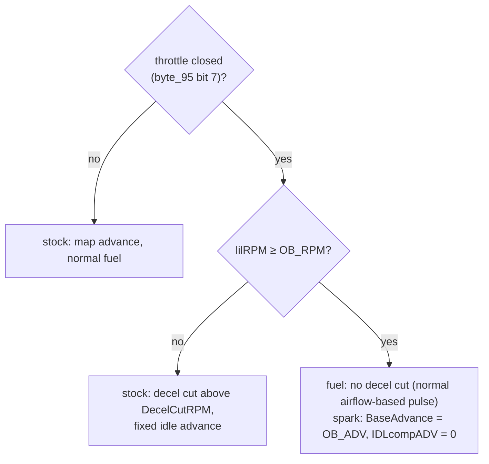

# Overrun fuel and retard (Bluetop D151801)

**Status:** prototype patch, simulator only.

- **Patch:** [`analysis/patches/bluetop_overrun.asm`](../../analysis/patches/bluetop_overrun.asm)
- **Tests:** [`tests/test_overrun.py`](../../tests/test_overrun.py) [EMU:test_overrun]
- **ROM:** `cap.bin` (AE86 Bluetop). For the 17140, the hooks are re-found after the dump (P4).

## Stock behaviour on a closed throttle

The ROM's closed-throttle state is `byte_95` bit 7: IDL high for about 125 main-loop passes.

| | Stock | Evidence |
|---|---|---|
| **Fuel** | Cut while `lilRPM` ≥ `DecelCutRPM` (coolant table `$FEE2`: ≈1200 rpm hot, ≈2700 rpm cold, clamped to ≥1500 rpm with A/C on). Entering the cut needs a further +400 rpm (`addb #16`), so there is 400 rpm of hysteresis | [ROM:$F50A–$F51C, $FBDA] CONFIRMED |
| **Spark** | The ignition map is not used. A fixed idle advance applies instead: 45 raw (+14 with A/C, +14 while `word_42` < $42) plus the idle-speed term `IDLcompADV` | [ROM:$F82C–$F857] CONFIRMED |

So on a closed-throttle overrun above ≈1200 rpm (warm), no fuel is injected, and the spark timing has no effect.

## What the patch changes

| Hook | Address | Was | Now |
|---|---|---|---|
| A | `$F512` | `cmpb lilRPM` / `bhi` / `ldab byte_95` / `bpl` (decel-cut decision) | `jsr ob_cut` / `bpl`: as stock, except no cut inside the overrun window |
| B | `$F8AD` | `staa BaseAdvance` / `ldaa ADC_ThW` (both the idle and the map paths pass here) | `jsr ob_adv`: inside the window, `BaseAdvance` = `OB_ADV` and `IDLcompADV` = 0 |

The new code is 39 bytes at `$E000`, which is external memory on the P7 board, because the 4 KB ROM has no free space. The ROM checksum is re-balanced.

## Calibration

| Constant | Default | Physical | Scaling |
|---|---|---|---|
| `OB_RPM` | 160 | 4000 rpm | rpm = value × 25 (`lilRPM`) |
| `OB_ADV` | 38 | 12.5° BTDC (warm) | degrees ≈ value × 90/256 − 0.9, warm (`ThW_tADV` = 28) |

**In tuning terms:**
- Above 4000 rpm with the throttle shut, the engine keeps getting fuel and fires it at a fixed, retarded angle.
- Below 4000 rpm, the normal decel fuel cut and idle timing take over again.
- The retard is a single number, not a table. A cold engine adds its usual extra advance (`ThW_tADV` > 28) on top.

**The 256 µs lead (open question Q3).** The ROM fires every spark 256 µs earlier than the map arithmetic says: +6.9° at 4500 rpm, +9.2° at 6000 rpm.
- If the lead is real crank angle, the default actually fires at about 19–22° BTDC.
- For a true 10–15° in that case, `OB_ADV` would be about 18–24 (rpm-dependent).
- A timing light settles this (Q3).

## Simulator results (warm, imposed rpm and airflow)

| Condition | Stock: pulses / spark | Patched: pulses / spark |
|---|---|---|
| 900 rpm idle | 9 / 16.3° | 9 / 16.3° |
| 3000 rpm, closed (below window) | 0 / 19.5° | 0 / 19.5° (stock cut) |
| 4500 rpm, closed | 0 / 21.8° | **90 / 19.4°** |
| 6000 rpm, closed | 0 / 24.2° | **120 / 21.7°** |
| 4500 rpm, throttle open | 90 / 51.7° | 90 / 51.7° |

- Pulses are counted over 0.3 s, both banks together.
- The measured spark includes the 256 µs lead.
- The overrun pulse width comes from the measured airflow, as on throttle. The simulator's airflow is imposed, so the real overrun pulse will be smaller.

## Limits of this prototype

- **Engine response is not modelled.** Whether and how much it pops depends on the real overrun mixture, the exhaust and the retard. That needs a car, with a wideband and a timing light.
- **No time limit.** Fuel flows for as long as the overrun lasts above `OB_RPM`. A timer, or a coolant or exhaust-temperature guard, would be a natural next step.
- **Side effects of fuelling the overrun:**
  - heat in the exhaust valves and manifold;
  - a catalyst (if fitted) can be damaged;
  - less engine braking;
  - more fuel used.
- **Running it in the car** needs the P7 board, or a programmed EPROM-version chip, and the bench validation in RE_PLAN P7/P8.
