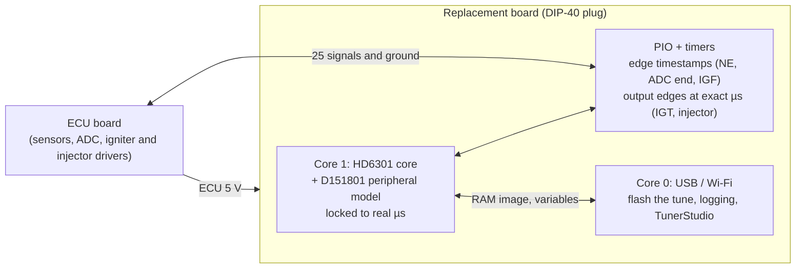

# Emulator design: CPU replacement

## Summary

The project removes the CPU (D151801) from the 17140 and installs a Pico 2 W in its socket. The Pico 2 W runs the 17140 ROM on an emulated CPU in mode 7, with the timers, serial interface and ports of the D151801. The ECU board sees the same 40 pins with the same functions. The tune is a file in the flash memory of the Pico 2 W. The emulator runs locked to real time and has a speed margin of 4.6× (150 MHz) to 7.7× (250 MHz) on the Pico 2 W. The test results are in [validation](validation.md).

## Why the CPU is replaced

An external ROM needs mode 2 (expanded multiplexed). Mode 2 takes port pins that the ECU board uses (HD6301 handbook §2.1, Table 2-1-1, Fig. 2-1-3 and 2-2-1, `reference/hd6301_hd6303_series_handbook_1989.pdf`):

- Port 3 becomes the shared data and low-address bus, and port 4 becomes the high-address lines.
- SC1 and SC2 become AS and R/W. Thus the IS3 input (IGF) is not available.
- The bus needs an address latch (the handbook gives a 74LS373).
- The port 3 and port 4 registers (`$04`–`$07`, `$0F`) move to the external address space.
- The HD6301V1 mode-2 map shows `$20`–`$7F` as external. The 17140 keeps variables in `$40`–`$7F` [ROM:$F310-$F336, RAM test] CONFIRMED. Possibly the D151801 also needs an external RAM in mode 2 (GUESS).

The ECU board uses these pins in mode 7 ([port audit](../mr2/program.md)):

- G, T and J8
- the trims
- the A/C and speed inputs
- the P31 and T-VIS outputs
- IGF.

A design that keeps the factory CPU must make all of these again outside the CPU. It needs a latch, a CPLD or shadow registers, and possibly RAM. An emulated CPU in mode 7 keeps all the pins. It is not known which output drives the `FC` pin (fuel pump control) of the ECU board. No ROM output operates like a fuel-pump control (Q13, [open items](../project/open_items.md)).

## Block diagram

## What is emulated

The list comes from the register use of the 17140 ROM [ROM: xref, `roms/mr2_17140/xref.md`]. The simulator ([`src/pcmre/emu/`](../../src/pcmre/emu/)) models all of it and runs the ROM from end to end. The emulator ([`hardware/ecu-emu/core/`](../../hardware/ecu-emu/core/)) has the same model in C.

| Block | Registers | Pins | Model |
|---|---|---|---|
| CPU | — | — | C core (`hd6301.c`), with MC6801 instruction timing. Each I/O register access is on its own bus cycle [BENCH:data/captures/chipdiff_17140_run3_2026-10-15.log] LIKELY |
| Timer 1 | TCSR `$08`, FRC `$09`, OCR1 `$0B`, ICR1 `$0D` | IC1 ← P20 (ADC end), OC1 → P21 (injector) | C (`d151801.c`), from the HD6301 handbook |
| Second timer | TCSR2 `$18`, OCR2 `$1B`, ICR2 `$1D` | IC2 ← P10 (NE), OC2 → P11 (IGT) | C (`d151801.c`), from the ROM. Spark edges agree with the real CPU at 800, 2000 and 5000 rpm (LIKELY, [validation](validation.md)) |
| SCI | RMCR `$10`, TRCSR `$11`, RDR `$12`, TDR `$13` | P23, P24 | C. The line side uses callbacks |
| Ports | `$00`–`$07`, P3CSR `$0F` (IS3 = IGF) | Ports 1–4, SC1 | C |
| RAM, RAMCR | `$40`–`$FF`, `$14` | STBY | Python only. The standby function (fault codes kept by the battery) has no design yet |
| Reset, mode | PORT2 bits 5–7 read as mode 7 | /RES | C |

The MC6801 behaviours that the chip test showed

The chip test showed these behaviours of the real CPU. The simulator and the emulator both have them [BENCH:data/captures/chipdiff_17140_run3_2026-10-15.log] [EMU:tests/hardware/test_chip_vs_emulator.py].

1. The CPU uses MC6801 instruction timing (MAME `cycles_6803`), not HD6301 timing. The RAM-clear loop at `$F336` takes 3 cycles more per pass than with HD6301 timing [ROM:$F336-$F33A] LIKELY. The 17140 ROM uses no HD6301-only opcode.
2. A write to the free-running counter only sets it to `$FFF8`. The low byte is not loaded. LIKELY.
3. A read of the counter high byte latches the low byte. LIKELY.
4. Each I/O register read or write occurs on its own bus cycle, at the end of the instruction (`pcmre.emu.cpu.access_offsets`). LIKELY.
5. The port 4 data latch reads high after reset. LIKELY.
6. The CPU takes an interrupt after an instruction only if the flag is set at least 2 cycles before the instruction ends. A compare flag sets 1 cycle after the match. A capture flag sets 1 cycle before the input edge. LIKELY (fitted to the chip-test data).

## Timing

The emulated CPU runs locked to real time.

- **Execution:** core 1 executes instructions with their cycle counts. It never runs more than a few µs ahead of the real clock.
- **Inputs:** PIO gives each input edge (NE, ADC end, IGF) a timestamp from a 1 MHz counter. Thus ICR1 and ICR2 hold the exact capture time, as in the real CPU.
- **Outputs:** when the program writes OCR1 or OCR2, a PIO program or a hardware alarm switches the IGT or injector pin at that µs. Thus the spark and injection times do not depend on the emulation speed, only on the emulation keeping up.

| Platform | Speed, as a multiple of the real CPU (E = 1 MHz) | Evidence |
|---|---|---|
| PC | about 270× | [EMU: host benchmark] |
| Pico 2 W, 150 MHz, all memory through callbacks | 4.5× (1.42 M instructions/s) | [BENCH: `ecu_emu_bench` v1, console output] CONFIRMED |
| Pico 2 W, 150 MHz, direct path for RAM and ROM (only `$00`–`$1F` through callbacks) | 4.6× | [BENCH: `ecu_emu_bench` v2, console output] CONFIRMED |
| Pico 2 W, 250 MHz, direct path | 7.7× (2.46 M instructions/s) | [BENCH: `ecu_emu_bench` v2, console output] CONFIRMED |

The CPU speed is not a risk. The peripheral model must fit inside this margin. In the loopback test the emulator was busy for 73–77 % of the time at 150 MHz ([validation](validation.md)).

## Pins

The car rig uses 25 signals and ground. The pin map is [`hardware/ecu-emu/car/pins.h`](../../hardware/ecu-emu/car/pins.h). The wire table and the wiring picture are in the [car test](../procedures/car_test.md).

- **Directions** come from the DDR writes of the ROM [ROM:$F2CA-$F2EB, $F371-$F380] CONFIRMED. `tests/hardware/test_car_rig.py` reads them from the ROM bytes.
  - Inputs: /RES, NE (P10), IDL (P16), P17, ADC end (P20), IGF (SC1), T (P30), P32, P33, J8 (P34), G (P35), A/C (P37).
  - Outputs: IGT (P11), ADC select and hold (P12–P15), injector (P21), P24 (serial TX and fault lamp), P31, P40, P41, E.
  - Both: P22 and P23 are inputs at reset and outputs in the main loop. P23 is the serial RX when the serial link is on.
- **The 5 V rule:** GP0–GP22 of the Pico 2 W accept 5 V while the Pico 2 W has power. GP26–GP28 (the ADC pins) do not.
  - Each pin that the ECU board can drive is on GP0–GP22.
  - GP26–GP28 carry only P12–P14 (ADC select). The ROM always drives them as outputs.
  - The ECU board cannot drive these lines, because it would fight the stock CPU. Thus they can only have a pull-up. A pull-up of 3 kΩ or more limits the current into the pad diode to less than 1 mA. MC6801 port outputs sink about 1.6–2 mA (LIKELY). The meter check in the [car test](../procedures/car_test.md) measures it.
  - `pins.h` has a compile-time check of this rule.
- **No wire:** the crystal pins (the ECU crystal is not used), the supply and mode pins, and the straps P36 and P42–P47. The car firmware uses fixed values for the straps (P36 low, P42–P47 high).
- **Output levels:** the Pico 2 W drives 3.3 V. If the D151801 is an NMOS part like the MC6801, its outputs give only TTL high levels, and the ECU board accepts 3.3 V (LIKELY). If it is a CMOS part, the board needs two 74HCT541 buffers ([BOM](../project/hardware_bom.md) C1). The supply current of the CPU tells the type: an NMOS MC6801 takes about 100 mA or more, a CMOS HD6301 a few mA.

## Firmware

Each project builds a UF2 file for the Pico 2 W (`PICO_BOARD=pico2_w`). CI makes each UF2 as an artefact.

| Project | Purpose | Path | UF2 |
|---|---|---|---|
| bench | Speed of the C core on the Pico 2 W. Runs the 17140 ROM with pseudo-random I/O reads and an interrupt each 97 instructions, at 150 MHz and 250 MHz. No wires | [`hardware/ecu-emu/bench/`](../../hardware/ecu-emu/bench/) | `ecu_emu_bench_pico2_w.uf2` |
| loopback | Real-time emulator with the engine model on one Pico 2 W, at 250 MHz. It prints PASS when the edge and RAM checksums equal the simulator's (`expected.h`). Hardware alarms switch IGT and the injector at the compare µs. No wires | [`hardware/ecu-emu/loopback/`](../../hardware/ecu-emu/loopback/) | `ecu_emu_loopback_pico2_w.uf2` |
| chipdiff | The [chip test](../procedures/chip_test.md): clocks the real CPU, plays the engine and logs each pin change | [`hardware/ecu-emu/chipdiff/`](../../hardware/ecu-emu/chipdiff/) | `ecu_chipdiff_pico2_w.uf2` |
| car | The [car test](../procedures/car_test.md): the emulated CPU on the pins of the spare ECU. IGT and the injector stay at their engine-stopped level. It cannot run the engine | [`hardware/ecu-emu/car/`](../../hardware/ecu-emu/car/) | `ecu_emu_car_pico2_w.uf2` |

All four use the core in [`hardware/ecu-emu/core/`](../../hardware/ecu-emu/core/): `hd6301.c` (CPU), `d151801.c` (peripherals) and `board.c` (CPU, peripherals and memory). `uv run pcmre gen-hd6301-c` makes the opcode and timing tables of the core. `uv run pcmre loopback-ref` makes `expected.h`.

To run the speed test, copy the bench UF2 to the Pico 2 W and open its USB serial port. Each few seconds it prints the instructions per second and the multiple of the real CPU speed.

## Final board

The final board is a KiCad PCB, assembled by the PCB factory. It has:

- the RP2350 (or a Pico 2 W with castellated edges);
- SMD 74HCT541 buffers;
- a buck converter;
- a USB-C connector that is accessible for flashing;
- turned-pin DIP-40 legs below it.

Its outline needs a photo of the clearance above the CPU socket. A fallback to the factory CPU on the same board (a second socket and a switch) is an open item. Open questions: [open items](../project/open_items.md).
