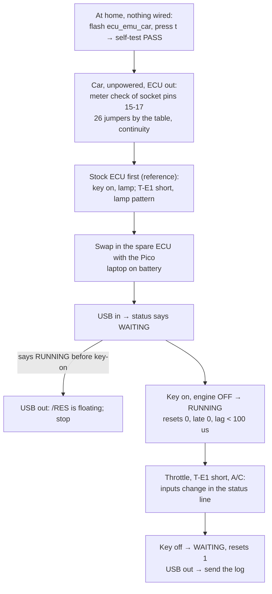

# First in-car test: key on, engine off

The Pico 2 W takes the D151801's place in the **spare ECU**, which is plugged into the car. It runs the 17140 ROM on the emulated chip, on the ECU board's real pins (firmware [`hardware/ecu-emu/car/`](../../hardware/ecu-emu/car/), wiring [`../mr2/cpu_replacement.md`](../mr2/cpu_replacement.md#in-car-test-rig)).

**What this build cannot do: run the engine.** The firmware holds IGT (P11) and the injector (P21) at the level the real chip drives while the engine is not turning (both high) [BENCH: chip test run 5] [EMU:tests/test_car_fw.py::test_koeo_no_spark_or_fuel]. The emulator still works out spark and injection, and the status line counts them, but neither pin ever moves. The firmware refuses to build without the hold. Running the engine waits for the strict bench gate (STATUS).

**What it shows:**
- the emulated chip starts from the board's own /RES;
- it reads the real sensors through the board's ADC (conversion times per channel);
- it reads the switches (T, IDL, J8, A/C);
- it drives the lamp and the solenoid outputs;
- it keeps real time with no late outputs.

That covers everything except spark and fuel.

## At home: flash and self-test (nothing connected)

1. Hold BOOTSEL, plug the Pico into USB, and copy `ecu_emu_car_pico2_w.uf2` onto it.
2. Open the serial port (`screen /dev/tty.usbmodem* 115200`). It prints the help text and then `# ... WAITING for /RES` twice a second.
3. **With nothing connected to the Pico's pins**, press `t`. The self-test drives every output pin with a pattern for 2 ms and reads it back through the pin's own pad. This proves the sampling and output rings and the pin directions.
   - **Pass:** `self-test: PASS, pad delay N us, 0 bad samples`. N is a small constant, typically 0 to 2.
   - **Fail:** the line names the bad pins as a mask (bit n = GPn). Stop there and send me the line.
   - It refuses to run if /RES reads high.
4. Unplug USB.

## At the car: unpowered work (the owner's normal care, no confirmation needed)

1. Spare ECU on the bench, chip out, spare turned-pin socket pressed into the CPU socket, notch matching.
2. **Meter check** of socket pins **15, 16 and 17**, each to **pin 21**, measured both ways round (meter on Ω).
   - A pull-up reads the same both ways. A reading that changes when you swap the leads is a diode inside a chip, not a pull-up.
   - **Pass:** no same-both-ways reading below 3 kΩ.
   - **If one fails, stop:** that signal must move to GP9 first (a one-line change to `pins.h`).
3. Fit the **26 female-to-male jumpers** by the wire table and picture in [`cpu_replacement.md`](../mr2/cpu_replacement.md#in-car-test-rig). The female end goes on the Pico header and the male end into the spare socket. Remember the header pins point down: turned over, Pico pin 1 is top right.
4. Check each jumper by continuity, from the Pico pin to the socket pin.
5. **Laptop on battery**, not on its charger. The Pico's ground becomes the car's ground, and a charger can make a ground loop.
6. The straps P36 and P42-P47 (Q12) are **not needed tonight**:
   - The firmware uses the chip-test values: P36 low, P42-P47 high.
   - P36 only gates a self-test that runs with T shorted.
   - P42/P43 only trim the spark advance.

## Stock reference first (powered: the owner's OK on the day)

With the car's **own** ECU fitted (the known-good one):
1. Key on, engine off. Note the check-engine lamp.
2. Short **T to E1** at the check connector, key on, and watch the lamp for 15 s. Write down the pattern. Then remove the short.
3. Key off.

The Pico must reproduce both.

## The Pico test (each powered step: the owner's OK on the day)

Fit the spare ECU with the Pico. **Never** have 5 V on the Pico's pins while the Pico is unpowered: **USB in before key-on, key off before USB out.**

| Step | Do | Expect | If not |
|---|---|---|---|
| 1 | USB in. Do not turn the key | `WAITING for /RES`, `RES=0` | `RUNNING` before key-on means /RES is floating: USB out, stop |
| 2 | **Key on, engine off.** Watch for 30 s | `RUNNING`; `resets=0`; `traps=0`; `lost=0`; `late=0`; `lag_max` under 100 us; `qfull=0`; `held: spark=0 inj=0` | Note the line and key off |
| 3 | Look at the dash | **Check-engine lamp on**, as with the stock ECU. `lamp(P24)=0` in the status line (the ROM drives P24 low at key-on [EMU]; low = lamp on, LIKELY) | Lamp off with P24=0: the board did not see the Pico's 3.3 V output, so buffers are needed (BOM C1); key off |
| 4 | Read the ADC line | Eight conversion times that are steady and **differ by channel**. Channel 0 (zero) is the shortest; channel 7 (reference) is long. The counts keep rising | All eight equal: the ADC select lines (P12-P14) are not seen, so buffers are needed. All zero: no ADC-end edges (P20 wire) |
| 5 | Press the throttle, then release it | `IDL(P16)` changes (idle contact) | Check the P16 jumper (socket pin 19) |
| 6 | A/C switch on, then off (if fitted) | `A/C(P37)` changes | Check the P37 jumper (socket pin 30) |
| 7 | Key off. Short T to E1. Key on and watch the lamp for 15 s. Key off and remove the short | `T(P30)=0` while shorted, and the **same lamp pattern as the stock ECU** (the simulator gives a 0.5 s flash about every 5 s, the no-fault pattern [EMU]) | Different pattern: send the log |
| 8 | Key off | `WAITING for /RES`, `resets` up by one, all outputs released | — |
| 9 | USB out. Save the whole screen log (`Ctrl-A H` in screen, or copy it) and send it | | |

**Abort at any point** (key off, then USB out) if anything gets warm or smells, a relay chatters, the fuel pump runs with the key on and the engine off for more than a couple of seconds, or the status line stops updating.

**Do not crank.** The firmware cannot spark or inject, so cranking would do nothing useful and would not start the engine. A crank test with the outputs held (it checks the NE/G signals and rpm) is a separate step for another day, with its own OK.

## Reading the log

- **`#` lines** are for people:
  - the run state and counters;
  - the solenoid and lamp outputs as the chip drives them;
  - the switch inputs as the pins read them;
  - the held spark and injection counts;
  - the ADC conversion time per channel, in µs at the pins.
- **`D,<ms>,<addr>,<word>` lines** are the RAM variables, in the serial-link logger's format. Decode them with `PYTHONPATH=analysis uv run python -m pcmre.peeklog log.txt`, which gives MAP, coolant and intake raw values, rpm and so on.
- **`S,...` lines** are a compact machine copy of the status.
- **`r`** prints a full RAM dump (`R,` lines).

## Open questions this test also answers

- **Q10, which map the car runs stock:** `J8(P34)` in the status line is the level the board puts on P34 with the factory J8 fitted. 1 means map `$F1EF` with fuel x1.00; 0 means the secret map `$F25D` with the `$F117` correction.
- **The kPa scale:** Load is RAM `$46` (the `D,…,46,…` lines). At key-on, engine off, near sea level, the proposed scale gives about **745** and the old one about 603 (STATUS conflicts log).
- **Buffers or not:** if the lamp lights and the ADC channels read differently, the board accepts the Pico's 3.3 V outputs, and the supply-current check is no longer needed.

## What this test does not cover

- Spark and injector timing. Both are held. Arming them waits for the strict bench gate (STATUS) and its Verifier sign-off.
- The output timing of IGT and the injector. In this build every output reaches its pin a constant 100 µs after the emulated chip changes it. That is harmless for the lamp, the solenoids and the ADC: the ROM subtracts its zero channel, so a constant delay cancels out [EMU:tests/test_car_fw.py::test_glue_is_a_constant_delay]. A running build needs hardware-timed compares for IGT and the injector, which the loopback firmware already does.
