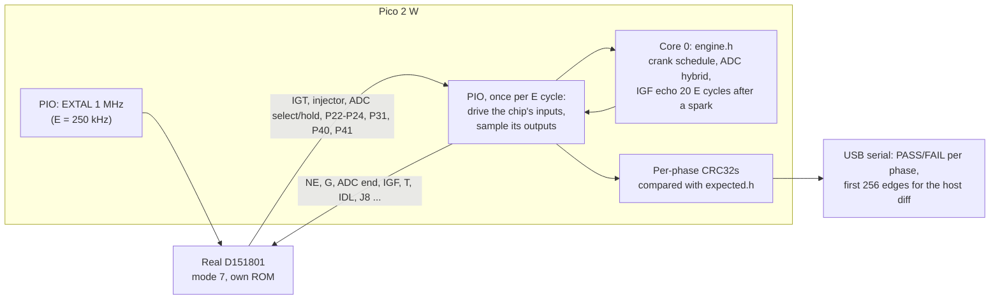

# Chip-in-isolation test: the real D151801 against the emulator

**Purpose:** prove that the emulator behaves exactly like the real CPU, using only the chip, the Pico 2 W and the existing reader breadboard. No ECU board, 12 V supply or dummy loads are needed.

**Method:**
1. The real D151801 runs its own 17140 program in its normal single-chip mode (mode 7) on the breadboard.
2. The Pico 2 W plays the engine around it: crank signals, the ADC hybrid and the IGF echo. It uses the same engine model (`engine.h`) and the same 6-phase schedule as the [loopback test](../mr2/cpu_replacement.md#loopback-test-no-wiring).
3. The Pico records every output edge of the chip, timed in the chip's own E cycles.

The loopback test already showed that the emulator produces checksums identical to `expected.h` [BENCH: owner, loopback v2/v2.1, 2026-10-14]. If the real chip produces the same checksums, the emulator is identical to the chip, edge for edge.

**Every powered step needs the owner's confirmation at the time** (CLAUDE.md hardware safety). The power order is the reader's:
- powering up: USB into the Pico, then the 5 V jumper in **last**;
- powering down: the 5 V jumper out **first**.

## Why this is enough

- **What it covers:** everything the emulator replaces is inside the chip: the CPU, its cycle timing, timer 1, the Denso timer 2, the ports and IS3. All of it is exercised here, with the chip's real silicon.
- **What it leaves out:** the rest of the ECU board (sensors, ADC hybrid, igniter and injector drivers) is not emulated. In the car the emulator uses that board unchanged, exactly as the real chip does.
- **The open model questions it settles:**
  - Timer 2 semantics (GUESS in [`cpu_replacement.md`](../mr2/cpu_replacement.md)).
  - The per-instruction cycle counts (STATUS: 6801-like bus cycles seen on the bench).
  - The reset latency.
  - Any undocumented behaviour.

## Clock and timing

- **Clock:** EXTAL is driven at 1 MHz, the reader's proven clock on this breadboard, so E = 250 kHz.
- **Time base:** the emulator and `expected.h` count time in E cycles, so the slower clock changes nothing in the comparison. It gives the Pico 4 µs per E cycle.
- **Faster run:** once the test passes, it can be repeated at EXTAL 4 MHz (E = 1 MHz).
- **Per E cycle:** one PIO state machine waits for E to rise, drives the chip's input pins from a DMA ring, and samples all pins into a second DMA ring.
- **Reactions:** core 0 scans the samples for output edges, runs `engine.h`, and writes the input levels a few E cycles ahead. The fastest reaction in the model is the IGF echo, 20 E cycles after a spark (80 µs at E = 250 kHz), so the look-ahead has room to spare.
- **Time zero:** the cycle when /RES is released, as in the simulator. If the real chip takes a different number of cycles to reach its first instruction, every edge is shifted by the same amount. The host diff (below) reports that shift instead of failing silently.

## Wiring: changes from the reader breadboard

In single-chip mode, the reader's bus pins become the chip's ports:
- pins 37–30 (AD0–AD7) are P30–P37;
- pins 29–22 (A8–A15) are P40–P47;
- pin 39 (AS) is SC1 (IS3, the IGF input).

Most existing wires therefore stay. The changes, all made **unpowered**:

1. **Mode straps:** move the three 10 kΩ resistors on pins 8, 9 and 10 from GND to the 5 V rail (mode 7 = HHH).
2. **Remove** the wires on pins 22–25 (P44–P47), 26 and 27 (P43, P42), 31 (P36) and 38 (SC2).
3. **Straps:** these levels match the simulator's defaults.
   - Pins 22–27 (P47–P42): 10 kΩ each to the 5 V rail.
   - Pin 31 (P36): 10 kΩ to GND.
4. **Add** the Port 1 and Port 2 wires from the table below. GP26–GP28 are the Pico's ADC pins and are **not 5 V tolerant**, so they only drive chip inputs, through 1 kΩ.
5. **Pull-up:** pin 11 (P23) gets a 10 kΩ pull-up to the 5 V rail. The serial link is off unless the Pico pulls it low.

Unchanged: pin 1 GND; pins 21, 7 (STBY), 4 (NMI) and 5 (IRQ1) on the 5 V rail; 100 nF + 10 µF across pins 21/1; XTAL (pin 2) open.

| Chip pin | Signal | Direction (chip view) | GPIO | Notes |
|---|---|---|---|---|
| 3 | EXTAL | in | GP9 | Unchanged: open-drain, 470 Ω pull-up |
| 6 | /RES | in | GP8 | Unchanged: open-drain, 10 kΩ pull-up |
| 40 | E | out | GP19 | Unchanged; PIO paces on it |
| 37 | P30 (T) | in | GP0 | Unchanged |
| 36 | P31 | out | GP1 | Unchanged |
| 35 | P32 | in | GP2 | Unchanged; held high |
| 34 | P33 | in | GP3 | Unchanged; held high |
| 33 | P34 (J8) | in | GP4 | Unchanged; 1 = map `$F1EF` |
| 32 | P35 (G) | in | GP5 | Unchanged |
| 30 | P37 | in | GP7 | Unchanged |
| 29 | P40 | out | GP10 | Unchanged |
| 28 | P41 | out | GP11 | Unchanged |
| 39 | SC1 / IS3 (IGF) | in | GP18 | Unchanged |
| 12 | P24 (TX, fault lamp) | out | GP21 | Unchanged; keeps its 10 kΩ pull-up |
| 13 | P10 (NE) | in | GP26 via 1 kΩ | New |
| 14 | P11 (IGT) | out | GP14 | New (was A12) |
| 15 | P12 (ADC select) | out | GP15 | New (was A13) |
| 16 | P13 (ADC select) | out | GP16 | New (was A14) |
| 17 | P14 (ADC select) | out | GP17 | New (was A15) |
| 18 | P15 (ADC hold) | out | GP6 | New (was AD6) |
| 19 | P16 (IDL) | in | GP27 via 1 kΩ | New |
| 20 | P17 | in | GP28 via 1 kΩ | New; held high |
| 8 | P20 (ADC end, mode bit 0) | in | GP12 | New (was A10); 10 kΩ pull-up; Pico pin floating until /RES rises |
| 9 | P21 (injector, mode bit 1) | out | GP13 | New (was A11); 10 kΩ pull-up |
| 10 | P22 (mode bit 2) | out | GP20 | New (was R/W); 10 kΩ pull-up |
| 11 | P23 | out | GP22 | New; 10 kΩ pull-up |

That is 26 GPIOs in all. **New parts:** three 1 kΩ resistors plus 10 kΩ ones (7 straps and the P23 pull-up); everything else is already on the board. A generated wiring picture and a checklist come with the firmware.

## Firmware and pass criteria

`hardware/ecu-emu/chipdiff/` builds `ecu_chipdiff_pico2_w.uf2`, sharing `engine.h` and `expected.h` with the loopback. Over USB serial it offers:

1. **`rigcheck`** (chip out, 5 V jumper out): checks for stuck or shorted lines, and that the straps read the expected levels.
2. **`clock`:** E frequency and duty, as in the reader.
3. **`run`:** the 6-phase schedule, 36 s of chip time (144 s at E = 250 kHz). For each phase the chip's edge count, edge CRC32 and injector totals are compared with `expected.h`, giving PASS/FAIL per phase. The first 256 output edges are printed as a log.
4. **`peek`:** the same run with P23 held low at reset, so the chip's serial link is on. The Pico reads RAM `$40`–`$FF` at each phase end and compares it with the simulator's RAM CRC.

**Host diff:** `analysis/emu/chipdiff.py` takes a pasted log. It runs the C emulator through the same schedule and prints the first edge that differs, or the constant offset if every edge is shifted. This tells us exactly what to fix in the model.

**PASS:**
- all 6 phases identical, with the peek RAM CRCs matching;
- the emulator's own loopback already matches the same `expected.h`.

Together these mean the emulator is identical to the D151801 for this ROM. Then the car (see [`cpu_replacement.md`](../mr2/cpu_replacement.md#in-car-test-rig)).

**FAIL:** the host diff names the first differing edge. The C and Python models are fixed together, `expected.h` is regenerated, and both the loopback and this test are re-run.
