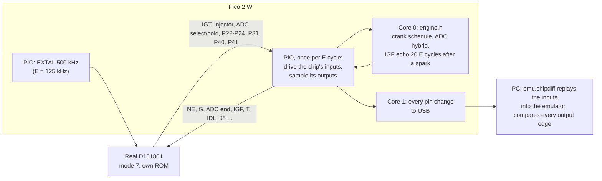

# Chip-in-isolation test: the real D151801 against the emulator

**Purpose:** prove that the emulator behaves exactly like the real CPU, using only the chip, the Pico 2 W and the existing reader breadboard. No ECU board, 12 V supply or dummy loads are needed.

**Method:**
1. The real D151801 runs its own 17140 program in its normal single-chip mode (mode 7) on the breadboard.
2. The Pico 2 W plays the engine around it: crank signals, the ADC hybrid and the IGF echo. It uses the same engine model (`engine.h`) and the same 6-phase schedule as the [loopback test](../mr2/cpu_replacement.md#loopback-test-no-wiring).
3. The Pico logs every change on every pin, inputs and outputs, timed in the chip's own E cycles.

On the PC, `analysis/emu/chipdiff.py` replays exactly the inputs the chip received into the emulator and compares every output edge, pin by pin. If they all match, the emulator is identical to the chip, edge for edge.

**Every powered step needs the owner's confirmation at the time** (CLAUDE.md hardware safety). The power order is the reader's:
- powering up: USB into the Pico, then the 5 V jumper in **last**;
- powering down: the 5 V jumper out **first**.



## Why this is enough

- **What it covers:** everything the emulator replaces is inside the chip: the CPU, its cycle timing, timer 1, the Denso timer 2, the ports and IS3. All of it is exercised here, with the chip's real silicon.
- **What it leaves out:** the rest of the ECU board (sensors, ADC hybrid, igniter and injector drivers) is not emulated. In the car the emulator uses that board unchanged, exactly as the real chip does.
- **The open model questions it settles:**
  - Timer 2 semantics (GUESS in [`cpu_replacement.md`](../mr2/cpu_replacement.md)).
  - The per-instruction cycle counts (STATUS: 6801-like bus cycles seen on the bench).
  - The reset latency.
  - Any undocumented behaviour.

## Clock and timing

- **Clock:** EXTAL is driven at 500 kHz, the reader's proven clock on this breadboard, so E = 125 kHz. The emulator counts time in E cycles, so the slower clock changes nothing in the comparison, and it gives the Pico 8 µs per E cycle. A full run (6 phases, 36 M cycles) takes about 5 minutes.
- **Per E cycle:** one PIO state machine waits for E to rise, drives the chip's inputs from a DMA ring, and a quarter period later samples every pin into a second DMA ring.
- **Reactions:** core 0 scans the samples for output edges, runs the engine model, and writes the input levels 8 E cycles ahead. The fastest reaction is the IGF echo, 20 E cycles after a spark, so it always lands on time; the log's `late=` count proves it.
- **Time zero:** the first E cycle after /RES is released (the PIO releases it itself, so it is the same cycle every run). If the real chip takes a different number of cycles than the emulator to reach its first instruction, every input is shifted by the same amount; the PC tool finds that offset first.
- **Latency:** the chip's pins are sampled once per E cycle, so each output pin may show a constant offset from the emulator's edge time. A constant offset is fine; an offset that varies, a missing edge or a different level is a real difference.

## Wiring: changes from the reader breadboard

In single-chip mode, the reader's bus pins become the chip's ports:
- pins 37–30 (AD0–AD7) are P30–P37;
- pins 29–22 (A8–A15) are P40–P47;
- pin 39 (AS) is SC1 (IS3, the IGF input).

Most existing wires therefore stay. The changes, all made **unpowered**:

1. **Mode straps:** move the three 10 kΩ resistors on pins 8, 9 and 10 from GND to the 5 V rail (mode 7 = HHH).
2. **Remove** the wires on pins 22–25 (P44–P47), 26 and 27 (P43, P42), 31 (P36) and 38 (SC2).
3. **Straps:** these levels match the simulator's defaults.
   - Pins 22–27 (P47–P42): 10 kΩ each to the 5 V rail.
   - Pin 31 (P36): 10 kΩ to GND.
4. **Add** the Port 1 and Port 2 wires from the table below. GP26–GP28 are the Pico's ADC pins and are **not 5 V tolerant**, so they only drive chip inputs, through 1 kΩ.
5. **Pull-up:** pin 11 (P23) gets a 10 kΩ pull-up to the 5 V rail. The serial link is off unless the Pico pulls it low.

Unchanged: pin 1 GND; pins 21, 7 (STBY), 4 (NMI) and 5 (IRQ1) on the 5 V rail; 100 nF + 10 µF across pins 21/1; XTAL (pin 2) open.

| Chip pin | Signal | Direction (chip view) | GPIO | Notes |
|---|---|---|---|---|
| 3 | EXTAL | in | GP9 | Unchanged: open-drain, 470 Ω pull-up |
| 6 | /RES | in | GP8 | Unchanged: open-drain, 10 kΩ pull-up |
| 40 | E | out | GP19 | Unchanged; PIO paces on it |
| 37 | P30 (T) | in | GP0 | Unchanged |
| 36 | P31 | out | GP1 | Unchanged |
| 35 | P32 | in | GP2 | Unchanged; held high |
| 34 | P33 | in | GP3 | Unchanged; held high |
| 33 | P34 (J8) | in | GP4 | Unchanged; 1 = map `$F1EF` |
| 32 | P35 (G) | in | GP5 | Unchanged |
| 30 | P37 | in | GP7 | Unchanged |
| 29 | P40 | out | GP10 | Unchanged |
| 28 | P41 | out | GP11 | Unchanged |
| 39 | SC1 / IS3 (IGF) | in | GP18 | Unchanged |
| 12 | P24 (TX, fault lamp) | out | GP21 | Unchanged; keeps its 10 kΩ pull-up |
| 13 | P10 (NE) | in | GP26 via 1 kΩ | New |
| 14 | P11 (IGT) | out | GP14 | New (was A12) |
| 15 | P12 (ADC select) | out | GP15 | New (was A13) |
| 16 | P13 (ADC select) | out | GP16 | New (was A14) |
| 17 | P14 (ADC select) | out | GP17 | New (was A15) |
| 18 | P15 (ADC hold) | out | GP6 | New (was AD6) |
| 19 | P16 (IDL) | in | GP27 via 1 kΩ | New |
| 20 | P17 | in | GP28 via 1 kΩ | New; held high |
| 8 | P20 (ADC end, mode bit 0) | in | GP12 | New (was A10); 10 kΩ pull-up; Pico pin floating until /RES rises |
| 9 | P21 (injector, mode bit 1) | out | GP13 | New (was A11); 10 kΩ pull-up |
| 10 | P22 (mode bit 2) | out | GP20 | New (was R/W); 10 kΩ pull-up |
| 11 | P23 | out | GP22 | New; 10 kΩ pull-up |

That is 26 GPIOs in all, defined once in [`chipdiff.h`](../../hardware/ecu-emu/chipdiff/chipdiff.h). **New parts:** three 1 kΩ resistors and eight 10 kΩ (the seven straps and the P23 pull-up); everything else is already on the board.

## Firmware and the PC tool

[`hardware/ecu-emu/chipdiff/`](../../hardware/ecu-emu/chipdiff/) builds `ecu_chipdiff_pico2_w.uf2` (CI artefact). It shares `engine.h` and `expected.h` with the loopback. On the USB serial port it offers:
- **`rigcheck`** (chip out, 5 V jumper out): no line stuck low, no two lines shorted.
- **`clock`:** E frequency.
- **`run [phases]`:** the schedule (1–6 phases of 6 s chip time; default 6). It prints `BEGIN`, one line per pin change (`<cycle hex> <pin word hex>`), then `END cycles=… late=… qfull=… dropped=…`. All three counts must be 0. It prints `ABORT …` instead if the Pico ever fell behind the chip.

**PC side** ([`analysis/emu/chipdiff.py`](../../analysis/emu/chipdiff.py)):
```
PYTHONPATH=analysis uv run --with pyserial python -m emu.chipdiff capture /dev/ttyACM0 run1.log
PYTHONPATH=analysis uv run python -m emu.chipdiff analyse run1.log
```
`analyse` finds the input offset, replays the logged inputs into the C emulator and prints, for each output pin: edge counts (chip, emulator), the latencies seen, and the first difference. `tests/test_chipdiff.py` runs the same pipeline with the emulator standing in for the chip: an exact match, and a single spark moved by one cycle is caught.

**PASS:** every output pin has the same edges at a constant latency over the full run, `late`, `qfull` and `dropped` are 0, and a second run gives the same log. Then the car (see [`cpu_replacement.md`](../mr2/cpu_replacement.md#in-car-test-rig)).

**FAIL:** the first differing edge points at the instruction or timer behaviour to fix. The C and Python models are fixed together, the loopback's `expected.h` is regenerated, and both tests are re-run.

## Steps (each powered step needs the owner's OK on the day)

1. **Unpowered:** make the wiring changes above; check each new wire against the table with the multimeter.
2. Chip out, 5 V jumper out: flash the UF2, run `rigcheck`.
3. Chip in (notch the same way as for the dump), USB first, then the 5 V jumper: `clock` should read 125 000 Hz.
4. `run 1` as a short first try; capture it with `emu.chipdiff capture … --phases 1`, and send the log (or the `analyse` output).
5. Then `run 6` twice. Unplug the 5 V jumper before USB.
