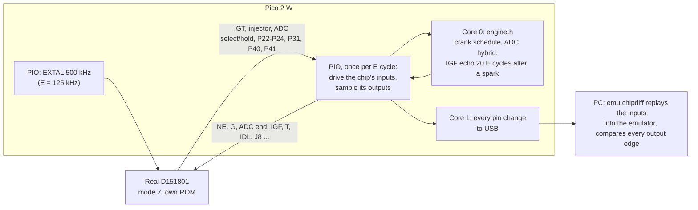
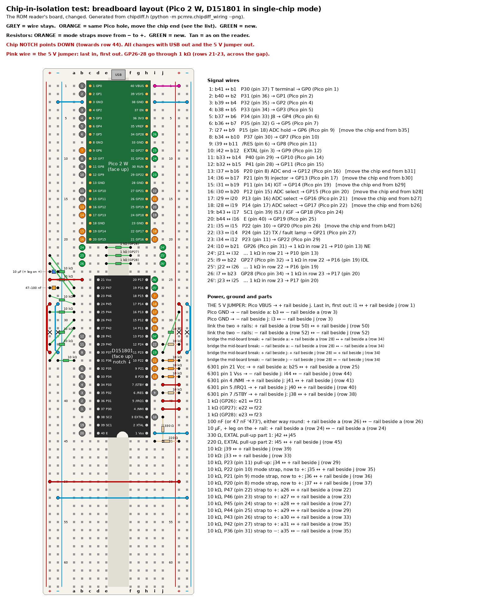

# Chip-in-isolation test: the real D151801 against the emulator

**Purpose:** prove that the emulator behaves exactly like the real CPU, using only the chip, the Pico 2 W and the existing reader breadboard. No ECU board, 12 V supply or dummy loads are needed.

**Method:**
1. The real D151801 runs its own 17140 program in its normal single-chip mode (mode 7) on the breadboard.
2. The Pico 2 W plays the engine around it: crank signals, the ADC hybrid and the IGF echo. It uses the same engine model (`engine.h`) and the same 6-phase schedule as the [loopback test](../mr2/cpu_replacement.md#loopback-test-no-wiring).
3. The Pico logs every change on every pin, inputs and outputs, timed in the chip's own E cycles.

On the PC, `analysis/emu/chipdiff.py` replays exactly the inputs the chip received into the emulator and compares every output edge, pin by pin. If they all match, the emulator is identical to the chip, edge for edge.

**Every powered step needs the owner's confirmation at the time** (CLAUDE.md hardware safety). The power order is the reader's:
- powering up: USB into the Pico, then the 5 V jumper in **last**;
- powering down: the 5 V jumper out **first**.



## Why this is enough

- **What it covers:** everything the emulator replaces is inside the chip: the CPU, its cycle timing, timer 1, the Denso timer 2, the ports and IS3. All of it is exercised here, with the chip's real silicon.
- **What it leaves out:** the rest of the ECU board (sensors, ADC hybrid, igniter and injector drivers) is not emulated. In the car the emulator uses that board unchanged, exactly as the real chip does.
- **The open model questions it settles:**
  - Timer 2 semantics (GUESS in [`cpu_replacement.md`](../mr2/cpu_replacement.md)).
  - The per-instruction cycle counts (STATUS: 6801-like bus cycles seen on the bench).
  - The reset latency.
  - Any undocumented behaviour.

## Clock and timing

- **Clock:** EXTAL is driven at 500 kHz, the reader's proven clock on this breadboard, so E = 125 kHz. The emulator counts time in E cycles, so the slower clock changes nothing in the comparison, and it gives the Pico 8 µs per E cycle. A full run (6 phases, 36 M cycles) takes about 5 minutes.
- **Per E cycle:** one PIO state machine waits for E to rise, drives the chip's inputs from a DMA ring, and a quarter period later samples every pin into a second DMA ring.
- **Reactions:** core 0 scans the samples for output edges, runs the engine model, and writes the input levels 8 E cycles ahead. The fastest reaction is the IGF echo, 20 E cycles after a spark, so it always lands on time; the log's `late=` count proves it.
- **Time zero:** the first E cycle after /RES is released (the PIO releases it itself, so it is the same cycle every run). If the real chip takes a different number of cycles than the emulator to reach its first instruction, every input is shifted by the same amount; the PC tool finds that offset first.
- **Latency:** the chip's pins are sampled once per E cycle, so each output pin may show a constant offset from the emulator's edge time. A constant offset is fine; an offset that varies, a missing edge or a different level is a real difference.

## Wiring: changes from the reader breadboard

In single-chip mode, the reader's bus pins become the chip's ports:
- pins 37–30 (AD0–AD7) are P30–P37;
- pins 29–22 (A8–A15) are P40–P47;
- pin 39 (AS) is SC1 (IS3, the IGF input).

Most existing wires therefore stay, and every reader GPIO is reused. The changes, all made **unpowered** (USB out, 5 V jumper out, chip out):

1. **Move 8 wire ends.** For GP6, GP12–GP17 and GP20 the Pico end stays where it is; only the chip end moves, from the old bus pin to its new port pin (orange in the picture, "MOVE" in the table).
2. **Mode straps:** move the far end of the three 10 kΩ resistors on pins 8, 9 and 10 from the − rail to the + rail (mode 7 = HHH).
3. **Add 4 signals** (green): GP22 to pin 11 (P23), and GP26–GP28 to pins 13, 19 and 20 (P10, P16, P17), each through a 1 kΩ that bridges the centre gap in rows 21–23. GP26–GP28 are the Pico's ADC pins and are **not 5 V tolerant**, so they only drive chip inputs, and only through 1 kΩ.
4. **Straps, almost no new parts:**
   - pins 22–27 (P47–P42): join their six strips with five short jumpers, then **one** resistor (any value from 1 kΩ to 100 kΩ) to +. They are inputs only (the ROM sets DDR4 = `$03`), so one pull-up serves all six; the resistor rather than a bare wire limits the current if the chip were ever strapped into a bus mode by mistake.
   - pin 31 (P36): a plain wire to − (input only, DDR3 = `$02`).
   - pin 11 (P23): nothing. The firmware turns on the Pico's own pull-up on GP22, so the chip reads it high at reset and the serial link stays off.

   These levels match the simulator's defaults.

Unchanged: pin 1 GND; pins 21, 7 (STBY), 4 (NMI) and 5 (IRQ1) on the 5 V rail; 100 nF + 10 µF across pins 21/1; XTAL (pin 2) open.

| Chip pin | Signal | Direction (chip view) | GPIO | Notes |
|---|---|---|---|---|
| 3 | EXTAL | in | GP9 | Unchanged: open-drain, 470 Ω pull-up |
| 6 | /RES | in | GP8 | Unchanged: open-drain, 10 kΩ pull-up |
| 40 | E | out | GP19 | Unchanged; PIO paces on it |
| 37 | P30 (T) | in | GP0 | Unchanged |
| 36 | P31 | out | GP1 | Unchanged |
| 35 | P32 | in | GP2 | Unchanged; held high |
| 34 | P33 | in | GP3 | Unchanged; held high |
| 33 | P34 (J8) | in | GP4 | Unchanged; 1 = map `$F1EF` |
| 32 | P35 (G) | in | GP5 | Unchanged |
| 30 | P37 | in | GP7 | Unchanged |
| 29 | P40 | out | GP10 | Unchanged |
| 28 | P41 | out | GP11 | Unchanged |
| 39 | SC1 / IS3 (IGF) | in | GP18 | Unchanged |
| 12 | P24 (TX, fault lamp) | out | GP21 | Unchanged; keeps its 10 kΩ pull-up |
| 13 | P10 (NE) | in | GP26 via 1 kΩ | New |
| 14 | P11 (IGT) | out | GP14 | New (was A12) |
| 15 | P12 (ADC select) | out | GP15 | New (was A13) |
| 16 | P13 (ADC select) | out | GP16 | New (was A14) |
| 17 | P14 (ADC select) | out | GP17 | New (was A15) |
| 18 | P15 (ADC hold) | out | GP6 | New (was AD6) |
| 19 | P16 (IDL) | in | GP27 via 1 kΩ | New |
| 20 | P17 | in | GP28 via 1 kΩ | New; held high |
| 8 | P20 (ADC end, mode bit 0) | in | GP12 | New (was A10); 10 kΩ pull-up; the Pico holds it high through reset |
| 9 | P21 (injector, mode bit 1) | out | GP13 | New (was A11); 10 kΩ pull-up |
| 10 | P22 (mode bit 2) | out | GP20 | New (was R/W); 10 kΩ pull-up |
| 11 | P23 | out | GP22 | New; the Pico's own pull-up keeps it high at reset |

That is 26 GPIOs in all, defined once in [`chipdiff.h`](../../hardware/ecu-emu/chipdiff/chipdiff.h). **New parts:** three 1 kΩ resistors and one more resistor of any value from 1 kΩ to 100 kΩ; everything else is already on the board or is wire.

### Breadboard layout



Grey wires stay as on the reader; orange ones keep their Pico hole and move their chip end; green ones are new. The jumpers S1–S5 zigzag between holes a and b to join pins 22–27; their single resistor goes from a26 to the + rail.

<!-- generated: python -m pcmre.chipdiff_wiring; tests/test_chipdiff_wiring.py checks this table -->

| Wire | Change | From | To | What |
|---|---|---|---|---|
| 1 | keep | b41 | b1 | P30 (pin 37) T terminal → GP0 (Pico pin 1) |
| 2 | keep | b40 | b2 | P31 (pin 36) → GP1 (Pico pin 2) |
| 3 | keep | b39 | b4 | P32 (pin 35) → GP2 (Pico pin 4) |
| 4 | keep | b38 | b5 | P33 (pin 34) → GP3 (Pico pin 5) |
| 5 | keep | b37 | b6 | P34 (pin 33) J8 → GP4 (Pico pin 6) |
| 6 | keep | b36 | b7 | P35 (pin 32) G → GP5 (Pico pin 7) |
| 7 | MOVE | i27 | b9 | P15 (pin 18) ADC hold → GP6 (Pico pin 9)   [move the chip end from b35] |
| 8 | keep | b34 | b10 | P37 (pin 30) → GP7 (Pico pin 10) |
| 9 | keep | i39 | b11 | /RES (pin 6) → GP8 (Pico pin 11) |
| 10 | keep | i42 | b12 | EXTAL (pin 3) → GP9 (Pico pin 12) |
| 11 | keep | b33 | b14 | P40 (pin 29) → GP10 (Pico pin 14) |
| 12 | keep | b32 | b15 | P41 (pin 28) → GP11 (Pico pin 15) |
| 13 | MOVE | i37 | b16 | P20 (pin 8) ADC end → GP12 (Pico pin 16)   [move the chip end from b31] |
| 14 | MOVE | i36 | b17 | P21 (pin 9) injector → GP13 (Pico pin 17)   [move the chip end from b30] |
| 15 | MOVE | i31 | b19 | P11 (pin 14) IGT → GP14 (Pico pin 19)   [move the chip end from b29] |
| 16 | MOVE | i30 | b20 | P12 (pin 15) ADC select → GP15 (Pico pin 20)   [move the chip end from b28] |
| 17 | MOVE | i29 | i20 | P13 (pin 16) ADC select → GP16 (Pico pin 21)   [move the chip end from b27] |
| 18 | MOVE | i28 | i19 | P14 (pin 17) ADC select → GP17 (Pico pin 22)   [move the chip end from b26] |
| 19 | keep | b43 | i17 | SC1 (pin 39) IS3 / IGF → GP18 (Pico pin 24) |
| 20 | keep | b44 | i16 | E (pin 40) → GP19 (Pico pin 25) |
| 21 | MOVE | i35 | i15 | P22 (pin 10) → GP20 (Pico pin 26)   [move the chip end from b42] |
| 22 | keep | i33 | i14 | P24 (pin 12) TX / fault lamp → GP21 (Pico pin 27) |
| 23 | NEW | i34 | i12 | P23 (pin 11) → GP22 (Pico pin 29) |
| 24 | NEW | i10 | b21 | GP26 (Pico pin 31) → 1 kΩ in row 21 → P10 (pin 13) NE |
| 24' | NEW | j21 | i32 | … 1 kΩ in row 21 → P10 (pin 13) |
| 25 | NEW | i9 | b22 | GP27 (Pico pin 32) → 1 kΩ in row 22 → P16 (pin 19) IDL |
| 25' | NEW | j22 | i26 | … 1 kΩ in row 22 → P16 (pin 19) |
| 26 | NEW | i7 | b23 | GP28 (Pico pin 34) → 1 kΩ in row 23 → P17 (pin 20) |
| 26' | NEW | j23 | i25 | … 1 kΩ in row 23 → P17 (pin 20) |
| S1 | NEW | b26 | b27 | link the P4 strap strips: row 26 ↔ row 27 |
| S2 | NEW | a27 | a28 | link the P4 strap strips: row 27 ↔ row 28 |
| S3 | NEW | b28 | b29 | link the P4 strap strips: row 28 ↔ row 29 |
| S4 | NEW | a29 | a30 | link the P4 strap strips: row 29 ↔ row 30 |
| S5 | NEW | b30 | b31 | link the P4 strap strips: row 30 ↔ row 31 |
| P36 | NEW | a35 | − rail beside a (row 35) | P36 (pin 31) → − rail beside a |

| Part | Change | From | To |
|---|---|---|---|
| 1 kΩ (GP26) | NEW | e21 | f21 |
| 1 kΩ (GP27) | NEW | e22 | f22 |
| 1 kΩ (GP28) | NEW | e23 | f23 |
| 100 nF (or 47 nF '473'), either way round | keep | + rail beside a (row 26) | − rail beside a (row 26) |
| 10 µF, + leg on the + rail | keep | + rail beside a (row 24) | − rail beside a (row 24) |
| 330 Ω, EXTAL pull-up part 1 | keep | j42 | j45 |
| 220 Ω, EXTAL pull-up part 2 | keep | i45 | + rail beside j (row 45) |
| 10 kΩ | keep | j39 | + rail beside j (row 39) |
| 10 kΩ | keep | j33 | + rail beside j (row 33) |
| 10 kΩ, P22 (pin 10) mode strap, now to + | MOVE | j35 | + rail beside j (row 35) |
| 10 kΩ, P21 (pin 9) mode strap, now to + | MOVE | j36 | + rail beside j (row 36) |
| 10 kΩ, P20 (pin 8) mode strap, now to + | MOVE | j37 | + rail beside j (row 37) |
| 1 resistor, any 1–100 kΩ: P42–P47 (pins 22–27) to + | NEW | a26 | + rail beside a (row 27) |

## Firmware and the PC tool

[`hardware/ecu-emu/chipdiff/`](../../hardware/ecu-emu/chipdiff/) builds `ecu_chipdiff_pico2_w.uf2` (CI artefact). It shares `engine.h` and `expected.h` with the loopback. On the USB serial port it offers:
- **`rigcheck`** (chip out, 5 V jumper out): no line stuck low, no two lines shorted.
- **`clock`:** E frequency.
- **`run [phases]`:** the schedule (1–6 phases of 6 s chip time; default 6). It prints `BEGIN`, one line per pin change (`<cycle hex> <pin word hex>`), then `END cycles=… late=… qfull=… dropped=…`. All three counts must be 0. It prints `ABORT …` instead if the Pico ever fell behind the chip.

**PC side** ([`analysis/emu/chipdiff.py`](../../analysis/emu/chipdiff.py)):
```
PYTHONPATH=analysis uv run --with pyserial python -m emu.chipdiff capture /dev/ttyACM0 run1.log
PYTHONPATH=analysis uv run python -m emu.chipdiff analyse run1.log
```
`analyse` finds the input offset, replays the logged inputs into the C emulator and prints, for each output pin: edge counts (chip, emulator), the latencies seen, and the first difference. `tests/test_chipdiff.py` runs the same pipeline with the emulator standing in for the chip: an exact match, and a single spark moved by one cycle is caught.

**PASS:** every output pin has the same edges at a constant latency over the full run, `late`, `qfull` and `dropped` are 0, and a second run gives the same log. Then the car (see [`cpu_replacement.md`](../mr2/cpu_replacement.md#in-car-test-rig)).

**FAIL:** the first differing edge points at the instruction or timer behaviour to fix. The C and Python models are fixed together, the loopback's `expected.h` is regenerated, and both tests are re-run.

## Results

**Run 3** (owner, 2026-10-15; one 800 rpm phase, 6 M E cycles):
- **Log:** [`analysis/captures/chipdiff_17140_run3_2026-10-15.log`](../../analysis/captures/chipdiff_17140_run3_2026-10-15.log). All 6 000 000 cycles were sampled in 47 999 ms against 48 000 expected; nothing was dropped.
- **Edge counts:** with the emulator given exactly the chip's inputs, every output pin shows the same number of edges.
- **Timing:**
  - all 318 spark edges (P11) and 162 injector edges (P21) at a constant 2 cycles;
  - all ADC-select and port edges at a constant 3 cycles;
  - the ADC hold line (P15) at 3 cycles on 2994 of 3001 edges.

  The constant offsets are the chip's start-up after /RES plus where in the cycle the Pico samples [EMU:tests/test_chip_vs_emulator.py].

**What the chip showed** (now in both models, `emu` and `hardware/ecu-emu/core`):
1. **MC6801 instruction timing, not HD6301.** The RAM-clear loop at `$F336` takes 3 cycles more per pass on the chip.
2. **A counter write only presets `$FFF8`**; the low byte is not loaded.
3. **I/O registers are read and written on their own bus cycle**, the last cycle(s) of the instruction (`emu.cpu.access_offsets`).
4. **The port 4 data latch reads high at reset.**
5. **Interrupt sampling:** an interrupt is taken after an instruction only if its flag counts at least 2 cycles before the instruction's end. A compare flag counts from the cycle after the match, a capture flag from the cycle before the input edge. This is fitted to the interrupts of run 3 (LIKELY).

**Run 4** (owner, 2026-10-15; all 6 phases, 36 M cycles):
- **Log:** [`analysis/captures/chipdiff_17140_run4_6phase_2026-10-15.log`](../../analysis/captures/chipdiff_17140_run4_6phase_2026-10-15.log), 287 999 ms against 288 000 expected, nothing dropped.
- **The chip is deterministic:** its phase-1 output is identical, edge for edge, to run 3.
- **Replay:** it matches as run 3 through phase 1. Shortly after the switch to 2000 rpm it drifts apart, with no interrupt near the first difference; the program state had already diverged, most likely from the 7 phase-1 ADC-start differences.
- **Closed loop** (`python -m emu.chipdiff summary`: the emulator running free with the same engine model, as in the car):
  - every phase has the same number of sparks and injector pulses;
  - the spark sits at the usual 2-cycle offset at 800 and 2000 rpm, and 8 cycles early at 5000 rpm;
  - the injector pulse is 0.3-0.8 % shorter on the chip.
- **Rig caveat:** the Pico applied 3420 engine reactions late in run 4 (`late=3420`), mostly the quick ADC conversions. Late ADC-end edges change the chip's readings, so a closed-loop comparison is only fair with `late=0`. The firmware now looks ahead 8 cycles instead of 16 (USB no longer runs on that core), so the reactions land on time.

**Run 5** (owner, 2026-10-15; all 6 phases, look-ahead 8, `late=0`). Spark and fuel at steady points: LIKELY. The PASS criterion above is not yet met (see Verifier, below).
- **Log:** [`analysis/captures/chipdiff_17140_run5_6phase_2026-10-15.log`](../../analysis/captures/chipdiff_17140_run5_6phase_2026-10-15.log).
- **Closed loop, edge for edge** (`python -m emu.chipdiff summary`, the emulator running as in the car), over 36 s at 800, 2000 and 5000 rpm [EMU:tests/test_chip_vs_emulator.py]:
  - **every spark edge (6 238) and every injector edge (3 130) of the real chip, at a constant 2-cycle offset;**
  - injector pulse widths equal to the cycle in every phase;
  - the ADC channel sequence on 99.3-99.6 % of edges; the rest are a few conversions shifted by one slot. Most of this residual comes from the rig: the Pico applies ADC-start 12-15 cycles after the edge it sees and ADC-end/IGF 2-3 cycles later than the model. With those latencies modelled, P15 rises to 17 978 of 18 002. It changes no spark or injector edge.
- **Replay** (the chip's exact inputs):
  - spark and injector match through phases 1 and 2, but P15 already differs on 41 edges there;
  - in phase 3 every spark sits 8 cycles off from the switch to 5000 rpm;
  - the replayed program state differs from the start: AdcZero (`$50`) is 27 against 24 closed loop, consistent with replayed ADC-end edges arriving 3 cycles late.

  Not root-caused; STATUS conflict.
- **Scope:**
  - three steady points with constant sensor voltages, so ADC sampling time cannot move a reading (the ROM also subtracts AdcZero);
  - not tested: idle contact closed, cranking, rev limit, cold start, missing IGF, the test terminal, serial traffic;
  - the chip clocked at E = 125 kHz, not 1 MHz;
  - the C core run on a PC, not on the RP2350 with its I/O.
- **Verifier** (independent agent, 2026-10-15): PASS WITH ISSUES for "spark and fuel at steady points". The PASS criterion above needs every pin exact, the replay passing, and a repeat `late=0` run; that is not yet met.

**Open:** 7 ADC-hold edges where the chip's output-compare routine runs 3-5 cycles off the emulator's. The first, at cycle 322 048, is an interrupt the chip took one instruction earlier. Another, at 661 883, comes later on the chip although the interrupt had a 6-cycle margin, so a second effect is involved. More runs (other rpm and load points) will show the pattern.

## Steps (each powered step needs the owner's OK on the day)

1. **Unpowered:** make the wiring changes above; check each new wire against the table with the multimeter.
2. Chip out, 5 V jumper out: flash the UF2, run `rigcheck`.
3. Chip in (notch the same way as for the dump), USB first, then the 5 V jumper: `clock` should read 125 000 Hz.
4. `run 1` as a short first try; capture it with `emu.chipdiff capture … --phases 1`, and send the log (or the `analyse` output).
5. Then `run 6` twice. Unplug the 5 V jumper before USB.
