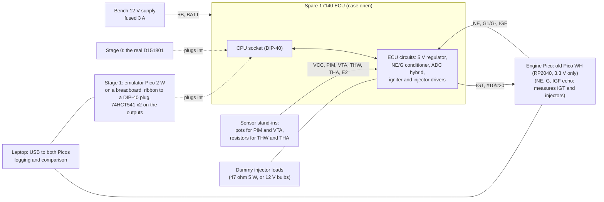

# ECU bench setup: the Pico with the 17140 board (DRAFT)

**Status: draft for the owner's review. Nothing here is bought or powered yet.** Every powered step needs the owner's confirmation at the time (CLAUDE.md hardware safety). The car's own ECU stays untouched; only the **spare** ECU goes on the bench.

**Purpose:** run the spare ECU on the bench with a simulated engine around it, twice:
- **Stage 0, stock baseline:** the real D151801 in its socket. Record how the stock ECU drives the spark and injectors across rpm and load. This is P8 (bench outputs must match the stock ECU), and also step 5 of the [CPU-replacement validation](../mr2/cpu_replacement.md): the real chip against the simulator.
- **Stage 1, emulator:** the D151801 out, and the emulator Pico plugged into the CPU socket in its place. Same stimulus, same recording; every spark and injector edge is compared with Stage 0.

Only when Stage 1 matches Stage 0 does anything go near the car.

## The setup

## Connector side (both stages)

Wired at the ECU's edge connector, using the board labels ([`aw11_ecu.md`](aw11_ecu.md)). The 17140's connector numbering is still unconfirmed, so every wire is checked by continuity against the board trace before power.

| ECU pin | Bench connection | Notes |
|---|---|---|
| +B, +B1, BATT | Fused bench 12 V | The EFI main relay is bypassed on the bench |
| E01, E02, E1, E2, E21 | Bench ground, and the Picos' GND | One ground point |
| VCC → PIM | 10 kΩ pot between VCC and E2, wiper to PIM | Manifold pressure: about 0.6 V at 0 kPa to 3.6 V at 100 kPa (EWD curve) |
| VCC → VTA, IDL | 10 kΩ pot for VTA; a switch for IDL to E2 | Throttle |
| THW, THA | Fixed resistors to E2: about 300 Ω for THW (hot engine) and 2.2 kΩ for THA (about 20 °C) | Swap the values for cold-start tests |
| OX (mixture screw, GUESS) | 10 kΩ pot to mid position | Ross R-M08 |
| T, STA | Open (T shorted to E1 for the fixed-timing test) | |
| NE, G1 / G− | From the engine Pico through a resistor (see below) | Whether the input wants a VR-style AC signal is open (STATUS Q5); Stage 0 shows it |
| IGF | From the engine Pico through an NPN transistor (open-collector, pulled low 20 µs after each spark) | Without IGF the ECU cuts injection after 2 sparks [ROM:$FFB8] |
| IGT | To the engine Pico through a 10 kΩ / 20 kΩ divider | The spark trigger |
| #10, #20 | Dummy loads to 12 V; the driver side to the engine Pico through a 33 kΩ / 10 kΩ divider and a 3.3 V clamp | Injector pulses |
| STH, FC, VISC, W | 12 V bulbs or LEDs with resistors to 12 V | T-VIS, fuel pump, idle-up and check-engine outputs, so they can be seen |

**The engine Pico is the owner's old Raspberry Pi Pico WH (RP2040)** (owner decision, 2026-10-14; no purchase). It generates NE every 30° and G every 180°, echoes IGF, and timestamps every IGT and injector edge, just as the loopback's core 0 does now.

**Its pins are 3.3 V only, not 5 V tolerant even when powered**, so nothing from the ECU reaches it directly:
- **Inputs** (IGT, #10, #20) go through the dividers in the table, plus a 3.3 V Zener clamp on each.
- **Outputs:**
  - NE and G go through a series resistor into the ECU's input conditioner, which sees only 0–3.3 V;
  - IGF goes through the NPN transistor, so the ECU's 5 V pull-up never reaches the Pico pin.

## CPU-socket side (Stage 1 only)

The emulator Pico 2 W sits on the breadboard and reaches the ECU's CPU socket through a 40-way ribbon to a DIP-40 plug. Its pins (draft):

| Socket pin | Signal | Direction (Pico view) | Pico | Notes |
|---|---|---|---|---|
| 1 | Vss | — | GND | |
| 21 | Vcc | — | (not connected) | The Pico runs from USB on the bench; the grounds are shared |
| 6 | /RES | in | GP | The ECU's reset circuit; the emulator starts when it rises |
| 13 | P10 NE | in | GP | Input capture 2 |
| 8 | P20 ADC end | in | GP | Input capture 1 |
| 39 | SC1 IGF | in | GP | IS3 flag |
| 19, 20 | P16, P17 | in | GP ×2 | |
| 37, 34, 32, 30 | P30 (T), P33, P35 (G), P37 | in | GP ×4 | |
| 33, 27, 26, 31 | P34 (J8), P43, P42, P36 | in | GP ×4 | Read from the real board, so **Q10 and Q12 are answered** the first time it runs |
| 14 | P11 IGT | out | GP → 74HCT541 | Hardware-timed compare (v3) |
| 15–18 | P12–P15 ADC select / hold | out | GP ×4 → 74HCT541 | |
| 9 | P21 injector | out | GP → 74HCT541 | Hardware-timed compare (v3) |
| 10, 12 | P22, P24 (fault lamp) | out | GP ×2 → 74HCT541 | |
| 36, 29, 28 | P31 (FC?), P40, P41 (T-VIS?) | out | GP ×3 → 74HCT541 | |
| 11 | P23 | out (in at reset for the serial link) | via 1 kΩ | |
| 2, 3, 4, 5, 7, 22–25, 35, 38, 40 | crystal, /NMI, /IRQ1, /STBY, P44–P47, P32, SC2, E | — | not connected | /STBY can be added if standby RAM is modelled |

That is 26 GPIOs. The **74HCT541** buffers (5 V powered from the ECU's Vcc) turn the Pico's 3.3 V outputs into full 5 V CMOS levels; their inputs accept 3.3 V. Inputs from the board go straight to the 5 V-tolerant GPIOs.

**Power order:** the Pico on USB first. Then the ECU's 12 V on. ECU 12 V off first at the end. This is the CLAUDE.md rule: 5 V only reaches the Pico's pins while it is powered.

## Parts beyond what's owned (proposed, needs approval)

| Item | Why |
|---|---|
| Fused 12 V bench supply, 3 A (or a battery charger plus an in-line fuse) | Powers the ECU |
| DIP-40 IDC plug + 40-way ribbon + breadboard adapter | Emulator to the CPU socket |
| 74HCT541 ×2 | 5 V outputs |
| 10 kΩ pots ×3, resistors (300 Ω, 2.2 kΩ, dividers), 2N3904 ×2, 3.3 V Zener ×2 | Sensors, IGF echo, input protection |
| 47 Ω 5 W resistors ×2 (or 12 V 5 W bulbs) | Dummy injector loads |
| (owned) Engine Pico: the old Pico WH (RP2040) | Stimulus and measurement |

## Steps (draft)

1. **Unpowered:** finish Q11/Q12 tracing; confirm every connector pin above by continuity.
2. **Stage 0, powered, real CPU** (owner confirmation): 12 V on with no stimulus. Check VCC = 5 V and the current draw. Then crank the simulated engine to 800 rpm, check sparks and injection appear, and record sweeps (rpm × MAP, T shorted, rev limit, IGF missing).
3. **Compare Stage 0 with the simulator.** This is the real-chip check of our model (timer 2, cycle timing, ADC hybrid constants).
4. **Stage 1, powered, emulator** (owner confirmation): same sweeps; every edge compared with Stage 0.
5. Only then: the emulator in the car, with the car's own ECU kept as the known-good spare.
