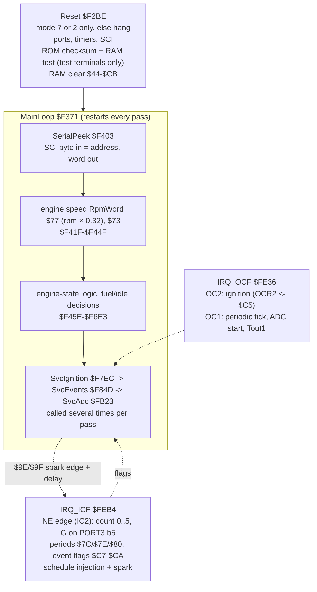

# MR2 89661-17140: program architecture (first pass)

**ROM:** `AW11 MR2 PCM/89661-17140.bin`, 4 KB at `$F000`–`$FFFF`. SHA-256 `0cfc1fdd…6f271f6e`.

**Labelled source:** [`analysis/mr2_17140/mr2_17140.asm`](../../analysis/mr2_17140/mr2_17140.asm), generated from [`symbols.yaml`](../../analysis/mr2_17140/symbols.yaml). It reassembles to the identical image.

**Cross-references and call graph:** [`analysis/mr2_17140/xref.md`](../../analysis/mr2_17140/xref.md).

This is the P4 step-1 map: where things are and roughly what they do. Names are working names. Every statement carries its evidence and a confidence level; LIKELY and GUESS items get confirmed in the simulator and on the real-CPU harness in the next steps.

## Overall shape

The structure matches the Bluetop's design: crank interrupts set event flags, and the main loop does the arithmetic. The code itself is a different program, though: only 4 % of the Bluetop's instructions align [ingest].

## Memory and I/O

| Area | Use | Evidence |
|---|---|---|
| `$00`–`$14` | HD6301V1 registers | handbook |
| `$18`, `$1B`, `$1D` | **second timer channel** (TCSR2, OCR2, ICR2): the NE input capture and the ignition output compare. The Bluetop listing names the same registers TmrCntStat2 / OutCmp2 / InpCap2 | [ROM:$FE36-$FE45, $FEB4-$FEC4] CONFIRMED (code) |
| `$40`–`$FF` | RAM. Self-test writes `$55AA`/`$AA55` over `$40`–`$FF`; reset clears `$44`–`$CB`; stack top `$00FF` | [ROM:$F310-$F336, $F2CA] CONFIRMED (code) |
| `$F000`–`$F2BD` | calibration tables and table descriptors, at the **start** of the ROM | [ingest: 45 referenced blocks] LIKELY |
| `$F2BE`–`$FFED` | code | [xref: 1783 instructions here, plus 94 in `$F01E`–`$F194` (lookup helpers and a range check inside the table area)] |
| `$FFEE` | checksum balance word (`$523D`); the ROM word sum is `$AA55` | [ROM:$F2FE-$F30B] CONFIRMED |

**Ports (car mode 7):**

| Port | Use | Evidence | Confidence |
|---|---|---|---|
| PORT1 bits 2–4 | ADC channel select (8 channels) | [ROM:$FB5F-$FB96] | LIKELY |
| PORT1 bit 5 | set when a channel is selected; bits 5–7 cleared at the OC1 tick that starts a conversion | [ROM:$FB8D-$FB96, $FE8B-$FE8F] | GUESS |
| PORT1 bit 7 | read as a test/diagnostic input (`ldx PORT1 / bmi`) before the self-test and fault logging | [ROM:$F2FA, $F717] | GUESS |
| PORT2 bit 3 (P23, SCI RX, pin 11) | read once at reset: **low enables the serial diagnostic link** ([`serial_link.md`](serial_link.md)) | [ROM:$F33B-$F343] | CONFIRMED (code) |
| PORT2 bit 1 (P21, Tout1) | timer-1 output-compare pin, driven by OC1 | [ROM:$FE9B-$FEB0] | LIKELY |
| PORT2 bits 2–4 | outputs set and cleared in the main loop (bit 2 near the start logic, bit 3 by a fault-dependent timer compare (`$69` against `$A6`, 8 with a stored fault), bit 4 = the fault-code flasher; bits 3–4 are also the serial link's RX/TX, [`serial_link.md`](serial_link.md)) | [ROM:$F497-$F49F, $FC1C-$FC28, $F7DF-$F7E9] | bits 3–4 LIKELY, bit 2 GUESS |
| PORT3 bit 5 | G (cam reference): resets the NE edge count | [ROM:$FED2] | LIKELY |
| PORT3 bits 0, 3, 6, 7 | switch inputs (bit 0 tested before the self-test and the fault logic; bit 3 counted as edges into $B5) | [ROM:$F2F5, $F70D, $FBD0-$FBE3] | GUESS |
| PORT4 bits 0–1, 2–3 | outputs bits 0–1 (set from an rpm compare); inputs bits 2–3 select an offset table at $F01A | [ROM:$FB9E-$FBB6, $FDE6-$FDF8] | GUESS |
| SCI | RAM-peek diagnostic link only (not the ADC): 7812.5 baud, read-only, `$00`–`$FF`, off after about 1 s without a request ([`serial_link.md`](serial_link.md)) | [ROM:$F403-$F41E, $F62E-$F641] [EMU:tests/test_peek17140.py] | CONFIRMED |

## Interrupts

**IRQ_ICF `$FEB4`, the crank (NE on input capture 2):**
- **Edge counting:** counts NE edges 0–5 in `$97`. When the count wraps, it checks G on PORT3 bit 5. With no G it starts again; a missing G with RPM present triggers a 10 ms injection request (`$2710`) [ROM:$FEC7-$FEDF].
- **Periods:** on even counts, it stores half the time since the last counted edge in `$7C`/`$7E`/`$80`. Their sum (`NEperiodSum`) is the crank period the main loop turns into speed [ROM:$FF24-$FF35, $F3E4].
- **Event flags** for the main loop, in place of doing the arithmetic in the interrupt [ROM:$FF37-$FF5E]:
  - `$C8` on edge 1;
  - `$C9`/`$CA` on edge 2;
  - `$C7` when edge 3 or 2 matches a condition.
- **Injection:** on every 4th edge (`$97` = 4) it schedules a pulse of length `$88`, doubled when `$B7` bit 0 is set (per-group alternation; GUESS) [ROM:$FEE1-$FF11].
- **Spark:** on the edge `$9E` it sets OCR2 to the edge time + `$C3` + `$9C` and arms TCSR2 [ROM:$FF78-$FF94]. `$9E`/`$9F` come from `SvcIgnition`.

**IRQ_OCF `$FE36`:**
- **OC2 (ignition):** reloads OCR2 from `$C5` and re-arms TCSR2 [ROM:$FE36-$FE45].
- **OC1:** a periodic tick every 1 ms or 4 ms (`$92`).
  - At the 4 ms tick it clears PORT1 bits 5–7 and timestamps the FRC in `$90`. That is the start of an ADC conversion, which input capture 1 ends; `SvcAdc` reads ICR1 − `$90`.
  - It also handles the Tout1 (P21) level and the injector end time `$8D` set by `SchedInj` `$FFB7`. Injector output on P21: LIKELY; the exact sharing of OC1 between the tick and the injector is still to be confirmed [ROM:$FE6F-$FEB3, $FFB7-$FFE0].

## Main loop `$F371`

1. Re-initialise SP, DDRs and RAMCR every pass. This is a watchdog-style robustness measure [ROM:$F371-$F383].
2. Answer a pending SCI RAM-peek request (`SerialPeek`, [`serial_link.md`](serial_link.md)).
3. **Speed:** NE period sum → reciprocal → `$77` (RpmWord, rpm × 0.32, see [`maps.md`](maps.md)) → `$73` (RpmIndex), the byte compared against rpm-like thresholds (`#$64`, `#$C8`, `#$DC` …) everywhere [ROM:$F41F-$F44F].
4. Engine-state and fuel decisions [ROM:$F45E-$F6E3]: start/after-start (`$53`, `$62`), idle (`$4A` against `$F0CA`–`$F0DB` limits), flags `$59`/`$5A`/`$99`, and outputs on PORT2.
5. `SvcIgnition` → `SvcEvents` → `SvcAdc` are called several times per pass, so the crank events and ADC conversions are serviced promptly.

## Helpers

| Address | Helper | Confidence |
|---|---|---|
| `$F11D`–`$F16A` | table lookup family, entered at several offsets with X = table; the 1D/2D interpolation the ingest found reading `$F044`–`$F25D` | LIKELY |
| `$F9D3`–`$F9E5` | small arithmetic: shifts, saturation, filters (`$F9E5` walks a RAM block at X) | GUESS |
| `$FB33` | 16 × 16 multiply, saturating at `$FFFF`, result in X | LIKELY |
| `$FFB7` | `SchedInj`: end of an injector pulse at FRC + D (+`$22`) | LIKELY |

## Notable differences from the Bluetop

- **ADC:**
  - The Bluetop reads a serial ADC over the SCI.
  - The 17140 times an analogue conversion with input capture 1 and selects channels on PORT1 bits 2–4.
  - The SCI only serves the RAM-peek link [ROM:$F403, $FB5F, $FC32] (LIKELY).
- **Self-test:** the ROM checksum and RAM test run only when PORT3 and PORT1 test inputs say so, probably the check connector's test terminals [ROM:$F2F2-$F2FB] (LIKELY).
- **Mode check:** reset hangs unless the chip latched mode 7 or **mode 2**. Mode 2 is the expanded mode a P7 external-memory board would use [ROM:$F2BE-$F2C8] (CONFIRMED, code).
- **Tables at the start of the ROM** (`$F000`–`$F2BD`), not the end.

## Coverage and option behaviours

**No hidden code.** Tracing every path from the vectors reaches every code byte from `$F2BE` to `$FFED` except `$F9D2` (`$3D`), a padding byte between two helpers [xref; independent byte-coverage check by the Verifier, 2026-10-14] CONFIRMED. There are no dead routines or extra programs in the ROM. Everything below is existing code chosen by inputs.

**P30 is probably the test terminal T, active low** (LIKELY): the self-test, the flasher pattern and the fixed sum all act on P30 = 0.

| Behaviour | Selected by | Evidence |
|---|---|---|
| Serial diagnostic link ([`serial_link.md`](serial_link.md)) | P23 low at reset, then a request at least once a second | [ROM:$F33B, $F403, $F62E] [EMU] CONFIRMED |
| Ignition map A or B, and the rpm fuel correction `$F117` | P34 (jumper J8) | [ROM:$FDC9-$FDD5, $FAC2] [EMU] CONFIRMED |
| Fixed spark sum `$00AA` | **P30 = 0**, with `ModeFlags` bit 7 set (a start/stall state, not warm idle) and `DiagFlags` bit 7 clear | [ROM:$F7F2-$F800] CONFIRMED (code); whether this is the T-terminal base timing is doubtful (STATUS conflicts log) |
| Fault-code flasher pattern on pin 12 (P24) | P30 = 0 builds the pattern from the stored faults; P30 = 1 clears it and `DiagFlags` | [ROM:$F769-$F7E9] CONFIRMED (code) |
| Spark skipped altogether | P30 = 1 and `$A4` bit 7 (a current fault) | [ROM:$FF7C-$FF83] CONFIRMED (code); meaning GUESS |
| Advance trim +9 / −17 / −9 / 0 counts (≈ +2.1° / −4.0° / −2.1° / 0°) | PORT4 bits 2–3 (jumpers or connector pins, Q12) | [ROM:$FDE4-$FDFD] code CONFIRMED, wiring GUESS |
| ROM checksum and RAM test at reset (and `DiagFlags` = `$AA` afterwards, bit 7 set) | P30 = 0, P36 = 1, P17 = 0 | [ROM:$F2F0-$F2FD, $F331] CONFIRMED (code) |
| Mode 2 (external memory) accepted besides mode 7 | mode pins | [ROM:$F2BE-$F2C8] CONFIRMED (code) |
| P32 (jumpers J4/J9) | no direct PORT3 read tests bit 2; 21 indexed reads have an unknown X | [xref] LIKELY |
| `$F000`–`$F002` = `3F 3F 3F` (SWI) | — a stray jump to the start of the ROM traps to the reset vector | [ROM:$F000] LIKELY intent |

Table bytes that the simulator sweep never read (across rpm, pressure, both P34 levels, coolant, throttle, air temperature, battery and mixture): the high-load staircase `$F1DA`–`$F1EE` (see [`maps.md`](maps.md)), the top rows of both ignition maps, part of the reference table `$F047`–`$F054`, `$F095`–`$F09D` (an event path the sweep did not trigger) and the high range of the mixture table `$F0B1`–`$F0B8` [EMU:sweep].

## Next (P4 steps 2–3)

- Confirm the ADC channel map (which PORT1 code is coolant, air temp, MAP/PIM, throttle, battery, O2). Then name `$53`, `$4A` and the rest.
- Find the ignition and fuel maps through the code that reads them: the ingest leads are `$F1AE`/`$F1BA`/`$F1EF`/`$F25D`.
- Teach the simulator this ROM's I/O: the NE/G inputs on IC2/PORT3, the timed ADC on IC1, and the outputs. Then cross-check on the real-CPU harness.
