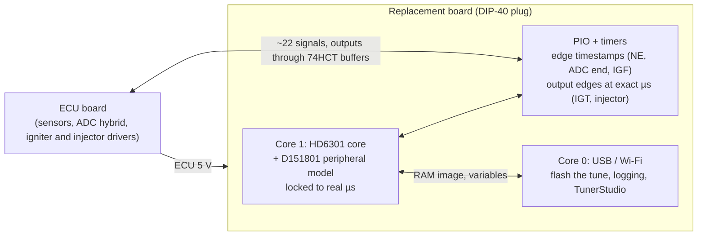

# MR2 89661-17140: CPU replacement by emulation (P7 design)

**Idea:** take the D151801 out of its socket and plug in an RP2350 board that *is* the CPU. It runs the 17140 program in emulation, with the Denso chip's timers, serial port and ports, in single-chip mode. The ECU board sees the same 40 pins doing the same jobs. The tune is a file on the RP2350's flash.

## Why not keep the factory CPU in external-memory mode

The handbook settles it (Hitachi HD6301 handbook, §2.1, Table 2-1-1 and Fig. 2-1-3, 2-2-1):
- **Mode 2** ("Multiplexed/RAM"): ROM external, RAM internal, vectors external.
- **Expanded multiplexed mode:**
  - Port 3 becomes the shared data / low-address bus, and Port 4 the high address lines;
  - SC1/SC2 become AS and R/W, so the IS3 (IGF) strobe input is gone;
  - "74LS373 … is required for address latch";
  - the Port 3/4 registers `$04`–`$07` and `$0F` move to external address space.
- **RAM map:** the HD6301V1's mode-2 map shows `$20`–`$7F` as external space, but the 17140 keeps variables in `$40`–`$7F` [ROM: RAM test `$F310`–`$F336`]. On the Denso part that RAM may also have to come from outside (unknown).

The ECU board was designed for single-chip mode and uses those very pins: G, T, J8, the trims, the fuel pump, T-VIS and IGF ([port audit](architecture.md)). Every design that keeps the factory CPU must rebuild them externally, which means a latch, a CPLD or shadows, and possibly RAM. Replacing the CPU avoids all of it: nothing is lost, because single-chip mode is what gets emulated.

## Block diagram

## What is emulated

All of this is from the 17140's own register use [xref], and all of it is already modelled in the Python simulator, which runs the ROM end to end ([`analysis/emu/`](../../analysis/emu/)).

| Block | Registers | Pins | Model status |
|---|---|---|---|
| CPU | — | — | **C core done**: matches the MAME-verified Python core on every opcode and on 200 000 steps of the 17140 ROM [EMU:tests/test_hd6301_c.py] |
| Timer 1 | TCSR `$08`, FRC `$09`, OCR1 `$0B`, ICR1 `$0D` | IC1 ← P20 (ADC end), OC1 → P21 (injector) | **C done** (`d151801.c`), handbook-based |
| Timer 2 (Denso) | TCSR2 `$18`, OCR2 `$1B`, ICR2 `$1D` | IC2 ← P10 (NE), OC2 → P11 (IGT) | **C done**; inferred from the ROM (GUESS until compared with the real chip) |
| SCI | RMCR `$10`, TRCSR `$11`, RDR `$12`, TDR `$13` | P23/P24 | **C done** (UART line side via callbacks) |
| Ports | `$00`–`$07`, P3CSR `$0F` (IS3 = IGF) | Port 1/2/3/4, SC1 | **C done** |
| RAM, RAMCR | `$40`–`$FF`, `$14` | STBY | Python; standby (battery-backed fault codes) to design |
| Reset, mode | PORT2 bits 5–7 read as mode 7 | RES | trivial |

## Timing

The emulated chip runs **locked to real time**:
- Core 1 executes instructions and their cycle counts, and never runs more than a few µs ahead of the real clock.
- **Inputs:** PIO timestamps every input edge (NE, ADC end, IGF) with a 1 MHz counter, so ICR1/ICR2 hold the exact capture time, as on the real chip.
- **Outputs:** when the program writes OCR1/OCR2, the compare is handed to PIO or a hardware alarm, which switches the IGT or injector pin at that exact µs. Spark and injection timing therefore do not depend on how fast the emulation runs, only on it keeping up.
- **Headroom:** on a PC the C core runs the 17140 ROM about **270×** faster than the real chip [EMU: host benchmark]. **On the owner's Pico 2 W at the stock 150 MHz it runs at 4.5× the real chip** (1.42 M instructions/s, E-clock equivalent 4.48 MHz) [BENCH: owner, ecu_emu_bench v1, 2026-10-14]. With a direct memory path for RAM/ROM (only `$00`–`$1F` through callbacks): **4.6× at 150 MHz and 7.7× at 250 MHz** (2.46 M instructions/s) [BENCH: owner, ecu_emu_bench v2, 2026-10-14]. CPU speed is not a risk; the peripheral model has to fit inside that margin.
- **Open:** the D151801 showed 6801-like bus-cycle counts on the bench (STATUS). The emulator's per-instruction cycle table must match the real chip, so that the main-loop pacing is right. The differential test below settles it.

## Pins (about 22 signals)

- **Inputs (5 V tolerant GPIOs):** RES, NE (P10), ADC end (P20), IGF (SC1), P16, P17, P30 (T), P33, P35 (G), P37; plus P23 (serial RX) when the link is used.
- **Outputs (through 74HCT buffers for 5 V CMOS levels):**
  - IGT (P11);
  - ADC select and hold (P12–P15);
  - injector (P21);
  - P22;
  - P24 (serial TX / fault lamp);
  - P23 (fault output when the link is off);
  - P31, P40, P41.
- **Settings, no wire:** J8 (P34), the trims (P42/P43), the P36 strap. Pin 40 (E) and the crystal pins are left open unless the board turns out to use E.
- **Fit:** the Pico 2 W's 26 usable GPIOs suffice for the bench prototype. A final board can use an RP2350B for spare pins.

## Validation path

1. **C core against the Python core: done** [EMU:tests/test_hd6301_c.py].
2. **Speed on the RP2350:** the bench UF2 (below) on the owner's Pico 2 W.
3. **C peripheral model against the Python simulator: done.** CPU + peripherals + memory in C (`board.c`), driven by the same engine model through `emu.cboard`: every spark, injector edge, ADC conversion, interrupt count and RAM byte identical at 8 operating points (idle, cruise, full load, rev limit, cranking, cold with map B, no IGF, test terminal) [EMU:tests/test_d151801_c.py]. A one-bit fault in the C output-compare logic fails all 8.
4. **On the Pico with real I/O:** PIO stimulus from the simulator's scenarios, outputs captured and compared.
5. **Differential against the real D151801:** the real chip in mode 7 on the breadboard harness and the emulator, driven with identical NE/G/ADC stimulus; compare every IGT and injector edge to the µs. This settles timer 2, the cycle table and anything undocumented.
6. **Bench ECU:** the emulator in the spare ECU against the stock ECU (CLAUDE.md: bench outputs must match first). Only then the car.

## Speed test (no wiring)

[`hardware/ecu-emu/bench/`](../../hardware/ecu-emu/bench/) builds `ecu_emu_bench_pico2_w.uf2`. Flash it, open the USB serial port, and read the line it prints every few seconds: instructions per second and the multiple of the real chip's speed. Nothing is connected to the ECU.

## Later: factory-chip fallback on the same board

The owner would like the board to be able to fall back to the factory D151801, for example with a socket for the original chip and a switch that selects which one drives the ECU pins. To revisit once the emulator works on the bench.
