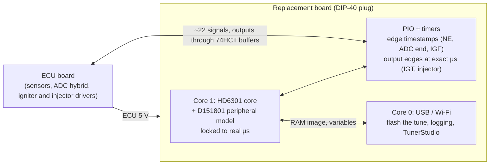
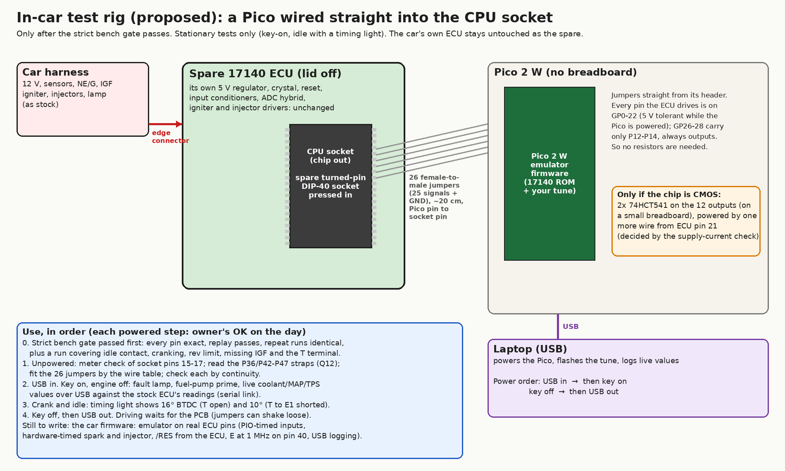
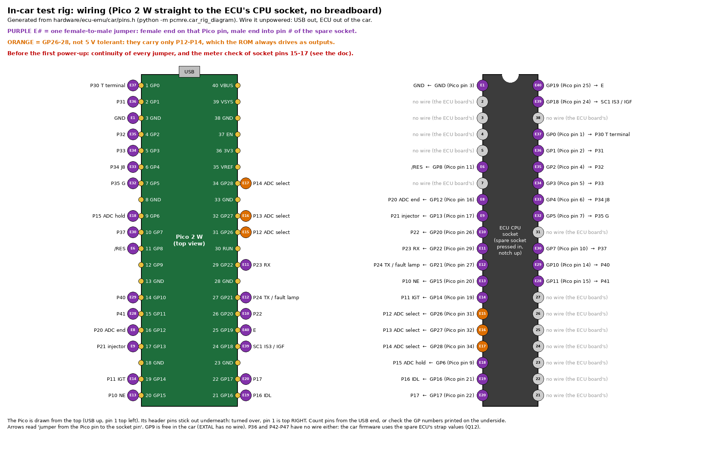

# MR2 89661-17140: CPU replacement by emulation (P7 design)

**Idea:** take the D151801 out of its socket and plug in an RP2350 board that *is* the CPU. It runs the 17140 program in emulation, with the Denso chip's timers, serial port and ports, in single-chip mode. The ECU board sees the same 40 pins doing the same jobs. The tune is a file on the RP2350's flash.

## Why not keep the factory CPU in external-memory mode

The handbook settles it (Hitachi HD6301 handbook, §2.1, Table 2-1-1 and Fig. 2-1-3, 2-2-1):
- **Mode 2** ("Multiplexed/RAM"): ROM external, RAM internal, vectors external.
- **Expanded multiplexed mode:**
  - Port 3 becomes the shared data / low-address bus, and Port 4 the high address lines;
  - SC1/SC2 become AS and R/W, so the IS3 (IGF) strobe input is gone;
  - "74LS373 … is required for address latch";
  - the Port 3/4 registers `$04`–`$07` and `$0F` move to external address space.
- **RAM map:** the HD6301V1's mode-2 map shows `$20`–`$7F` as external space, but the 17140 keeps variables in `$40`–`$7F` [ROM: RAM test `$F310`–`$F336`]. On the Denso part that RAM may also have to come from outside (unknown).

The ECU board was designed for single-chip mode and uses those very pins: G, T, J8, the trims, the A/C and speed inputs, the P31 and T-VIS outputs, and IGF ([port audit](architecture.md)). Which output, if any, drives the board's `FC` (fuel pump relay) pin is not known: no ROM output behaves like a fuel-pump control (STATUS Q13). Every design that keeps the factory CPU must rebuild them externally, which means a latch, a CPLD or shadows, and possibly RAM. Replacing the CPU avoids all of it: nothing is lost, because single-chip mode is what gets emulated.

## Block diagram

## What is emulated

All of this is from the 17140's own register use [xref], and all of it is already modelled in the Python simulator, which runs the ROM end to end ([`analysis/emu/`](../../analysis/emu/)).

| Block | Registers | Pins | Model status |
|---|---|---|---|
| CPU | — | — | **C core done**: matches the MAME-verified Python core on every opcode and on 200 000 steps of the 17140 ROM [EMU:tests/test_hd6301_c.py]. **The D151801 runs MC6801 instruction timing** (MAME `cycles_6803`), with each I/O register read or written on its own bus cycle [BENCH:analysis/captures/chipdiff_17140_run3_2026-10-15.log] |
| Timer 1 | TCSR `$08`, FRC `$09`, OCR1 `$0B`, ICR1 `$0D` | IC1 ← P20 (ADC end), OC1 → P21 (injector) | **C done** (`d151801.c`), handbook-based |
| Timer 2 (Denso) | TCSR2 `$18`, OCR2 `$1B`, ICR2 `$1D` | IC2 ← P10 (NE), OC2 → P11 (IGT) | **C done**; inferred from the ROM; spark edges match the real chip closed loop at 800/2000/5000 rpm [BENCH: run 5] LIKELY (spark timing is set by this timer, so it is a weak test of the CPU model) |
| SCI | RMCR `$10`, TRCSR `$11`, RDR `$12`, TDR `$13` | P23/P24 | **C done** (UART line side via callbacks) |
| Ports | `$00`–`$07`, P3CSR `$0F` (IS3 = IGF) | Port 1/2/3/4, SC1 | **C done** |
| RAM, RAMCR | `$40`–`$FF`, `$14` | STBY | Python; standby (battery-backed fault codes) to design |
| Reset, mode | PORT2 bits 5–7 read as mode 7 | RES | trivial |

## Timing

The emulated chip runs **locked to real time**:
- Core 1 executes instructions and their cycle counts, and never runs more than a few µs ahead of the real clock.
- **Inputs:** PIO timestamps every input edge (NE, ADC end, IGF) with a 1 MHz counter, so ICR1/ICR2 hold the exact capture time, as on the real chip.
- **Outputs:** when the program writes OCR1/OCR2, the compare is handed to PIO or a hardware alarm, which switches the IGT or injector pin at that exact µs. Spark and injection timing therefore do not depend on how fast the emulation runs, only on it keeping up.
- **Headroom:** on a PC the C core runs the 17140 ROM about **270×** faster than the real chip [EMU: host benchmark]. **On the owner's Pico 2 W at the stock 150 MHz it runs at 4.5× the real chip** (1.42 M instructions/s, E-clock equivalent 4.48 MHz) [BENCH: owner, ecu_emu_bench v1, 2026-10-14]. With a direct memory path for RAM/ROM (only `$00`–`$1F` through callbacks): **4.6× at 150 MHz and 7.7× at 250 MHz** (2.46 M instructions/s) [BENCH: owner, ecu_emu_bench v2, 2026-10-14]. CPU speed is not a risk; the peripheral model has to fit inside that margin.
- **Matched to the real chip** (chip-in-isolation test, [`chip_diff_test.md`](../hardware/chip_diff_test.md#results)):
  - MC6801 cycle counts; I/O accesses on their own bus cycle;
  - a counter write only presets `$FFF8`, and reading the counter's high byte latches the low byte;
  - the port 4 data latch reads high at reset;
  - an interrupt is taken after an instruction only if its flag counts at least 2 cycles before the instruction's end. A compare flag counts from the cycle after the match, a capture flag from the cycle before the input edge (LIKELY: fitted, see the results).

## Pins (25 signals)

The in-car pin map is [`hardware/ecu-emu/car/pins.h`](../../hardware/ecu-emu/car/pins.h); the wire table below is generated from it.

- **Directions** are the ROM's own [ROM:$F2CA-$F2EB, $F371-$F380] CONFIRMED (code, `tests/test_car_rig.py` reads them from the ROM bytes):
  - **inputs:** /RES, NE (P10), P16 (IDL), P17, ADC end (P20), IGF (SC1), P30 (T), P32, P33, P34 (J8), P35 (G), P37;
  - **outputs:** IGT (P11), ADC select and hold (P12-P15), injector (P21), P24 (serial TX / fault lamp), P31, P40, P41, E;
  - **both:** P22 and P23 are inputs at reset and outputs once the main loop runs (P23 is the serial RX when the link is on).
- **The 5 V rule:** the Pico 2 W's GP0-22 take 5 V while it is powered; GP26-28 (its ADC pins) do not. Every pin the ECU board can drive is on GP0-22. GP26-28 carry only P12-P14, the ADC channel select, which the ROM always drives as outputs. Nothing else on the ECU board can drive those lines (it would fight the stock CPU), so the most they can have is a pull-up, and one the stock CPU can still pull low is weak enough (about 3 kΩ or more) to limit the current into the pad's protection diode to well under 1 mA (LIKELY: MC6801-family port outputs sink about 1.6-2 mA). The meter check below confirms it. `pins.h` enforces the rule with a compile-time check.
- **No wire:** the crystal pins (the ECU's crystal stays unused; GP9 is free), the supply and mode pins, and the straps P36 and P42-P47. The Pico has no pins left to read the straps, so the car firmware uses the spare ECU's values (read unpowered with a meter, Q12).
- **Output levels:** see [In-car test rig](#in-car-test-rig) (buffers only if the chip turns out to be CMOS).

## Validation path

1. **C core against the Python core: done** [EMU:tests/test_hd6301_c.py].
2. **Speed on the RP2350:** the bench UF2 (below) on the owner's Pico 2 W.
3. **C peripheral model against the Python simulator: done.** CPU + peripherals + memory in C (`board.c`), driven by the same engine model through `emu.cboard`: every spark, injector edge, ADC conversion, interrupt count and RAM byte identical at 8 operating points (idle, cruise, full load, rev limit, cranking, cold with map B, no IGF, test terminal) [EMU:tests/test_d151801_c.py]. A one-bit fault in the C output-compare logic fails all 8.
4. **On the Pico, real time:** the loopback test (below) was bit-exact with the simulator, in real time, before the model moved to MC6801 timing. `expected.h` has been regenerated since, so it needs one re-run on the Pico.
5. **Against the real D151801:** the chip-in-isolation test ([`chip_diff_test.md`](../hardware/chip_diff_test.md)). The real chip runs its own ROM on the reader breadboard, the Pico plays the engine with the same model and schedule as the loopback, and its output edges must match the emulator's when the emulator is given exactly the chip's inputs. **Result so far (run 5, 36 s at three steady points):** running closed loop, every spark edge (6 238) and injector edge (3 130) of the real chip, at a constant 2-cycle offset; ADC sequencing 99.3-99.6 % [BENCH: run 5; EMU:tests/test_chip_vs_emulator.py]. LIKELY for spark and fuel at steady points. Verifier: PASS WITH ISSUES. The test's full PASS criterion is not yet met, and the scope is steady points only (STATUS). No ECU board is needed: the emulator uses the car's ECU board unchanged, exactly as the chip does.
6. **The car** (below), with the car's own ECU kept as the known-good spare.

## Loopback test (no wiring)

[`hardware/ecu-emu/loopback/`](../../hardware/ecu-emu/loopback/) builds `ecu_emu_loopback_pico2_w.uf2`: step 4 of the validation path, on one Pico.

**v1 result** [BENCH: owner, 2026-10-14, 150 MHz]:
- RpmWord exact at all three points;
- 2.00 sparks and 1.00 injections per revolution;
- spark angle within 0.13° of the simulator;
- emulator busy about 72 %, worst lag 14 µs, spark pin up to 9 µs late.

The injector pulse differed by up to 6 %. The cause is that the ECU's fuelling depends on its history (after-start and learned values). v1's free-running stimulus could not reproduce the simulator's history exactly, so an average comparison could not settle whether the emulation is exact.

**v2 is deterministic:**
- **Core 0** queues every crank edge ahead of time.
- **Core 1** runs the emulator locked to real time: never ahead of the 1 µs clock, nor past the last queued edge.
- **The engine model** ([`engine.h`](../../hardware/ecu-emu/loopback/engine.h), the same behaviour as `engine17140.py`: the ADC hybrid and the IGF echo) runs inside the emulator at exact emulated times.
- **The schedule:** 800 rpm / 35 kPa, 2000 / 50, 5000 / 95, 6 s each, switching at exactly 6 s.
- **The checksums:** at the end of each phase core 1 takes CRC32s of every output edge in seconds 3–6 and of the RAM. Core 0 prints PASS if they equal the simulator's ([`expected.h`](../../hardware/ecu-emu/loopback/expected.h), generated by `emu.loopback_ref`).
- **On the host,** `engine.h` already reproduces all 6 phases bit for bit [EMU:tests/test_loopback_engine.py].
- **On the Pico, PASS means** the real-time emulator is bit-exact to the simulator, including every spark and injector edge time.
- **v2 result** [BENCH: owner, 2026-10-14, 150 MHz]: **all 6 phases PASS**, bit-exact (output edges, RAM, injector pulses). Emulator busy 73–77 %. The worst lag was 1128 µs at 800 rpm: the emulator was held to the last *queued* crank edge, and at low rpm the edges are 3 ms apart. Fixed in v2.1, which lets it run to the end of the queue's look-ahead.
- **Also printed:** emulator load, worst lag, and how late the spark pin is (read back through its pad). The emulator still drives compare outputs when its own time reaches them; pre-scheduling them in hardware is the next step.

## Speed test (no wiring)

[`hardware/ecu-emu/bench/`](../../hardware/ecu-emu/bench/) builds `ecu_emu_bench_pico2_w.uf2`. Flash it, open the USB serial port, and read the line it prints every few seconds: instructions per second and the multiple of the real chip's speed. Nothing is connected to the ECU.

## In-car test rig

**Status: proposed. Used only after the strict bench gate passes** (owner decision: every pin exact, replay passing, identical repeat runs, and a run covering idle contact, cranking, the rev limit, missing IGF and the T terminal). It goes in the **spare ECU**, which already has a turned-pin socket where the D151801 was. The car's own ECU stays untouched as the known-good spare.

*Generated by `python -m pcmre.car_rig_diagram`.*

- **No breadboard.** A spare turned-pin DIP-40 socket (BOM A6) is pressed into the spare ECU's CPU socket, notch matching. **26 female-to-male jumper wires** (about 20 cm) run from the Pico 2 W's header pins (female end) to the same CPU pin of that socket (male end): 25 signals and ground, by the table below. The jumpers' square pins stretch a turned-pin contact, so they go into the sacrificial spare socket, never straight into the ECU's own socket. The chip-test board stays as it is, ready to re-run the bench gate.
- **Pin map:** the chip test's, except that NE, IDL and P17 move to GP15-17 and P12-P14 to GP26-28, so that every pin the ECU board can drive is 5 V tolerant ([Pins](#pins-25-signals)).

  

  *Generated by `python -m pcmre.car_rig_diagram`.* The Pico is drawn from the top; its header pins stick out underneath, so with the board turned over pin 1 is top right. Wire table (`python -m pcmre.car_rig_diagram --table`):

  | ECU socket pin | Signal | CPU direction | Pico end |
  |---|---|---|---|
  | 1 | GND |  | GND (Pico pin 3) |
  | 6 | /RES | in | GP8 (Pico pin 11) |
  | 8 | P20 ADC end | in | GP12 (Pico pin 16) |
  | 9 | P21 injector | out | GP13 (Pico pin 17) |
  | 10 | P22 | in/out | GP20 (Pico pin 26) |
  | 11 | P23 RX | in/out | GP22 (Pico pin 29) |
  | 12 | P24 TX / fault lamp | out | GP21 (Pico pin 27) |
  | 13 | P10 NE | in | GP15 (Pico pin 20) |
  | 14 | P11 IGT | out | GP14 (Pico pin 19) |
  | 15 | P12 ADC select | out | GP26 (Pico pin 31) |
  | 16 | P13 ADC select | out | GP27 (Pico pin 32) |
  | 17 | P14 ADC select | out | GP28 (Pico pin 34) |
  | 18 | P15 ADC hold | out | GP6 (Pico pin 9) |
  | 19 | P16 IDL | in | GP16 (Pico pin 21) |
  | 20 | P17 | in | GP17 (Pico pin 22) |
  | 28 | P41 | out | GP11 (Pico pin 15) |
  | 29 | P40 | out | GP10 (Pico pin 14) |
  | 30 | P37 | in | GP7 (Pico pin 10) |
  | 32 | P35 G | in | GP5 (Pico pin 7) |
  | 33 | P34 J8 | in | GP4 (Pico pin 6) |
  | 34 | P33 | in | GP3 (Pico pin 5) |
  | 35 | P32 | in | GP2 (Pico pin 4) |
  | 36 | P31 | out | GP1 (Pico pin 2) |
  | 37 | P30 T terminal | in | GP0 (Pico pin 1) |
  | 39 | SC1 IS3 / IGF | in | GP18 (Pico pin 24) |
  | 40 | E | out | GP19 (Pico pin 25) |

- **Meter check before the first power-up** (unpowered, chip out, spare socket in): resistance from socket pins 15, 16 and 17 each to pin 21 (5 V), measured both ways round. A pull-up reads the same both ways; a reading that changes when the leads swap is a diode inside a chip, not a pull-up. **Pass:** no same-both-ways reading below 3 kΩ. If one fails, that signal moves to GP9 (free and 5 V tolerant) before anything is powered.
- **Power:** the Pico runs from the laptop's USB. USB goes in before key-on and comes out after key-off, the same "Pico first" order as on the bench, so nothing taps the ECU's supply.
- **Output levels:** the Pico drives 3.3 V. The D151801 runs MC6801 timing; if it is an NMOS part like the MC6801, its outputs only guarantee TTL highs, the ECU board accepts those, and no buffers are needed. One check settles it: the chip's supply current on the bench (an NMOS 6801 draws about 100 mA or more, a CMOS HD6301 a few mA). If the chip is CMOS, two 74HCT541 buffers go on a small breadboard between the Pico and the socket, powered by one more jumper from ECU pin 21.
- **Firmware still to write:** the emulator on the real ECU pins:
  - inputs timestamped by PIO;
  - spark and injector on hardware-timed compares;
  - /RES read from the ECU;
  - E at 1 MHz on pin 40;
  - live values and tune flashing over USB.
- **Use, each powered step with the owner's confirmation on the day:**
  1. key on, engine off: fault lamp, fuel-pump prime, and live coolant/MAP/TPS against the stock ECU's readings over the serial link;
  2. crank and idle: a timing light shows 16° BTDC with T open and 10° with T-E1 shorted.

  **Stationary only:** jumpers can shake loose, so driving waits for the PCB.
- **Final board:** a KiCad PCB, factory-assembled (JLCPCB PCBA). It carries the RP2350 (or a castellated Pico 2 W), SMD 74HCT541s, the buck, USB-C reachable for flashing, and turned-pin DIP-40 legs underneath. Its outline waits for a photo of the clearance above the CPU socket.

## Later: factory-chip fallback on the same board

The owner would like the board to be able to fall back to the factory D151801, for example with a socket for the original chip and a switch that selects which one drives the ECU pins. To revisit once the emulator has run in the car.
