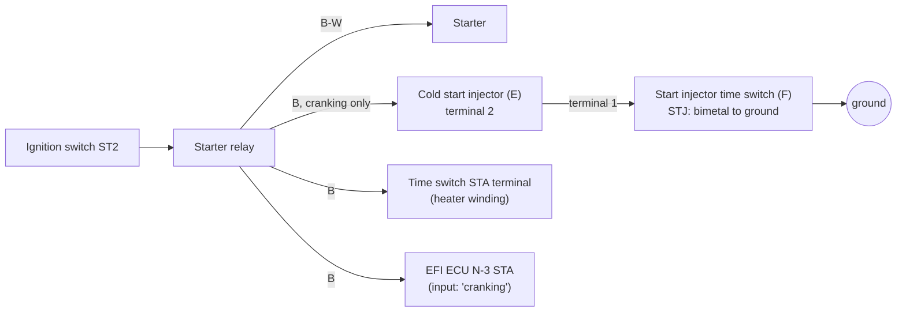
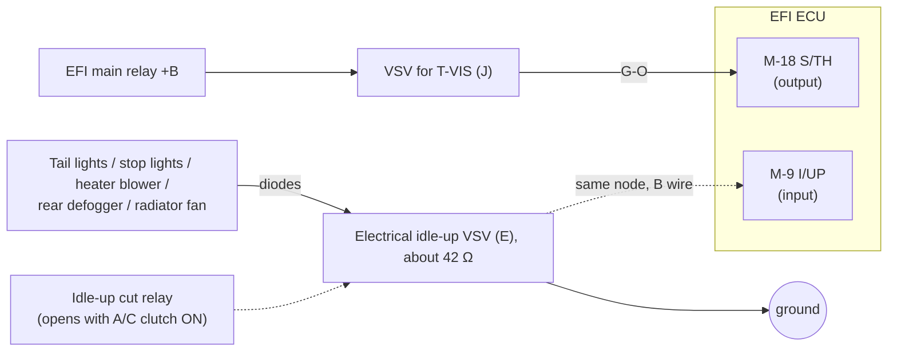
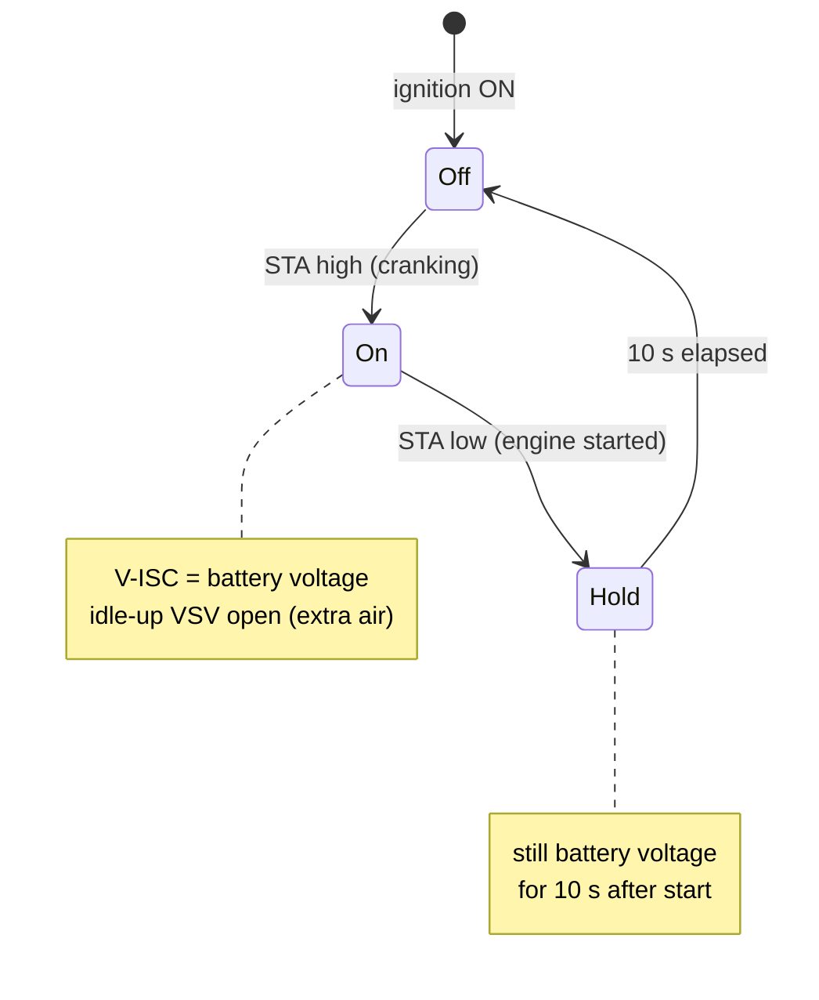
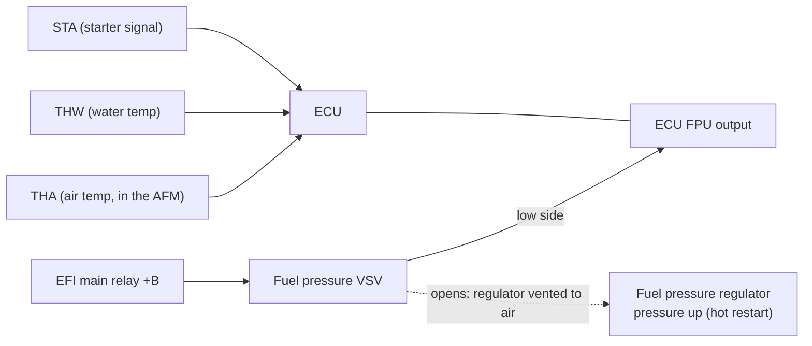

# MR2 AW11: factory data

## Summary

| Document | Market and era | Use for the 17140 |
|---|---|---|
| **EWD 1984**: *Toyota Electrical Wiring Diagram, MR2 AW11 series, Nov. 1984*, "For Europe & General", Pub. No. 36711E (© 1986 Toyota). 62 scanned pages | **Europe, mk1a**: vacuum sensor (PIM), CO resistor, no O2 sensor | Correct market, older era |
| **RM 1988**: *Toyota MR2 AW11 Repair Manual, 1988*. Approximately 1,000 scanned pages | **US / general export, mk1b**: air flow meter (VC/VS), O2 sensor (OX/HT), California EGR, A/T lines, 4A-GZE | Correct era, different market |

The two PDFs are Toyota copyright and are not in the repository. This page gives only the facts that the project uses. Each fact gives the printed page (for example "p25" or "FI-119"), and the PDF page in brackets. Factory documents rank below ROM bytes and bench measurements, and above the Ross articles ([`CLAUDE.md`](../../CLAUDE.md)). A fact from these documents that applies to the 17140 is LIKELY or GUESS until a continuity test or the ROM confirms it.

## Cold start and idle air

| Item | EWD 1984 (Europe) | RM 1988 (US) | 17140 |
|---|---|---|---|
| Cold start injector | Not connected to the ECU. Supplied from the starter circuit, grounded through the start injector time switch [p16–17 (PDF 10)] | The same [FI-73 (PDF 268); FI-115 to FI-116 (PDF 310–311)] | No CSI pin on the board. The ECU does not drive it (LIKELY) |
| Auxiliary air valve | Mechanical wax valve. Not in the diagram | Mechanical wax valve [FI-108 (PDF 303)] | The ECU does not drive or sense it (LIKELY) |
| Idle-up VSV | The electrical loads switch it through diodes. The ECU pin **I/UP** only senses the VSV line [p23, p28–29 (PDF 13, 16)] | The ECU **drives** it from the output **V-ISC**, during cranking and for 10 s after start [FI-119 (PDF 314)] | The board has a `VISC` pad and no `I/UP` pad. The ROM output P31 has a 20–21 s timer and is the best fit (GUESS) ([program](program.md#port-3-and-port-4)) |
| Fuel-pressure-up VSV | Not present | The ECU drives it from **FPU** (low side) [FI-118 (PDF 313)] | The board has an `FPU` pad. ROM PORT2 bit 2 goes low after a hot crank and is the best fit (GUESS) |

All cold-start behaviour of the ECU comes from **STA**, **THW**, **IDL** and the idle-up output. No 17140 ROM output follows the coolant temperature on a warm-up schedule [ROM:$F3A2-$F3CC, $F478-$F49F].

### Cold-start circuit (EWD 1984, p16–17)

| Item | Factory value |
|---|---|
| Cold start injector, 2→1 | 12 V while the start injector time switch is closed and the starter turns |
| Start injector time switch | Points **open above 35 °C (95 °F)** |
| Time switch STA–STJ (2–1) | 20–40 Ω below 30 °C; 40–60 Ω above 40 °C |
| Time switch STA–ground | 20–80 Ω |

### T-VIS (S/TH) and electrical idle-up (EWD 1984, p23, p25, p28–29)

- **S/TH drives the T-VIS VSV.** M-18 to N-7 is **0–2 V at idle and 10–14 V above 4350 rpm** [p25]. This is factory evidence for the mk1a T-VIS value of Ross, 4350 rpm ([Ross claims](../ross/claims.md), R-I10). The 17140 ROM uses 4650 rpm on and 4250 rpm off, the mk1b values ([maps](maps.md#t-vis-advance-step)).
- **Idle-up VSV:** approximately 42 Ω (pins 1–2). Pin 1 to ground reads 12 V with the tail lights, stop lights, heater blower, rear defogger or radiator fan on. The idle-up cut relay contacts (3–4) open when the A/C magnet clutch is on [p29].

### V-ISC start-up idle-up (RM 1988, FI-119)

- The VSV is between V-ISC and ground. Thus the ECU switches it on the **high side**.
- STA is the only input in the diagram. Thus the trigger is cranking and a timer.

### High-temperature line-pressure-up, FPU (RM 1988, FI-118)

- +B supplies the fuel pressure VSV. The ECU pin FPU grounds it (low-side switch).
- This is the "High Temperature Line Pressure Up System". On a hot restart, the ECU increases the fuel pressure to prevent vapour lock. It uses STA, THW and THA. The decision logic is not in the manual. It comes from the inputs in the diagram (LIKELY).
- This is a hot-start function, not a cold-start function.

## ECU connector pinout (EWD 1984)

The ECU has three connectors: **L** (14-pin), **M** (18-pin) and **N** (10-pin). This agrees with the 14P/18P/10P on the case label. The connector face drawings are on p26 (PDF 15). Pins that are not in the table are not in the diagram (not used, or for other markets).

| Conn-pin | Name | Wire | Connects to | Direction |
|---|---|---|---|---|
| L-1 | +B1 | B | EFI main relay output | power |
| L-2 | BATT | W-R | Battery (through N1-13), memory supply | power |
| L-4 | FC | G-R | Circuit opening relay coil (fuel pump control) | output |
| L-8 | +B | B | EFI main relay output | power |
| L-9 | DG | G-W | Diagnostic (combination meter / check connector) | output |
| L-11 | A/C | B-W | From the A/C amplifier (A/C switch on) | input |
| L-12 | SPD | V-W | Speed sensor in the combination meter | input |
| L-14 | VAF | R | **CO control resistor** (European mixture screw), wiper, 5 kΩ | input |
| M-1 | THW | W | Water thermo sensor | input |
| M-2 | PIM | LG-R | Vacuum sensor output | input |
| M-3 | THA | Y | Air thermo sensor | input |
| M-4 | T | W | Service connector T (diagnostic test) | input |
| M-5 | IGF | B-Y | Igniter IGF (spark confirmation) | input |
| M-6 | G+ | B | Distributor G pickup + | input |
| M-7 | G− | R | Distributor G pickup − | input |
| M-8 | IGT | B-W | Igniter IGT (spark trigger) | output |
| M-9 | I/UP | B | Electrical idle-up VSV line (load sense) | input |
| M-10 | E2 | BR | Sensor ground | ground |
| M-11 | VTA | R | Throttle position sensor, potentiometer | input |
| M-12 | VCC | Y | 5 V sensor supply (TPS, vacuum sensor, CO resistor) | output |
| M-13 | IDL | B | Throttle idle contact | input |
| M-15 | NE | W | Distributor NE pickup | input |
| M-16 | E21 | BR | Sensor ground | ground |
| M-17 | VF | R-W | Service connector VF (feedback / CO check) | output |
| M-18 | S/TH | G-O | VSV for T-VIS | output |
| N-3 | STA | B | Starter signal | input |
| N-4 | #10 | L | Injectors No.1 and No.3 | output |
| N-5 | E01 | BR | Power ground | ground |
| N-6 | BF | W | Injector supply after the 10 A INJ fuse and the injector relay. Possibly the battery-voltage (dead-time) input (LIKELY) | input |
| N-7 | E1 | BR | ECU ground | ground |
| N-9 | #20 | Y | Injectors No.2 and No.4 | output |
| N-10 | E02 | BR | Power ground | ground |

- The injectors are wired as **two groups**: No.1+3 on #10 and No.2+4 on #20. Ross says that the ECU connects #10 and #20 together internally, which gives simultaneous injection ([Ross claims](../ross/claims.md), R-F22).
- G+ to G− (M-6 to M-7) reads 140–180 Ω: the distributor pickup coil.

### Factory test values (EWD 1984, p25)

| Check | Value |
|---|---|
| L-2 to N-7 | 10–14 V (always) |
| L-1, L-8 to N-7 | 10–14 V (ignition on) |
| M-13 (IDL) to M-10 | 4–6 V throttle open; resistance ∞ open, < 2.3 kΩ closed |
| M-11 (VTA) to M-10 | 0.1–1.0 V closed, 4–5 V wide open; 0.2–0.6 kΩ closed, 3.3–10 kΩ wide open |
| M-4 (T) to N-7 | 10–14 V with T–E1 open; 0 V with T–E1 shorted |
| M-3 (THA) to M-10 | 1–3 V at 20 °C; 2–3 kΩ at 20 °C |
| M-1 (THW) to M-10 | 0.1–0.5 V at 80 °C; 0.2–0.4 kΩ at 80 °C |
| N-3 (STA) to N-7 | 6–14 V with the ignition switch at ST |
| M-18 (S/TH) to N-7 | 0–2 V at idle; 10–14 V above 4350 rpm |
| L-11 (A/C) to N-7 | > 7 V with A/C on; < 0.5 V with A/C off |
| N-4, N-9 (#10, #20) to N-7 | 10–14 V (ignition on) |
| M-12 (VCC) to M-10 | approximately 5 V (ignition on) |
| Injector, each | 1.5–3.0 Ω |
| Circuit opening relay | Closed with the starter on, or with the engine above 5 rpm |
| CO control resistor 2–3 | approximately 5 kΩ |
| TPS | 2–4: 0.2–0.8 kΩ at 0 mm lever gap; 3–4: < 2.3 kΩ at 0.35 mm gap, ∞ at 0.59 mm; 2–4: 3.3–10 kΩ wide open; 1–4: 3–7 kΩ |

The sensor curves (vacuum sensor, coolant and air thermistors) are in [`data/sensors/`](../../data/sensors/) as CSV files. Each file has a note on each scan digit that is not clear. The simulator uses them for the sensor scaling.

## ECU terminals (RM 1988, FI-29 to FI-30, PDF 224–225)

| Symbol | Terminal | Direction | Note |
|---|---|---|---|
| E01, E02 | Engine ground (power) | ground | |
| No.10 | **No.3 and No.4** injectors | output | The EWD 1984 connects #10 to No.1+3 |
| No.20 | **No.1 and No.2** injectors | output | |
| STA | Starter switch | input | 6–14 V at ST with the clutch pedal down (M/T) |
| IGT | Igniter | output | 0.7–1.0 V at idle |
| VF | Service connector | output | |
| E1 | Engine ground | ground | |
| NSW | Neutral start switch | input | A/T only |
| S/TH | VSV (T-VIS) | output | |
| **FPU** | **VSV (FPU)** | **output** | Low-side switch |
| **V-ISC** | **VSV (ISC)** | **output** | Idle-up during cranking + 10 s |
| W | Warning light | output | 9–14 V with no fault and the engine on (lamp off) |
| HT | Oxygen sensor heater | output | |
| T | Service connector | input | |
| IDL | Throttle position sensor (idle contact) | input | |
| A/C | A/C magnet clutch | input | 5–14 V with A/C on |
| IGF | Igniter (confirmation) | input | |
| E2, E21 | Sensor ground | ground | |
| G−, G+ | Engine revolution sensor (cam position) | input | |
| OX | Oxygen sensor | input | |
| VCC | Throttle position sensor supply | output | 4–6 V |
| THG | EGR temperature sensor | input | California only |
| VTA | Throttle position sensor | input | |
| NE | Engine revolution sensor | input | |
| THW | Water temperature sensor | input | 0.1–1.0 V at 80 °C |
| L1, L2, L3, ECT | ECT computer | in/out | A/T only |
| VC, VS | Air flow meter | out/in | US air flow meter. The UK car uses PIM |
| STP | Stop light switch | input | |
| THA | Inlet air temperature sensor | input | 1–3 V at 20 °C |
| SPD | Speedometer sensor | input | |
| BATT | Battery | power | |
| +B, +B1 | EFI main relay | power | 10–14 V ignition ON |

The connector face drawing (FI-29) has three connectors. From left to right, top row then bottom row:
- `E01 No10 STA VF NSW` / `E02 No20 IGT E1 S/TH`
- `FPU W T IDL IGF G− G+ THG NE` / `V-ISC HT – A/C E2 OX VCC VTA THW`
- `L3 L1 VC VS THA BATT +B1` / `ECT L2 E21 STP SPD – +B`

## Specifications

The values come from the RM 1988. The last column gives the confidence for the 17140.

| Item | Value | Page | Confidence for the 17140 |
|---|---|---|---|
| Start injector time switch, STA–STJ | 20–40 Ω below 30 °C; 40–60 Ω above 40 °C | FI-115 to FI-116 (PDF 310–311) | LIKELY (the same as the EWD 1984) |
| Cold start injector resistance | 3–5 Ω | FI-73 (PDF 268) | LIKELY |
| Auxiliary air valve | Coolant wax type; open below 80 °C | FI-108 (PDF 303) | LIKELY |
| Decel fuel cut | Cut at **1600 rpm** (A/C off) / 1900 rpm (A/C on); return at **1200 rpm** / 1500 rpm | FI-128 (PDF 323) | The A/C-on values agree with the 17140 ROM floor for P37 high ([maps](maps.md#decel-fuel-cut)). The A/C-off values do not (17140 warm, car stopped: 1800 / 1400 rpm) |
| Base ignition timing | **10° BTDC at idle, with T–E1 shorted** | IG section (PDF 364–367) | LIKELY. It is the anchor of the absolute ignition degrees ([maps](maps.md#base-maps-a-and-b)) |
| Injector resistance | approximately **13.8 Ω** (4A-GE, high impedance); approximately 2.9 Ω (4A-GZE) | FI-80 (PDF 275) | GUESS (the EWD 1984 gives 1.5–3.0 Ω) |
| Fuel pressure | 265–304 kPa | Service specifications (PDF 980–992) | LIKELY |
| Throttle body, fully closed angle | 6° | Service specifications (PDF 980–992) | LIKELY |
| THW / THA thermistor | −20 °C 10–20 kΩ … 80 °C 0.2–0.4 kΩ | FI-116 (PDF 311), FI-94 (PDF 289) | LIKELY (agrees with [`data/sensors/`](../../data/sensors/)) |
| Thermostat | Opens at 80–84 °C; fully open at 95 °C | Service specifications (PDF 980–992) | LIKELY |
| Ignition coil | Primary 0.5–0.7 Ω; secondary 11–16 kΩ | IG section (PDF 364–367) | LIKELY |
| Distributor pickups (G, NE) | 140–180 Ω | IG section (PDF 364–367) | LIKELY (the same as the EWD 1984) |
| T-VIS (S/TH) | VSV switches **above 4350 rpm** | FI section (page not recorded) | mk1a value. The 17140 ROM uses 4650 rpm (mk1b) |
| EGR gas temperature sensor (California) | 69.4–88.5 kΩ at 50 °C; 11.89–14.37 kΩ at 100 °C; 2.79–3.59 kΩ at 150 °C | FI-117 (PDF 312) | Not installed on the UK car |

## Comparison: EWD 1984 and RM 1988

| Topic | EWD 1984 (Europe, mk1a) | RM 1988 (US / general, mk1b) | 17140 board |
|---|---|---|---|
| Load sensor | Vacuum sensor PIM | Air flow meter VC/VS | `PIM`: speed-density, as in 1984 |
| Idle-up VSV | Load-switched; the ECU **senses** it on I/UP | The ECU **drives** it on V-ISC (cranking + 10 s) | `VISC`, no `I/UP` |
| Fuel-pressure-up VSV | Not present | The ECU drives it on FPU | `FPU` |
| Cold start injector | Time switch, not the ECU | Time switch, not the ECU | No CSI pin |
| Mixture adjustment | CO resistor on VAF | O2 sensor on OX (closed loop) | `OX`, no `VAF` |
| Check-engine lamp | DG | W | `W` |
| Injector groups | #10 = No.1+3; #20 = No.2+4 | No.10 = No.3+4; No.20 = No.1+2 | `#10`, `#20`. The grouping has no effect if the ECU connects them internally (R-F22) |
| Injector resistance | 1.5–3.0 Ω (low impedance) | approximately 13.8 Ω (high impedance) | Not measured on the UK car |
| T-VIS | S/TH, above 4350 rpm | S/TH, above 4350 rpm | `STH` |

The two documents do not disagree for their own cars. The differences come from the market and the era.

## Labels on the 17140 board

| On both | Only in the EWD 1984 | Only on the 17140 board |
|---|---|---|
| E01, E02, E1, E2, E21, #10, #20, IGT, IGF, STA, NE, G−, VF, T, IDL, VTA, VCC, THA, PIM, THW, SPD, A/C, FC, BATT, +B, +B1, **STH = S/TH** | DG, **VAF**, **I/UP**, BF, G+ | ACT, FPU, NSW, **VISC**, **OX**, G1, L1, L2, L3, ECT, EGW, CCO, W |

| Label | Possible function on the 17140 | Confidence |
|---|---|---|
| `VISC` | V-ISC, the idle-up VSV **output** (cranking + 10 s), as on the 1988 US car | LIKELY (board design); UK use not known |
| `OX` | The CO control resistor (mixture screw), in place of VAF. Ross claim R-M08 says the 17140 reads the screw on a different pin | GUESS |
| `G1` | G+ | LIKELY |
| `W` | Check-engine lamp output, the function of the 1984 `DG` pin | LIKELY |
| `FPU` | Low-side output for the fuel-pressure-up VSV (hot restart). Possibly not used on UK cars | GUESS |
| `ACT`, `NSW`, `L1`–`L3`, `ECT`, `EGW`, `CCO` | Other-market or automatic-gearbox functions. Possibly not used on the UK manual car | GUESS |

The board details are in [hardware](hardware.md#connector-pin-labels).

## Open items

A 1986–89 UK (mk1b) wiring diagram is not available. It would give the function of `VISC`, `OX`, `W`, `ACT` and `FPU` on the UK car ([open items](../project/open_items.md)).
