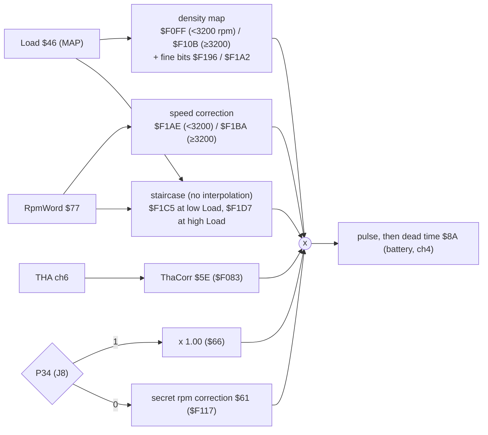

# MR2 89661-17140: sensor channels and maps (first pass)

**Builds on:** [`architecture.md`](architecture.md).

**Names:** [`analysis/mr2_17140/symbols.yaml`](../../analysis/mr2_17140/symbols.yaml).

**Status:** P4 steps 2–3, first pass. The channel map and maps are read from the code paths and their consumers (LIKELY). Their units come from the simulator (section below). Load in kPa and absolute advance still rest on GUESS anchors that the bench or the serial link ([`serial_link.md`](serial_link.md)) will settle.

## Sensor channels (ADC on input capture 1, channel on PORT1 bits 2–4)

The ECU times each conversion: ICR1 − the start stamp `$90`. It then subtracts the channel-0 zero reading and scales the result by the channel-7 reference. Each channel has its own consumer [ROM:$FC32-$FE35].

| Ch | Signal | Result | Evidence | Confidence |
|---|---|---|---|---|
| 0 | zero reference | `$50` AdcZero | stored raw and subtracted from every other channel [ROM:$FC45-$FC4A] | LIKELY |
| 1 | **MAP (PIM)** | `$4A` MapRaw (8-bit), `$46` Load (16-bit, filtered) | feeds the ignition-map row and the density maps; the immediate value `#$4D` is used on a fault [ROM:$FD70-$FD92] | LIKELY |
| 2 | **Throttle (VTA)** | `$44` TpsOpen, `$45` TpsZero | learned closed position; a fast opening triggers an extra asynchronous injection [ROM:$FCCA-$FD51] | LIKELY |
| 3 | **Mixture adjust (VAF / CO resistor)** | `$8C` Mixture | range-checked (<$30 / >$D0 tables); `$80` on a fault; used as reading − `$80` | LIKELY (Ross R-M01) |
| 4 | **Battery (+B)** | `$8A` InjDeadTime | table `$F0A4` → injector dead time added in SchedInj [ROM:$FE14-$FE1E, $FFD0] | LIKELY |
| 5 | **Coolant (THW)** | `$53` Coolant; also `$4D` via table `$F090` | latched on an NE event; `$1E` on a fault [ROM:$FE1F-$FE33] | LIKELY |
| 6 | **Intake air (THA)** | `$5F` Tha, `$5E` ThaCorr | table `$F083` → fuel correction; `$79` on a fault [ROM:$FE0A-$FE12] | LIKELY |
| 7 | reference | `$55` AdcRef | table `$F044`; every other channel is multiplied by (`$55` + 410) [ROM:$FC4D-$FC64] | LIKELY |

There is no O2 channel. A UK 1985–89 MR2 runs open loop, which fits.

## Engine speed

**`$77` RpmWord = rpm × 0.32** (LIKELY). The evidence:
- It is the reciprocal of the NE period sum [ROM:$F41F-$F44C].
- With that scale, the rpm sites of both staircase tables come out at round numbers (600, 650, 950, 1100, 1150; 3500, 4500, 5100, 5700, 6100, 6500).
- `$0400` = 3200 rpm, the split between the two density and speed maps that Ross describes (R-F06).
- The Bluetop uses the same 0.32 scale (`FullRPM`).

## Ignition: two base maps, chosen by P34 (jumper J8)

`IgnMapSelect` [ROM:$FDCF-$FDD5]:
- **PORT3 bit 4 = 1** → map **A** `$F1EF` (13 × 8).
- **PORT3 bit 4 = 0** → map **B** `$F25D` (13 × 7).

That bit is **P34**, which the factory jumper **J8** ties to node N (BENCH 2026-10-09).

**This is Ross's secret mode mechanism** (R-I15, R-F12): one logic level swaps the whole ignition base map and also switches the fuel chain's rpm correction (below). Calling map B the *secret* one assumes the stock P34 level is 1; Q10 settles that.

**Which map runs in your car depends on what P34 reads, i.e. on node N (open question Q10).**

**Lookup:**
- columns are RpmWord × 2 − `$0200` → **800 to 5600 rpm, every 400 rpm**;
- rows are Load × 4 − `$04A4` (map A) or `$05A4` (map B), one row per 256;
- interpolated in both directions [ROM:$F16A-$F1A0] (the `Lookup2D` helper).

The result `$A8` then gets a **trim from PORT4 bits 2–3** (table `$F01A`):

| PORT4 bits 2–3 | Trim (raw) |
|---|---|
| 00 | +9 |
| 01 | −17 |
| 10 | −9 |
| 11 | 0 |

That looks like an octane/fuel-grade selection, probably on the untested jumpers or a connector pin (GUESS) [ROM:$FDE4-$FDFD].

Rows run from light load (row 0) to heavy load. Values are raw. **Larger means more advance** (CONFIRMED in code: the spark delay is `$05AA` − the sum [ROM:$F81B-$F824]). **Degrees per count are not yet known.**

**Other ignition paths** (the base value `$A8` is not always the map):
- With `ModeFlags` bit 7 set, the base comes from a 1-D rpm table `$F0FA` instead of the maps [ROM:$FD96-$FDA3].
- With PORT3 bit 0 set, the spark sum is a fixed `$00AA`, probably the fixed timing for the test terminal (GUESS) [ROM:$F7F6-$F7FF].
- +13 is added when `$72` bit 7 is set [ROM:$FDDA].
- `SvcIgnition` sums `$A8` + `$A9` + `$AA` + `$AB`, with `$AB` a copy of `$A8`, so **the map value counts twice** in the advance. This matters when calibrating degrees per count [ROM:$F7F0, $F806].

**Map A `$F1EF`** (P34 = 1)

| Load row \ rpm | 800 | 1200 | 1600 | 2000 | 2400 | 2800 | 3200 | 3600 | 4000 | 4400 | 4800 | 5200 | 5600 |
|---|---|---|---|---|---|---|---|---|---|---|---|---|---|
| 0 | 192 | 201 | 205 | 209 | 211 | 213 | 213 | 213 | 213 | 209 | 207 | 207 | 207 |
| 1 | 136 | 145 | 171 | 166 | 177 | 198 | 207 | 203 | 194 | 198 | 209 | 203 | 209 |
| 2 | 107 | 132 | 137 | 141 | 164 | 166 | 173 | 166 | 169 | 169 | 183 | 188 | 188 |
| 3 | 86 | 120 | 129 | 130 | 152 | 158 | 162 | 162 | 156 | 160 | 171 | 173 | 169 |
| 4 | 73 | 96 | 108 | 112 | 135 | 136 | 141 | 151 | 149 | 157 | 166 | 165 | 160 |
| 5 | 30 | 58 | 83 | 96 | 115 | 130 | 120 | 112 | 104 | 116 | 142 | 140 | 129 |
| 6 | 17 | 58 | 74 | 78 | 100 | 114 | 96 | 102 | 92 | 102 | 112 | 134 | 122 |
| 7 | 24 | 50 | 55 | 64 | 77 | 80 | 73 | 75 | 69 | 81 | 89 | 102 | 111 |

**Map B `$F25D`** (P34 = 0; 7 load rows, starting one row-step higher)

| Load row \ rpm | 800 | 1200 | 1600 | 2000 | 2400 | 2800 | 3200 | 3600 | 4000 | 4400 | 4800 | 5200 | 5600 |
|---|---|---|---|---|---|---|---|---|---|---|---|---|---|
| 0 | 132 | 166 | 194 | 183 | 186 | 188 | 188 | 190 | 192 | 197 | 203 | 203 | 203 |
| 1 | 139 | 147 | 154 | 173 | 175 | 177 | 177 | 178 | 179 | 182 | 186 | 186 | 186 |
| 2 | 90 | 119 | 129 | 137 | 151 | 151 | 151 | 153 | 153 | 159 | 162 | 162 | 162 |
| 3 | 43 | 57 | 76 | 89 | 136 | 145 | 133 | 133 | 128 | 134 | 142 | 143 | 151 |
| 4 | 33 | 56 | 53 | 73 | 106 | 119 | 109 | 104 | 98 | 106 | 128 | 141 | 143 |
| 5 | 17 | 38 | 55 | 70 | 78 | 88 | 81 | 87 | 89 | 98 | 121 | 137 | 142 |
| 6 | 8 | 17 | 40 | 49 | 58 | 63 | 68 | 81 | 79 | 85 | 108 | 132 | 142 |

## Fuel: speed-density chain

**Correction factors:** (value + 410) / 512, so **102 (`$66`) = × 1.00**. This is the `$FB28` multiply [ROM:$FB28-$FB2F].

**Also in `FuelPulse` (`$FA03`), not shown in the diagram:**
- the staircase factor is lag-filtered in `$B8`;
- the mid-load band (Load `$0199`–`$02B8`) uses a fixed ×1.00;
- an `InjFlags` factor [ROM:$FAA5];
- a factor passed in by the caller [ROM:$FACD];
- the mixture term [ROM:$FAEE-$FB0F];
- a 600-count minimum on the pulse.

| Table | What | Ross | Confidence |
|---|---|---|---|
| `$F0FF` / `$F10B` | density map (base fuel vs MAP), 9 sites, below / from 3200 rpm | R-F03, R-F06 | LIKELY |
| `$F196` / `$F1A2` | added at 1/32 of a base count (base >> 3, this >> 8): a fine-resolution extension of the density map | — | GUESS |
| `$F1AE` / `$F1BA` | speed (rpm) correction below / from 3200 rpm; `$F1BA` has 11 sites, 3200–7200 rpm (it ends at `$F1C7`) | R-F06–R-F08 | LIKELY |
| `$F1C8` (walk based at `$F1C5`) | staircase at low Load: sites 600–1150 rpm (idle/decel range) | — | LIKELY |
| `$F1DA` (walk based at `$F1D7`) | **hard-driving staircase** at high Load: 3500/4500/5100/5700/6100/6500 rpm, factors 90/81/101/85/109/77, then 92 above 6500 (−2 % to −5 % mostly) | R-F09, R-F10 (staircase confirmed; sites differ from Ross's 17030) | LIKELY. **Used only above Load `$2B8`, about 120 kPa on the current scale, so never in the simulator.** See below |
| `$F117` | **secret rpm correction**, used only with P34 = 0: 3 sites, 1200/2000/2800 rpm → ×1.00/1.025/1.05 | R-F12 | LIKELY |
| `$F083` | THA correction | R-F11 | LIKELY |

## Units from the simulator (P4 step 3)

The 17140 ROM runs in the whole-ROM simulator with its own I/O model, [`analysis/emu/engine17140.py`](../../analysis/emu/engine17140.py). It boots, syncs to NE/G, converts all 8 ADC channels, sparks twice and injects once per revolution [EMU:tests/test_sim17140.py].

| Quantity | Unit | How sure |
|---|---|---|
| RpmWord `$77` | rpm × 0.32, within 2 counts from 1200 to 5200 rpm | CONFIRMED [EMU], given 30° per NE edge (LIKELY: the 4A-GE's 24-tooth NE rotor) |
| Ignition map value | **15/64° per count** (0.234°). The map counts twice in a sum read at 15/128° per count. Identical at 1200, 2000, 3600 and 5200 rpm | CONFIRMED [EMU] |
| Absolute advance | BTDC = 10 + (2 v + 85 − 170) × 15/128 ≈ **v × 15/64** when warm (coolant term `$A9` = 85, no trims) | The factory figure is LIKELY: base timing is set to **10° BTDC with T–E1 shorted** (repair manual). The GUESS is the ROM link: that shorting T selects the fixed-sum path (`$00AA`). That path also needs `ModeFlags` bit 7 set and `DiagFlags` bit 7 clear, and it is taken when PORT3 bit 0 reads **0** [ROM:$F7F4-$F7FF], so the pin polarity is open; the simulator does not yet reproduce it. Check: timing-light readings with T **open** at idle and at a steady 2500–3000 rpm, against the predicted values |
| Load `$46` | ≈ 4.98 × kPa + 98.6, linear | LIKELY: rests on the EWD PIM curve and **ADC channel 7 being the 5 V supply (GUESS)** |
| Map rows | map A: 40 kPa + 12.85 kPa per row (40–130); map B: 53–130 kPa | as Load |
| Injector pulse | InjPulse `$88` µs + dead time `$8A` µs, on Tout1 (P2-1) active low, one per revolution | CONFIRMED [EMU] |
| Cold advance | `$A9` = 85 from coolant reading 12 to 82, 117 at 124 (a cold sensor), so about +3.8° cold | LIKELY [EMU] |

**Doubt about the kPa scale.** The high-load staircase `$F1DA` only applies above Load `$2B8`. On the current scale that is about 120 kPa, which a naturally aspirated engine cannot reach. The top one or two rows of both ignition maps are out of reach for the same reason. A factory calibration with unreachable tables is unlikely, so the scale is probably **about 20–25 % low**, most likely because ADC channel 7 is not the 5 V supply. Logged as a conflict in STATUS. Two ways to settle it:
- read Load over the serial link with the key on and the engine off (barometric pressure, about 100 kPa);
- measure what channel 7 carries.

Until then, the kPa labels in [`ignition_maps.md`](ignition_maps.md) may be stretched. The degree values are not affected.

**Readable maps in degrees over kPa and rpm:** [`ignition_maps.md`](ignition_maps.md), generated by `pcmre.readable17140`.

## What this means for the goals

- **Secret maps (goal 2):**
  - The selector is P34 / jumper J8.
  - The alternative ignition map and the rpm fuel correction are located: `$F25D` and `$F117`.
  - **The next owner step is Q10:** a powered measurement of node N, to learn which map the car runs stock.
- **Tuning (goal 3):** the ignition maps, density maps, speed maps and staircases are now addressable, ready for a definition file and TunerPro XDF once the units are calibrated.

## Next

1. Read the live variables through the serial link ([`serial_link.md`](serial_link.md)): Load at key-on (kPa scale), PORT3 (which map the car runs), and the channel readings against known inputs.
2. Settle the two GUESS anchors on the bench and in the car: what ADC channel 7 measures, and timing-light readings with T open (idle, steady 2500–3000 rpm). With T shorted a correctly set car always reads 10°, so that reading only checks the distributor setting.
3. Write `analysis/defs/mr2_17140.yaml` (replacing the auto-ported Bluetop file) and generate the XDF and readable tables.
