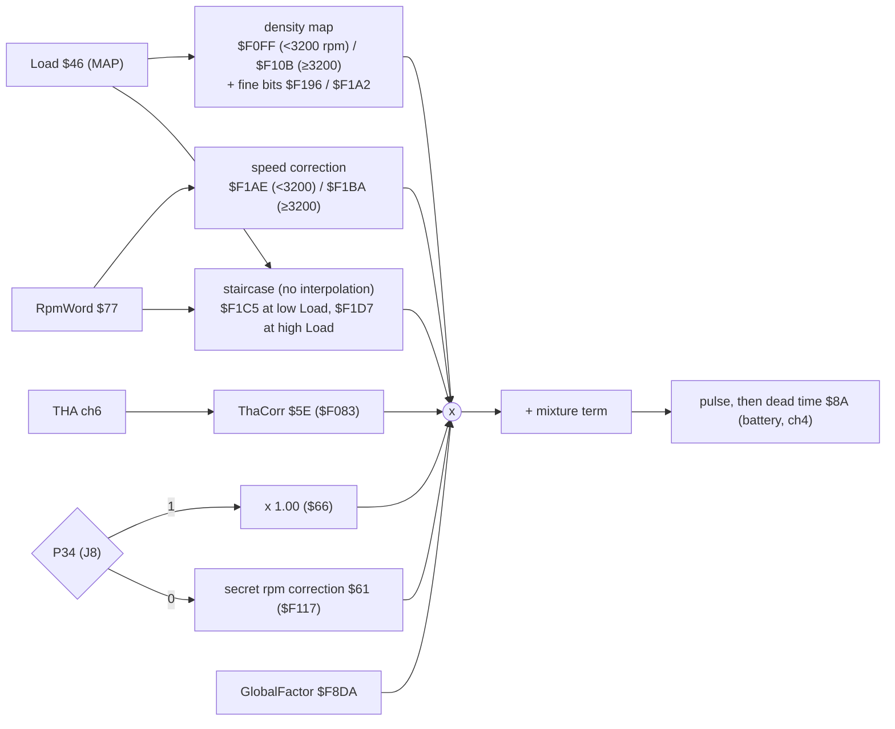

# MR2 17140: sensor channels and maps

## Summary

| Item | Result | Confidence |
|---|---|---|
| ADC channels | 0 zero, 1 MAP, 2 throttle, 3 mixture screw, 4 battery, 5 coolant, 6 intake air, 7 reference. No O2 channel | LIKELY |
| Engine speed | `RpmWord` `$77` = rpm × 0.32 | CONFIRMED [EMU] |
| Ignition | Two base maps, 13 rpm columns (800–5600 rpm), selected by P34 (jumper J8): map A `$F1EF` (8 rows) and map B `$F25D` (7 rows). 15/64° per count | CONFIRMED [EMU] (scale); LIKELY (absolute degrees) |
| Fuel | Speed-density: density map × speed correction × staircase × THA correction × global factor, then the mixture term and the dead time | LIKELY |
| Load scale | Load `$46` ≈ 6.14 × kPa + 123. The simulator default is 4.98 × kPa + 98.6 | LIKELY |

The names come from the [symbols file](../../roms/mr2_17140/symbols.yaml). The code structure is in [program](program.md). The ignition maps in degrees are in [ignition maps](ignition_maps.md), generated by `uv run pcmre readable17140 --write`. The [defs file](../../roms/mr2_17140/defs.yaml) has no maps yet.

## Sensor channels

The ADC is on input capture 1. PORT1 bits 2–4 select the channel. The ECU times each conversion: ICR1 − the start time `$90`. It then subtracts the channel-0 zero reading and scales the result by the channel-7 reference. Each channel has its own consumer [ROM:$FC32-$FE35].

| Ch | Signal | Result | Evidence | Confidence |
|---|---|---|---|---|
| 0 | zero reference | `$50` AdcZero | stored raw and subtracted from all other channels [ROM:$FC45-$FC4A] | LIKELY |
| 1 | **MAP (PIM)** | `$4A` MapRaw (8-bit), `$46` Load (16-bit, filtered) | the ignition-map row and the density maps use it. The ROM uses the immediate value `#$4D` on a fault [ROM:$FD70-$FD92] | LIKELY |
| 2 | **Throttle (VTA)** | `$44` TpsOpen, `$45` TpsZero | learned closed position. A fast opening gives one more asynchronous injection [ROM:$FCCA-$FD51] | LIKELY |
| 3 | **Mixture screw (CO resistor)** | `$8C` Mixture | range check (tables for < `$30` / > `$D0`). `$80` on a fault. Used as reading − `$80` | LIKELY (Ross R-M01) |
| 4 | **Battery (+B)** | `$8A` InjDeadTime | table `$F0A4` → injector dead time, added in SchedInj [ROM:$FE14-$FE1E, $FFD0] | LIKELY |
| 5 | **Coolant (THW)** | `$53` Coolant; also `$4D` through table `$F090` | latched on an NE event. `$1E` on a fault [ROM:$FE1F-$FE33] | LIKELY |
| 6 | **Intake air (THA)** | `$5F` Tha, `$5E` ThaCorr | table `$F083` → fuel correction. `$79` on a fault [ROM:$FE0A-$FE12] | LIKELY |
| 7 | reference | `$55` AdcRef | table `$F044`. The ROM multiplies all other channels by (`$55` + 410) [ROM:$FC4D-$FC64] | LIKELY |

- **The readings are ratiometric.** (AdcRef + 410) × the ch7 time is constant to 0.1 %. Thus each reading is 153.7 × V / V_ch7 [EMU:tests/mr2/test_ross17140.py::test_adc_reference_table_is_ratiometric].
- There is no O2 channel. A UK 1985–89 MR2 has no closed loop, so this agrees.

Mixture screw channel (ch3)

- The 8-bit value `Mixture` is a remap of the reading through tables `$F0B9`/`$F0AB`/`$F0B1`. It is gentle in the middle (readings 48–207 → 103–153, 128 at mid travel) and steep near the ends. The ROM averages it with the previous value [ROM:$FC6D-$FC96, $FAF3-$FAF9] [EMU:tests/mr2/test_ross17140.py::test_mixture_tables] CONFIRMED.
- A reading below 10 or from 248 (of 0–255, approximately 4 % of the travel at each end) sets `Mixture` = `$80`: zero correction [ROM:$FC6D-$FC76, $F00D-$F00E] [EMU:tests/mr2/test_ross17140.py::test_mixture_screw_end_stops_read_as_zero_correction] CONFIRMED.

## Engine speed

**`$77` RpmWord = rpm × 0.32.** The simulator agrees within 2 counts from 1200 to 5200 rpm [EMU:tests/mr2/test_sim17140.py::test_rpmword_is_rpm_times_0_32] CONFIRMED. This uses 30° per NE edge (LIKELY: the 24-tooth NE rotor of the 4A-GE). Other evidence:
- It is the reciprocal of the NE period sum [ROM:$F41F-$F44C].
- With this scale, the rpm sites of the two staircase tables are round numbers (600, 650, 950, 1100, 1150; 3500, 4500, 5100, 5700, 6100, 6500).
- `$0400` = 3200 rpm, the split between the two density maps and the two speed maps that Ross gives (R-F06).
- The Bluetop uses the same 0.32 scale (`FullRPM`).

`RpmIndex` `$73` is a byte: rpm / 25 (for example `$F0` = 6000 rpm). It saturates at 255 (approximately 6375 rpm). RpmWord saturates at 2344 (approximately 7325 rpm) [EMU].

## Load scale

`Load` `$46` is a 16-bit MAP value. Two scales are possible:

| Scale | Load | Evidence | Confidence |
|---|---|---|---|
| **256 counts per 5 V** | Load ≈ **6.14 × kPa + 123** | 101.3 kPa reads Load 745: the top row of the two ignition maps and the top density site. The mixture screw reads 128 (zero correction) at mid travel, and the two end-stop checks (10 and 248) are reachable. The high-load staircase starts at 93 kPa [EMU:tests/mr2/test_ross17140.py::test_load_tables_top_out_at_one_atmosphere_on_a_256_per_5v_scale] | **LIKELY** |
| Simulator default | Load ≈ 4.98 × kPa + 98.6 | The factory PIM curve ([`data/sensors/pim_map.csv`](../../data/sensors/pim_map.csv)) and the converter constant `adc_k` of the simulator (GUESS). AdcRef is at the end of table `$F044` for all `ref_v` above approximately 3.7 V, so this scale does not depend on ch7 = 5 V | GUESS |

On the simulator default scale:
- the high-load staircase `$F1DA` starts at Load `$2B8`, approximately 120 kPa;
- the top one or two rows of the two ignition maps need more than 100 kPa;
- a 5 V input on the mixture channel reads only approximately 207.

A naturally aspirated engine cannot get these pressures. A factory calibration with tables that the engine cannot reach is not probable. Thus the default scale is possibly approximately 20 % low. The alternative explanation is a table layout that the supercharged 4A-GZE also uses.

The degree values do not depend on the kPa scale. The [ignition maps](ignition_maps.md) page shows the rows on both scales. To get the scale, read Load over the [serial link](serial_link.md) at key-on with the engine off. At sea level, expect approximately 745 on the LIKELY scale and 603 on the default scale.

## Ignition

### Base maps A and B

`IgnMapSelect` [ROM:$FDC9-$FDD5]:
- **PORT3 bit 4 = 1** → map **A** `$F1EF` (13 × 8).
- **PORT3 bit 4 = 0** → map **B** `$F25D` (13 × 7).

That bit is **P34**. The factory jumper **J8** connects P34 to node N ([hardware](hardware.md#option-jumpers)) [BENCH]. This is the "secret map" mechanism of Ross (R-I15, R-F12). One logic level changes the full ignition base map and also the rpm fuel correction `$F117`. Map B is the secret map only if the stock P34 level is 1. The level of node N is not known, so the map that the car uses is not known.

**Axes and scaling** [ROM:$F16A-$F1A0] (`Lookup2D`, interpolated in the two directions):

| Item | Raw | Physical |
|---|---|---|
| Columns | RpmWord × 2 − `$0200`, one column per 256 | **800 to 5600 rpm, each 400 rpm** (column c = 800 + 400 × c rpm) |
| Rows, map A | Load × 4 − `$04A4`, one row per 256 | Load = 297 + 64 × row. LIKELY scale: **28–101 kPa, 10.4 kPa per row**. Simulator default: 40–130 kPa |
| Rows, map B | Load × 4 − `$05A4` | Load = 361 + 64 × row. LIKELY scale: **39–101 kPa**. Simulator default: 53–130 kPa |
| Cell value | v (raw byte) | **v × 15/64° BTDC** (0.234° per count), warm engine, no trims (LIKELY absolute; the scale is CONFIRMED [EMU]) |

Row 0 is light load. **A larger value gives more advance** (CONFIRMED in the code: the spark delay is `$05AA` − the sum [ROM:$F81B-$F824]).

**Derivation of the degree scale.** The simulator measures 15/64° per map count at 1200, 2000, 3600 and 5200 rpm [EMU:tests/mr2/test_sim17140.py::test_spark_moves_15_64_degree_per_map_count]. This uses E = 1 MHz and 30° per NE edge (both LIKELY). `SvcIgnition` adds `$A8` + `$A9` + `$AA` + `$AB`, and `$AB` is a copy of `$A8`. Thus the map value counts two times in a sum that has 15/128° per count [ROM:$F7F0, $F806].

**Derivation of the absolute degrees** (LIKELY). With the throttle closed and T shorted, the ROM uses the fixed sum 170 (`$00AA`). The factory sets this condition to 10° BTDC (1988 repair manual). Thus advance ≈ 10° + (sum − 170) × 15/128°. Off idle, warm and with no trims, the sum is 2 × map + 85. Thus a map cell is almost its own advance: v × 15/64° BTDC (+0.04°) [EMU:tests/mr2/test_ross17140.py::test_t_terminal_fixed_sum_only_with_the_throttle_closed]. Light-load cells reach 50°. The largest value of map A, 213, is 49.9° BTDC. This agrees with the approximately 50° of Ross (p16).

Map A `$F1EF` (P34 = 1), raw values

| Load row \ rpm | 800 | 1200 | 1600 | 2000 | 2400 | 2800 | 3200 | 3600 | 4000 | 4400 | 4800 | 5200 | 5600 |
|---|---|---|---|---|---|---|---|---|---|---|---|---|---|
| 0 | 192 | 201 | 205 | 209 | 211 | 213 | 213 | 213 | 213 | 209 | 207 | 207 | 207 |
| 1 | 136 | 145 | 171 | 166 | 177 | 198 | 207 | 203 | 194 | 198 | 209 | 203 | 209 |
| 2 | 107 | 132 | 137 | 141 | 164 | 166 | 173 | 166 | 169 | 169 | 183 | 188 | 188 |
| 3 | 86 | 120 | 129 | 130 | 152 | 158 | 162 | 162 | 156 | 160 | 171 | 173 | 169 |
| 4 | 73 | 96 | 108 | 112 | 135 | 136 | 141 | 151 | 149 | 157 | 166 | 165 | 160 |
| 5 | 30 | 58 | 83 | 96 | 115 | 130 | 120 | 112 | 104 | 116 | 142 | 140 | 129 |
| 6 | 17 | 58 | 74 | 78 | 100 | 114 | 96 | 102 | 92 | 102 | 112 | 134 | 122 |
| 7 | 24 | 50 | 55 | 64 | 77 | 80 | 73 | 75 | 69 | 81 | 89 | 102 | 111 |

Map B `$F25D` (P34 = 0), raw values

7 load rows. Row 0 is one row step higher than row 0 of map A.

| Load row \ rpm | 800 | 1200 | 1600 | 2000 | 2400 | 2800 | 3200 | 3600 | 4000 | 4400 | 4800 | 5200 | 5600 |
|---|---|---|---|---|---|---|---|---|---|---|---|---|---|
| 0 | 132 | 166 | 194 | 183 | 186 | 188 | 188 | 190 | 192 | 197 | 203 | 203 | 203 |
| 1 | 139 | 147 | 154 | 173 | 175 | 177 | 177 | 178 | 179 | 182 | 186 | 186 | 186 |
| 2 | 90 | 119 | 129 | 137 | 151 | 151 | 151 | 153 | 153 | 159 | 162 | 162 | 162 |
| 3 | 43 | 57 | 76 | 89 | 136 | 145 | 133 | 133 | 128 | 134 | 142 | 143 | 151 |
| 4 | 33 | 56 | 53 | 73 | 106 | 119 | 109 | 104 | 98 | 106 | 128 | 141 | 143 |
| 5 | 17 | 38 | 55 | 70 | 78 | 88 | 81 | 87 | 89 | 98 | 121 | 137 | 142 |
| 6 | 8 | 17 | 40 | 49 | 58 | 63 | 68 | 81 | 79 | 85 | 108 | 132 | 142 |

#### In tuning terms

Map A is the normal ignition map: rpm across, manifold pressure down, about 0.23° per count. Each cell is approximately its own advance in degrees BTDC when the engine is warm. Map B is a second complete map with less advance at mid load. The J8 jumper selects it. The maps stop at 5600 rpm: above that, the ROM holds the last column.

### Trims and other ignition terms

The map result `$A8` gets a **trim from PORT4 bits 2–3** (table `$F01A`) [ROM:$FDE4-$FDFD]. It is possibly an octane or fuel-grade selection, on jumpers or a connector pin (GUESS).

| PORT4 bits 2–3 | Trim (raw) | Degrees |
|---|---|---|
| 00 | +9 | +2.1° |
| 01 | −17 | −4.0° |
| 10 | −9 | −2.1° |
| 11 | 0 | 0° |

| Term | Function | Evidence |
|---|---|---|
| **Idle ignition table `$F0FA`** | With the throttle closed (`ModeFlags` bit 7: P16 low for approximately 150 ms, or cranking), the base comes from this table, not from the maps, with no trims: 68/98/162 at 1200/1600/2000 rpm, held outside that range. These are the values of Ross for the 17030 (R-I07) | [ROM:$FD96-$FDA4, $F4C9-$F51E] [EMU:tests/mr2/test_ross17140.py::test_idle_ignition_table_matches_ross] LIKELY (P16 = IDL) |
| **Fixed sum `$00AA`** | P30 = 0 (T shorted), `ModeFlags` bit 7 set and `DiagFlags` bit 7 clear. With the engine on, bit 7 means throttle closed. Thus this is the factory base-timing check (T–E1 shorted, idle, 10° BTDC). With the throttle open, T has no effect | [ROM:$F7F2-$F800] [EMU:tests/mr2/test_ross17140.py::test_t_terminal_fixed_sum_only_with_the_throttle_closed] LIKELY |
| **Coolant advance `$A9`** | From table `$F0EC`, coolant only: 85 warm (reading ≤ 99), up to 145 cold (reading ≥ 195), **+7.0°** maximum. Added to all spark sums | [ROM:$F60A-$F629, $F806] [EMU:tests/mr2/test_ross17140.py::test_warm_up_and_over_temperature_advance_tables] CONFIRMED |
| **Over-temperature retard** | With coolant hotter than reading `$1B` and MapRaw ≥ `$85` (not closed throttle), `$A9` comes from `$F0F2`: 85 → **17 (−8.0°)** at reading 14 and hotter. At light load it stays at 85 | [ROM:$F60A-$F629] [EMU:tests/mr2/test_ross17140.py::test_over_temperature_retard_only_at_high_load] CONFIRMED |
| **Idle stability `$AA`** | With the throttle closed, table `$F0F6` of (slow rpm filter `$B2` − fast `$75`): 0 → **68 counts (8.0° maximum)** over a 16-count (50 rpm) decrease. The change starts immediately. It decays with the 1/32 filter | [ROM:$F84D-$F884] [EMU:tests/mr2/test_ross17140.py::test_idle_stability_advance_on_an_rpm_dip] CONFIRMED |

The simulator shows the coolant term `$A9` = 85 from coolant reading 12 to 82, and 117 at reading 124 (a cold sensor): approximately +3.8° [EMU]. The coolant temperature in °C needs the THW characterisation.

A warm idle with T open (idle table 68, coolant term 85) is at **16.0° BTDC**, 5.98° more than with T shorted [EMU] LIKELY.

### T-VIS advance step

- **P41** (T-VIS VSV, LIKELY `STH`) comes on above RpmIndex `$BA` = **4650 rpm** and goes off at `$AA` = **4250 rpm**. These are the mk1b values of Ross [ROM:$FBA6-$FBB6] [EMU:tests/mr2/test_ross17140.py::test_tvis_and_6000_rpm_thresholds_in_code] CONFIRMED.
- When P41 comes on, `TvisTimer` `$72` counts down 50 ADC ticks. Then `IgnBase` gets **+13 counts (3.0°)**. The step comes **0.21 s** after P41 [ROM:$FBB8-$FBC6, $FDDA-$FDE2] [EMU:tests/mr2/test_ross17140.py::test_tvis_output_and_delayed_advance_step] CONFIRMED.

## Fuel: speed-density chain

**Base value.** The density lookup gives a 16-bit base in `$AE`: the 8-bit map value × 32, plus the fine table `$F196`/`$F1A2` at 1/256 [ROM:$FA43-$FAD0] CONFIRMED.

**Correction factors:** (value + 410) / 512. Thus **102 (`$66`) = × 1.00**. This is the `$FB28` multiply [ROM:$FB28-$FB2F] CONFIRMED.

**Injector pulse:** `InjPulse` `$88` µs + dead time `$8A` µs, on Tout1 (P21), active low, one pulse per revolution below 6000 rpm [EMU:tests/mr2/test_sim17140.py::test_two_sparks_and_one_injection_per_revolution] CONFIRMED. One output drives the two injector groups together: simultaneous injection [ROM:$FEE1-$FF11, $FFB7-$FFED] CONFIRMED.

**Other terms in `FuelPulse` (`$FA03`):**
- the staircase factor has a lag filter in `$B8`;
- the mid-load band (Load `$0199`–`$02B8`) uses a fixed × 1.00;
- an `InjFlags` factor [ROM:$FAA5];
- the global factor from the caller, in X [ROM:$FACD];
- the mixture term [ROM:$FAEE-$FB0F];
- a minimum pulse of 600 counts.

| Table | Function | Ross | Confidence |
|---|---|---|---|
| `$F0FF` / `$F10B` | Density map (base fuel against MAP), 9 sites, below / from 3200 rpm | R-F03 (17030: 11 sites), R-F06 | LIKELY |
| `$F196` / `$F1A2` | Added at 1/32 of a base count (base >> 3, this >> 8): a fine-resolution extension of the density map | — | GUESS |
| `$F1AE` / `$F1BA` | Speed (rpm) correction below / from 3200 rpm. `$F1BA` has 11 sites, 3200–7200 rpm each 400 rpm (it ends at `$F1C7`): −4.5, 0, +2.3, +0.4, +2.5, +4.1, +2.5, +2.5, +2.0, −1.4, −1.0 %. Zero at 3600 rpm [EMU:tests/mr2/test_ross17140.py::test_speed_correction_above_3200_differs_from_the_17030] | R-F06–R-F08 (17030: −10 % to +8 %, zero at 5200 rpm) | LIKELY |
| `$F1C8` (walk from `$F1C5`) | Staircase at low Load: sites 600–1150 rpm (idle and decel range) | — | LIKELY |
| `$F1DA` (walk from `$F1D7`) | **Hard-driving staircase** at high Load: 3500/4500/5100/5700/6100/6500 rpm, factors 90/81/101/85/109/77, then 92 above 6500 rpm (mostly −2 % to −5 %). No interpolation. Used only above Load `$2B8`: 93 kPa (LIKELY scale) or 120 kPa (default scale) [EMU:tests/mr2/test_ross17140.py::test_hard_driving_staircase_sites] | R-F09, R-F10 (the sites differ from the 17030) | LIKELY |
| `$F117` | **Secret rpm correction**, used only with P34 = 0: 3 sites, 1200/2000/2800 rpm → × 1.00 / 1.025 / 1.05 [EMU:tests/mr2/test_ross17140.py::test_p34_low_multiplies_fuel_by_the_secret_rpm_correction] | R-F12 | LIKELY |
| `$F083` | THA correction. More fuel with colder air. The values agree with Ross within 0.2 % [EMU:tests/mr2/test_ross17140.py::test_air_temperature_correction_matches_ross_values] | R-F11 | LIKELY |
| `$F0A4` | Battery voltage → injector dead time. The dead time increases as the voltage decreases [EMU:tests/mr2/test_ross17140.py::test_dead_time_rises_as_the_battery_voltage_falls] | — | LIKELY |

### Global factor

`GlobalFactor` `$F8DA` runs once per crank group, outside the fuel routine. It gives `FuelPulse` a factor in X (÷ 128) [ROM:$F8DA-$F9BF, $FACD-$FACE] [EMU:tests/mr2/test_ross17140.py::test_global_factor_drops_below_the_throttle_threshold] CONFIRMED:

factor = (load transient + `AccelFuel` `$5D` + `AfterStart` `$5C` + `RegionFuel` `$60`) × (1 + `WarmFuel` `$58` / 128), with a maximum of `FuelCap` `$56`.

- Coolant enters through `$58`, `$5C`, the transient gains `$51`/`$52` and the maximum. Rpm, load and throttle enter through `$60`.
- **Load transient:** Load against its lagged copy `$4B`, with gain `$51` against coolant. A change from 40 to 95 kPa at 2400 rpm gives more than 20 % extra fuel (the first pulses approximately +31 %). It decays in approximately 0.5 s [ROM:$F8DA-$F93C] [EMU:tests/mr2/test_ross17140.py::test_throttle_snap_gives_a_brief_enrichment] CONFIRMED.
- **Region 0 (high rpm, high load):** RpmIndex ≥ `$FC` = **6300 rpm** (held down to 6100 rpm). MapRaw ≥ `$8F` (73 kPa LIKELY / 95 kPa default scale). It sets `RegionFuel` to 42, or 50 with the throttle past `$3D`, from 36: **+8.5 % fuel** at wide throttle [ROM:$F550-$F566, $F0CA-$F0CD, $F0E2] [EMU:tests/mr2/test_ross17140.py::test_global_factor_steps_up_at_6300_rpm] CONFIRMED.

### Mixture screw term

- The pulse changes by (`Mixture` − 128) × MX2 / **32 µs**. This is Ross's ÷ 32000 in ms. It is added after all multipliers and before the dead time. Example: 104 µs for +26 counts at 1000 rpm [ROM:$FAEC-$FB0F] [EMU:tests/mr2/test_ross17140.py::test_mixture_screw_correction] CONFIRMED.
- **MX2 table `$F0BD`:** 128/113/96/81/64 at 1000/1800/2600/3400/4200 rpm (one site per 32 RpmIndex). The input is clamped at 3600 rpm. Thus MX2 = 128 up to 1000 rpm, 81 at 3400 rpm, 78 at 3500 rpm and 76 at 3600 rpm. The value 64 is never used [ROM:$F0BD-$F0C3, $FAEC-$FAF1] [EMU:tests/mr2/test_ross17140.py::test_mixture_tables] CONFIRMED. The bytes agree with Ross, but his rpm axis does not ([Ross claims](../ross/claims.md), R-M02).
- **Range:** the term applies only while RpmIndex ≤ `$90` (**3600 rpm**) and MapRaw ≤ `$9A` (80 kPa LIKELY / 104 kPa default scale). After a cut-out it comes back at `$88` (3400 rpm) and MapRaw `$96` [ROM:$FAD2-$FAEA, $F00F-$F012] CONFIRMED.

### Decel fuel cut

With the throttle closed (P16 low for approximately 150 ms), fuel is cut above `DecelCutRpm` + 16 RpmIndex counts. It comes back at `DecelCutRpm`, with a short ramp from 19 % [ROM:$F4C9-$F51E, $F675-$F686, $FEFB-$FEFF] [EMU:tests/mr2/test_ross17140.py::test_decel_fuel_cut_and_return] CONFIRMED.

| Condition | Cut above | Fuel back at |
|---|---|---|
| Warm, car stopped | 1800 rpm | 1400 rpm |
| Car moving (SPD count `$B4` > `$23`), or warm with fast rpm decrease (base 42) | 1450 rpm | 1050 rpm |
| Cold, car moving (table `$F0C4`, base 112) | 3200 rpm | 2800 rpm |
| Cold, car stopped | 3550 rpm | 3150 rpm |
| First 5 s after start | +16 counts (+400 rpm) | +16 counts |
| P37 high (A/C on) | minimum approximately 1900 rpm | minimum 1500 rpm |

The A/C-on values agree with the 1988 repair manual ([factory data](factory_data.md#specifications)).

#### In tuning terms

The fuel is a speed-density calculation. The density map gives the base fuel for the manifold pressure. The speed correction and the staircases shape it by rpm. Air temperature, warm-up and transients multiply it. A correction byte of 102 is × 1.00, and each count is approximately 0.2 %. The mixture screw adds or removes a fixed time in µs below 3600 rpm and 80 kPa. Above 6300 rpm at high load the ROM adds 8.5 %. The rpm limit is in [program](program.md#speed-limit).

## Open items

The kPa scale, the stock P34 level (which map the car uses), the measured absolute advance, and the coolant scale in °C are open ([open items](../project/open_items.md)).
