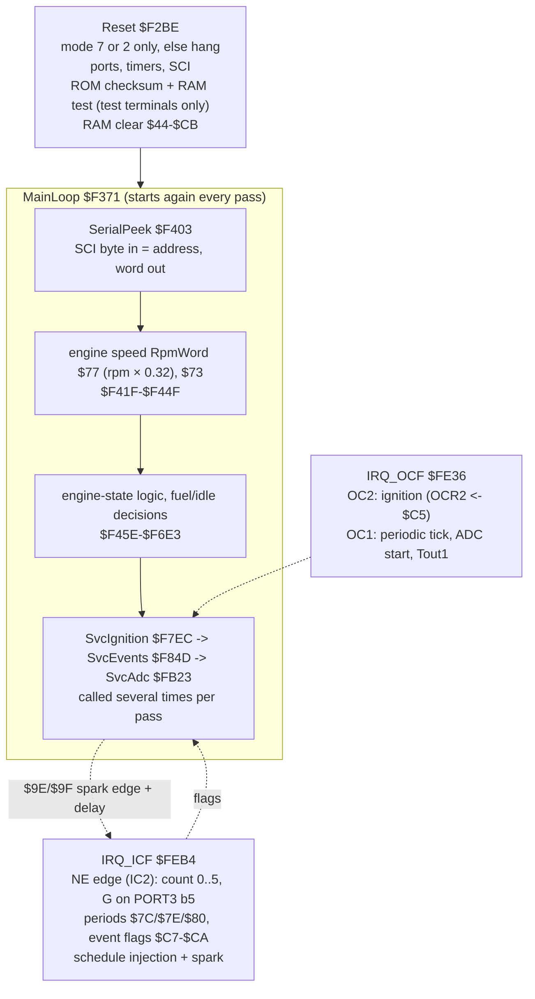
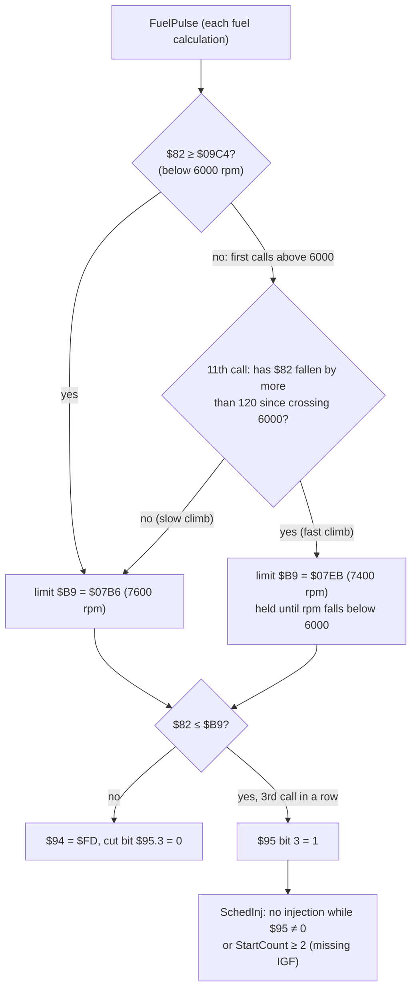

# MR2 17140: program structure

## Summary

The 17140 ROM is 4 KB at `$F000`–`$FFFF`: calibration tables at the start, code from `$F2BE`. The crank interrupt (NE on input capture 2) sets event flags, and the main loop does the fuel and ignition arithmetic. Ignition uses output compare 2, the injector uses output compare 1 on P21, and the ADC is timed by input capture 1. The SCI serves only a read-only RAM-peek link. The ROM has no hidden code: every code byte is reachable from the vectors.

| Item | Location |
|---|---|
| ROM | [`roms/mr2_17140/89661-17140.bin`](../../roms/mr2_17140/89661-17140.bin), SHA-256 `0cfc1fdd…6f271f6e` |
| Labelled source | [`roms/mr2_17140/mr2_17140.asm`](../../roms/mr2_17140/mr2_17140.asm), generated from the [symbols file](../../roms/mr2_17140/symbols.yaml). It assembles to the same bytes |
| Cross-references and call graph | [`roms/mr2_17140/xref.md`](../../roms/mr2_17140/xref.md) |

The names are working names from the symbols file. Each statement gives its evidence and a confidence level.

## Overall structure

The structure is the same as the Bluetop design ([AE86 architecture](../ae86/architecture.md)). But the code is a different program: only 4 % of the Bluetop instructions align with it.

## Memory map

| Area | Use | Evidence |
|---|---|---|
| `$00`–`$14` | HD6301V1 registers | handbook |
| `$18`, `$1B`, `$1D` | **second timer** (TCSR2, OCR2, ICR2): the NE input capture and the ignition output compare. The Bluetop listing uses the names TmrCntStat2 / OutCmp2 / InpCap2 for the same registers | [ROM:$FE36-$FE45, $FEB4-$FEC4] CONFIRMED (code) |
| `$40`–`$FF` | RAM. The self-test writes `$55AA`/`$AA55` over `$40`–`$FF`. Reset clears `$44`–`$CB`. The stack top is `$00FF` | [ROM:$F310-$F336, $F2CA] CONFIRMED (code) |
| `$40`–`$43` | Stored fault bits. They stay through a reset (value + complement, with a `$5A` signature). If the check fails, the ROM sets them again | [ROM:$F336-$F339, $F3CC-$F3E2, $F3F2-$F402] [EMU:tests/mr2/test_ross17140.py::test_fault_codes_survive_a_reset_and_nothing_is_learned] CONFIRMED |
| `$F000`–`$F2BD` | calibration tables and table descriptors | [ingest: 45 referenced blocks] LIKELY |
| `$F2BE`–`$FFED` | code | [xref: 1783 instructions, plus 94 in `$F01E`–`$F194` (lookup helpers and a range check in the table area)] |
| `$FFEE` | checksum balance word (`$523D`). The ROM word sum is `$AA55` | [ROM:$F2FE-$F30B] CONFIRMED |

The ROM keeps no learned values. The closed-throttle reading `$45` is learned again at each key-on [ROM:$F3CC-$F3E2] CONFIRMED.

## Ports

The table gives the port use in mode 7 (the car).

| Port | Use | Evidence | Confidence |
|---|---|---|---|
| PORT1 bits 2–4 | ADC channel select (8 channels) | [ROM:$FB5F-$FB96] | LIKELY |
| PORT1 bit 5 | Set when a channel is selected. Bits 5–7 are cleared at the OC1 tick that starts a conversion | [ROM:$FB8D-$FB96, $FE8B-$FE8F] | GUESS |
| PORT1 bit 6 (P16) | **IDL**. Low for more than 37 ADC ticks (approximately 150 ms) = throttle closed (`ModeFlags` bit 7: idle ignition table, decel fuel cut). With T shorted, P16 high **or P37 high** sets one fault bit: Toyota code 51, "IDL off or A/C on with T–E1 shorted" | [ROM:$F4C9-$F51E, $F769-$F797] [EMU:tests/mr2/test_ross17140.py::test_code_51_check_ors_idl_open_with_p37] | LIKELY |
| PORT1 bit 7 (P17) | Test or diagnostic input (`ldx PORT1 / bmi`), read before the self-test and the fault logic. While it is low, the P31 timer `$71` stays at 0 and the hot-start output on PORT2 bit 2 is permitted | [ROM:$F2FA, $F717, $F3A6-$F3AA, $F487] | GUESS (possibly STA) |
| PORT2 bit 3 (P23, SCI RX, pin 11) | Read once at reset: **low switches on the serial link** ([serial link](serial_link.md)) | [ROM:$F33B-$F343] | CONFIRMED (code) |
| PORT2 bit 1 (P21, Tout1) | Timer-1 output-compare pin, driven by OC1: the injector | [ROM:$FE9B-$FEB0] | LIKELY |
| PORT2 bit 2 | Low after a hot crank (coolant and intake air both hot), from approximately 0.18 s to 92 s. A fuel-pressure-up output (`FPU`) is the best fit | [ROM:$F478-$F49F, $F654-$F672] [EMU:tests/mr2/test_ross17140.py::test_hot_crank_p31_timer_and_port2_bit2, ::test_warmer_crank_keeps_port2_bit2_high] | GUESS |
| PORT2 bit 3 | Set and cleared by a fault-dependent timer compare (`$69` against `$A6`; `$A6` = 8 with a stored fault, 0 without). It is also the SCI RX pin | [ROM:$FC1C-$FC28] | LIKELY |
| PORT2 bit 4 (P24, pin 12) | Fault-code flasher. It is also the SCI TX pin | [ROM:$F769-$F7E9] | LIKELY |
| PORT3 bit 5 | G (cam reference): resets the NE edge count | [ROM:$FED2] | LIKELY |
| PORT3 bits 0, 3, 6, 7 | Switch inputs. See [Port 3 and Port 4](#port-3-and-port-4) | | |
| PORT4 bits 0–1 | Outputs from rpm compares | [ROM:$FB9E-$FBB6] | GUESS |
| PORT4 bits 2–3 | Inputs: select an advance trim from table `$F01A` | [ROM:$FDE6-$FDF8] | LIKELY |
| SCI | RAM-peek link only (not the ADC): 7812.5 baud, read-only, `$00`–`$FF`, off after approximately 1 s without a request ([serial link](serial_link.md)) | [ROM:$F403-$F41E, $F62E-$F641] [EMU:tests/mr2/test_peek17140.py] | CONFIRMED |

### Port 3 and Port 4

In expanded mode 2, Port 3 and Port 4 become the address and data bus. A design that keeps the factory CPU in mode 2 loses these pins. This audit shows what the ROM uses them for ([emulator design](../emulator/design.md)).

The direction registers are **DDR3 = `$02`** (only P31 is an output) and **DDR4 = `$03`** (P40 and P41 are outputs). The ROM writes them at reset and in each main-loop pass. P3CSR = `$02` (IS3 latch off) [ROM:$F2CD-$F2D1, $F37C-$F381].

| Pin | Use in the ROM | Evidence | Meaning |
|---|---|---|---|
| P30 | Input: fixed spark sum, flasher pattern, self-test, spark skip. All act on 0 | [ROM:$F2F0, $F771, $F7FA, $FF7C] | Test terminal T, active low, LIKELY |
| P31 | **Output.** On while P17 is low and for 20–21 s after P17 goes high (`$71` < `$15`: 21 one-second ticks, so the delay depends on where the change occurs between ticks). Also on during a decel fuel cut (`ModeFlags` bit 1) above the return rpm + 7 RpmIndex counts, with hysteresis (read back from its own pin) | [ROM:$F3A2-$F3CC] [EMU:tests/mr2/test_ross17140.py::test_hot_crank_p31_timer_and_port2_bit2] | Idle-up output (`VISC`) is the best fit, GUESS |
| P32 | Not used | [ROM: DDR3, all PORT3 reads] | — |
| P33 | Input: edges counted into `$B5` | [ROM:$FBD0-$FBE3] | Vehicle-speed sensor (`SPD`), GUESS |
| P34 | Input: map select and fuel correction | [ROM:$FAC2, $FDCC] | Jumper J8, CONFIRMED [BENCH] |
| P35 | Input: G | [ROM:$FEC8-$FED3] | G, LIKELY |
| P36 | Input: at reset only (self-test condition) | [ROM:$F2F0-$F2F6] | A test strap, GUESS |
| P37 | Input. When high: a floor of `$3C` (1500 rpm return, approximately 1900 rpm cut) under the decel fuel-cut rpm, the A/C-on values of the 1988 repair manual. With T shorted, ORed with P16 into the code-51 fault bit ("IDL off or A/C on") | [ROM:$F4EC-$F4F4, $F769-$F797] [EMU:tests/mr2/test_ross17140.py::test_decel_fuel_cut_and_return, ::test_code_51_check_ors_idl_open_with_p37] | A/C switch, high = A/C on, LIKELY |
| P40, P41 | **Outputs** from rpm compares. P41 is on above 4650 rpm and off below 4250 rpm | [ROM:$FB98-$FBB6] [EMU:tests/mr2/test_ross17140.py::test_tvis_and_6000_rpm_thresholds_in_code] | P41 = T-VIS VSV (`STH`), LIKELY; P40 not known, GUESS |
| P42, P43 | Inputs: advance trim | [ROM:$FDE7-$FDF8] | Trim jumpers, LIKELY |
| P44–P47 | Not used | [ROM: DDR4, all PORT4 reads] | — |
| IS3 (IGF) | P3CSR flag: the missing-IGF counter | [ROM:$FE57-$FE5A] | IGF, CONFIRMED (code) |

No ROM output behaves like a fuel-pump control. Thus the `FC` pin is possibly driven from NE or STA by board hardware outside the CPU (GUESS).

## Interrupts

**IRQ_ICF `$FEB4`: the crank (NE on input capture 2)**
- **Edge count:** counts NE edges 0–5 in `$97`. When the count goes back to 0, it reads G on PORT3 bit 5. With no G it starts again. A missing G with rpm present gives a 10 ms injection request (`$2710`) [ROM:$FEC7-$FEDF].
- **Periods:** on even counts, it stores half the time since the last counted edge in `$7C`/`$7E`/`$80`. Their sum (`NEperiodSum`) is the crank period that the main loop changes into speed [ROM:$FF24-$FF35, $F3E4].
- **Event flags** for the main loop [ROM:$FF37-$FF5E]. The main loop does the arithmetic, not the interrupt:
  - `$C8` on edge 1;
  - `$C9`/`$CA` on edge 2;
  - `$C7` when edge 3 or 2 agrees with a condition.
- **Injection:** on each 4th edge (`$97` = 4) it schedules a pulse of length `$88`. The pulse is doubled when `$B7` bit 0 is set (every other revolution, above 6000 rpm) [ROM:$FEE1-$FF11].
- **Spark:** on the edge `$9E` it sets OCR2 to the edge time + `$C3` + `$9C` and arms TCSR2 [ROM:$FF78-$FF94]. `$9E`/`$9F` come from `SvcIgnition`.

**IRQ_OCF `$FE36`**
- **OC2 (ignition):** loads OCR2 again from `$C5` and arms TCSR2 again [ROM:$FE36-$FE45].
- **OC1:** a periodic tick each 1 ms or 4 ms (`$92`).
  - At the 4 ms tick it clears PORT1 bits 5–7 and records the free-running counter in `$90`. This starts an ADC conversion, and input capture 1 ends it. `SvcAdc` reads ICR1 − `$90`.
  - It also controls the Tout1 (P21) level and the injector end time `$8D` that `SchedInj` `$FFB7` sets [ROM:$FE6F-$FEB3, $FFB7-$FFE0]. The injector is on P21 (LIKELY). The exact share of OC1 between the tick and the injector is not known.

## Main loop `$F371`

1. Set SP, the DDRs and RAMCR again in each pass. This gives watchdog-type recovery [ROM:$F371-$F383].
2. Answer a RAM-peek request if one is waiting (`SerialPeek`, [serial link](serial_link.md)).
3. **Speed:** NE period sum → reciprocal → `$77` (RpmWord, rpm × 0.32, [maps](maps.md#engine-speed)) → `$73` (RpmIndex). The ROM compares RpmIndex with its rpm thresholds (`#$64`, `#$C8`, `#$DC` …) [ROM:$F41F-$F44F].
4. Engine state and fuel decisions [ROM:$F45E-$F6E3]:
   - start and after-start (`$53`)
   - the fuel region `RegionState` `$62` (`MapRaw` `$4A` and `RpmIndex` against the limits at `$F0CA`–`$F0DB`)
   - the flags `$59`/`$5A`/`$99`
   - the PORT2 outputs.
5. Call `SvcIgnition` → `SvcEvents` → `SvcAdc` several times in each pass. Thus the crank events and the ADC conversions get fast service.

**`ModeFlags` `$99` bits** [ROM:$F4C9-$F51E] [EMU:tests/mr2/test_ross17140.py] CONFIRMED (code):

| Bit | Meaning |
|---|---|
| 7 | Throttle closed (P16 low for approximately 150 ms), or cranking |
| 6 | Closed-throttle idle |
| 1 | Decel fuel cut |
| 0 | Cranking |

## Helpers

| Address | Helper | Confidence |
|---|---|---|
| `$F11D`–`$F16A` | Table lookup family, with entry points at several offsets and X = table. The 1D and 2D interpolation that reads `$F044`–`$F25D` | LIKELY |
| `$F16A`–`$F1A0` | `Lookup2D`: the ignition-map lookup, interpolated in the two directions | LIKELY |
| `$F9D3`–`$F9E5` | Small arithmetic: shifts, saturation, filters (`$F9E5` goes through a RAM block at X) | GUESS |
| `$FB28` | Correction-factor multiply: × (v + 410) / 512 | CONFIRMED (code) |
| `$FB33` | 16 × 16 multiply, saturates at `$FFFF`, result in X | LIKELY |
| `$FFB7` | `SchedInj`: end of an injector pulse at FRC + D (+`$22`) | LIKELY |

## Differences from the Bluetop

- **ADC:** the Bluetop reads a serial ADC through the SCI. The 17140 times an analogue conversion with input capture 1 and selects the channel on PORT1 bits 2–4. The SCI serves only the RAM-peek link [ROM:$F403, $FB5F, $FC32] (LIKELY).
- **Self-test:** the ROM checksum and the RAM test run only when the PORT3 and PORT1 test inputs are set [ROM:$F2F2-$F2FB]. These inputs are possibly the test terminals of the check connector (LIKELY).
- **Mode check:** reset stops unless the CPU latched mode 7 or **mode 2**. Mode 2 is the expanded mode for external memory [ROM:$F2BE-$F2C8] (CONFIRMED, code).
- **Tables at the start of the ROM** (`$F000`–`$F2BD`), not at the end.

## Option behaviours

**No hidden code.** All paths from the vectors reach every code byte from `$F2BE` to `$FFED`, except `$F9D2` (`$3D`). That byte is padding between two helpers [xref; independent byte-coverage check] CONFIRMED. The ROM has no dead routines and no other programs. All the behaviours below are normal code that inputs select.

**P30 is possibly the test terminal T, active low** (LIKELY). The self-test, the flasher pattern and the fixed sum all act on P30 = 0.

| Behaviour | Selected by | Evidence |
|---|---|---|
| Serial link ([serial link](serial_link.md)) | P23 low at reset, then one request at least each second | [ROM:$F33B, $F403, $F62E] [EMU:tests/mr2/test_peek17140.py] CONFIRMED |
| Ignition map A or B, and the rpm fuel correction `$F117` | P34 (jumper J8) | [ROM:$FDC9-$FDD5, $FAC2] [EMU:tests/mr2/test_sim17140.py::test_p34_selects_the_map] CONFIRMED |
| Fixed spark sum `$00AA` | **P30 = 0**, with `ModeFlags` bit 7 set (throttle closed, or cranking) and `DiagFlags` bit 7 clear | [ROM:$F7F2-$F800] CONFIRMED (code). The closed-throttle base timing check (10° BTDC) is LIKELY [EMU:tests/mr2/test_ross17140.py::test_t_terminal_fixed_sum_only_with_the_throttle_closed] |
| Fault-code flasher pattern on pin 12 (P24) | P30 = 0 makes the pattern from the stored faults. P30 = 1 clears it and `DiagFlags` | [ROM:$F769-$F7E9] [EMU:tests/mr2/test_peek17140.py::test_pin_12_flashes_only_with_the_test_terminal_shorted] CONFIRMED (code) |
| No spark | P30 = 1 and `$A4` bit 7 (a current fault) | [ROM:$FF7C-$FF83] CONFIRMED (code); meaning GUESS |
| Advance trim +9 / −17 / −9 / 0 counts (+2.1° / −4.0° / −2.1° / 0°) | PORT4 bits 2–3 (jumpers or connector pins) | [ROM:$FDE4-$FDFD] code CONFIRMED, wiring GUESS |
| ROM checksum and RAM test at reset (then `DiagFlags` = `$AA`, bit 7 set) | P30 = 0, P36 = 1, P17 = 0 | [ROM:$F2F0-$F2FD, $F331] CONFIRMED (code) |
| Mode 2 (external memory) accepted, and mode 7 | mode pins | [ROM:$F2BE-$F2C8] CONFIRMED (code) |
| P32 (jumpers J4/J9) | No direct PORT3 read tests bit 2. 21 indexed reads have an unknown X | [xref] LIKELY not used |
| `$F000`–`$F002` = `3F 3F 3F` (SWI) | A jump to the start of the ROM by error goes to the reset vector | [ROM:$F000] LIKELY intent |

**Table bytes that the simulator never reads.** The simulator sweep covers rpm, pressure, the two P34 levels, coolant, throttle, air temperature, battery and mixture [EMU:sweep]. It never reads these bytes:
- the high-load staircase `$F1DA`–`$F1EE` ([maps](maps.md#load-scale));
- the top rows of the two ignition maps;
- part of the reference table `$F047`–`$F054`;
- `$F095`–`$F09D` (an event path that the sweep did not start);
- the high range of the mixture table `$F0B1`–`$F0B8`.

## Speed limit

**Code:** `FuelPulse` `$FA03`–`$FA3E` and `SchedInj` `$FFB7`. **Tests:** [`tests/mr2/test_rpm_limit17140.py`](../../tests/mr2/test_rpm_limit17140.py).

The ROM compares the crank period, not rpm. `$82` is the NE period sum (`NEperiodSum`, stored by the crank interrupt at edge 0). **rpm ≈ 15,000,000 / `$82`** [EMU: 2499 at 6000 rpm]. All rpm values here use E = 1 MHz (the 4 MHz crystal) and 30° of crank per NE edge (both LIKELY). The constants are CONFIRMED (code).

| Item | Detail | Evidence |
|---|---|---|
| **Limit** | **7600 rpm** (`$07B6` at `$FA1F`), or **7400 rpm** (`$07EB` at `$FA27`) after a fast climb through 6000 rpm | [ROM:$FA1E-$FA29] CONFIRMED (code); [EMU:tests/mr2/test_rpm_limit17140.py::test_fuel_cut_at_7600_with_no_hysteresis] |
| **Fast-climb rule** | At the 11th fuel calculation after 6000 rpm, the 7400 rpm limit applies if `$82` decreased by more than 120 (`#$78` at `$FA1A`) since 6000 rpm. In the simulator, 5000 rpm/s and more selects 7400 rpm, and 2000 rpm/s does not. This protects against an over-rev in a low gear | [ROM:$FA03-$FA27] CONFIRMED (code); [EMU:tests/mr2/test_rpm_limit17140.py::test_fast_climb_through_6000_lowers_the_limit_to_7400, ::test_slow_climb_through_6000_keeps_the_7600_limit] |
| **Delay** | 3 fuel calculations in sequence above the limit (`$94` counts `$FD`→`$FF`) | [ROM:$FA2B-$FA3E] CONFIRMED (code) |
| **Action** | **Fuel only.** `SchedInj` returns without a pulse while `$95` ≠ 0. The sparks continue | [ROM:$FFB7-$FFC1] CONFIRMED (code); [EMU] |
| **Recovery** | No hysteresis. Fuel comes back at the first calculation below the limit | [EMU:tests/mr2/test_rpm_limit17140.py::test_fuel_cut_at_7600_with_no_hysteresis] |
| **Missing IGF** | `SchedInj` also stops injection after **2** sparks in sequence with no IGF (`StartCount` ≥ 2). At 4, the ROM records the IGF fault when `$6B` bit 7 is set [ROM:$FE60]. The sparks continue | [ROM:$FE54-$FE6D, $FFB8-$FFC1] CONFIRMED (code); [EMU:tests/mr2/test_rpm_limit17140.py::test_missing_igf_stops_injection_but_not_the_spark] |

**Other speed limits in the code:**
- **`RpmWord` `$77` saturates at 2344 (approximately 7325 rpm)**, and `RpmIndex` `$73` at 255 (approximately 6375 rpm) [EMU]. A function that needs rpm above these values (for example a limiter or a launch control) must use `$82`, as the stock limiter does.
- **Above 6000 rpm** (RpmIndex above `$F0`; back below `$E0` = 5600 rpm), the injector fires **every other revolution with a doubled pulse** and one dead time. The fuel is the same, with half the events (Ross injection-mode claim) [ROM:$F454-$F460, $FEE1-$FF11] [EMU:tests/mr2/test_ross17140.py::test_double_pulse_every_other_revolution_above_6000_rpm]. The `$82` < `$09C4` (6000 rpm) test in `FuelPulse` only arms the fast-climb check.

### In tuning terms

The stock limiter is a soft, fuel-only cut at 7600 rpm (7400 rpm in a hard pull in a low gear). Fuel comes back as soon as rpm decreases below the limit. Above 5600 rpm, the last column of the ignition map, the timing is that column.

- The two limits are 2-byte constants in the code: `$FA1F` (slow climb) and `$FA27` (fast climb). The value is 15,000,000 / rpm.
- A changed ROM must keep the word sum `$AA55` (balance word `$FFEE`). Use `uv run pcmre checksum`.
- The [serial link](serial_link.md) can show `$95` (cut on), `$82` (true rpm) and `$B9` (the limit in use) live. It is read-only. It can log a limiter test, but it cannot change the limit.

## Open items

The function of P17, P36, P40 and PORT2 bit 2, and the pins that P31 and PORT2 bit 2 drive, are open ([open items](../project/open_items.md)).
