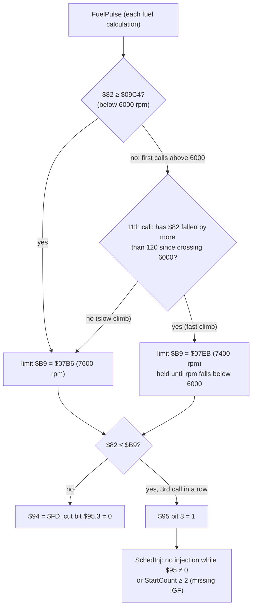

# MR2 89661-17140: rev limiter

**Code:** `FuelPulse` `$FA03`–`$FA3E` and `SchedInj` `$FFB7` in [`roms/mr2_17140/mr2_17140.asm`](../../roms/mr2_17140/mr2_17140.asm).

**Tests:** [`tests/test_rev_limiter17140.py`](../../tests/test_rev_limiter17140.py) [EMU].

## Mechanism

The ROM compares the crank period, not rpm. `$82` is the NE period sum (`NEperiodSum`, stored by the crank interrupt at edge 0), and **rpm ≈ 15,000,000 / `$82`** [EMU: 2499 at 6000 rpm]. All rpm figures here assume E = 1 MHz (the 4 MHz crystal) and 30° of crank per NE edge, both LIKELY; the constants themselves are CONFIRMED (code).

| Item | Detail | Evidence |
|---|---|---|
| **Limit** | **7600 rpm** (`$07B6` at `$FA1F`), or **7400 rpm** (`$07EB` at `$FA27`) after a fast climb through 6000 rpm | [ROM:$FA1E-$FA29] CONFIRMED (code); [EMU:test_fuel_cut_at_7600_with_no_hysteresis] |
| **Fast-climb rule** | On the 11th fuel calculation after passing 6000 rpm, the 7400 limit applies if `$82` has dropped by more than 120 (`#$78` at `$FA1A`) since the crossing. In the simulator, 5000 rpm/s and faster selects 7400 and 2000 rpm/s does not. This is a low-gear over-rev guard | [ROM:$FA03-$FA27] CONFIRMED (code); [EMU:test_fast_climb_through_6000_lowers_the_limit_to_7400] |
| **Delay** | 3 consecutive fuel calculations over the limit (`$94` counts `$FD`→`$FF`) | [ROM:$FA2B-$FA3E] CONFIRMED (code) |
| **Action** | **Fuel only**: `SchedInj` returns without scheduling a pulse while `$95` ≠ 0. Sparks continue | [ROM:$FFB7-$FFC1] CONFIRMED (code); [EMU] |
| **Recovery** | No hysteresis: fuel returns at the first calculation below the limit | [EMU:test_fuel_cut_at_7600_with_no_hysteresis] |
| **Missing IGF** | `SchedInj` also skips injection once **2** sparks in a row have no IGF echo (`StartCount` ≥ 2); at 4 the IGF fault is logged when `$6B` bit 7 is set [ROM:$FE60] | [ROM:$FE54-$FE6D, $FFB8-$FFC1] CONFIRMED (code); [EMU:test_missing_igf_stops_injection] |

**Other speed limits in the code:**
- **`RpmWord` `$77` saturates at 2344 (≈ 7325 rpm)**, and `RpmIndex` `$73` at 255 (≈ 6375 rpm) [EMU]. Anything that needs rpm above those (a limiter, a launch control) must use `$82`, as the stock limiter does.
- **Above 6000 rpm** (RpmIndex above `$F0`; back below `$E0` = 5600 rpm) injection switches to **every other revolution with a doubled pulse** and one dead time: the same fuel, half the events (Ross's injection-mode claim) [ROM:$F454-$F460, $FEE1-$FF11] [EMU:tests/test_ross17140.py::test_double_pulse_every_other_revolution_above_6000_rpm]. The `$82` < `$09C4` (6000 rpm) test in `FuelPulse` only arms the fast-climb check above.

## In tuning terms

The stock cut is a soft, fuel-only limiter at 7600 rpm (7400 in a hard low-gear pull) that re-fuels the instant rpm dips. Above 5600 rpm, the ignition map's last column, the timing is simply that column held.

**Where the limits are:**
- The two limits are 2-byte constants in code: `$FA1F` (slow climb) and `$FA27` (fast climb). The value is 15,000,000 / rpm. A changed ROM must keep the word sum `$AA55` (balance word `$FFEE`).
- **The serial link** ([`serial_link.md`](serial_link.md)) can watch `$95` (cut active), `$82` (true rpm) and `$B9` (which limit is armed) live. It is read-only, so it can log a limiter test but not change it.
