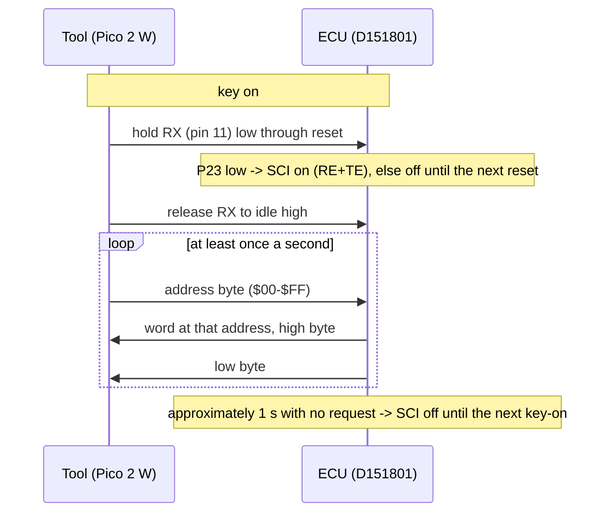
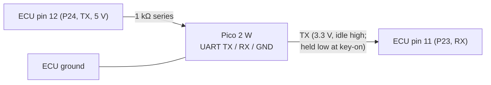
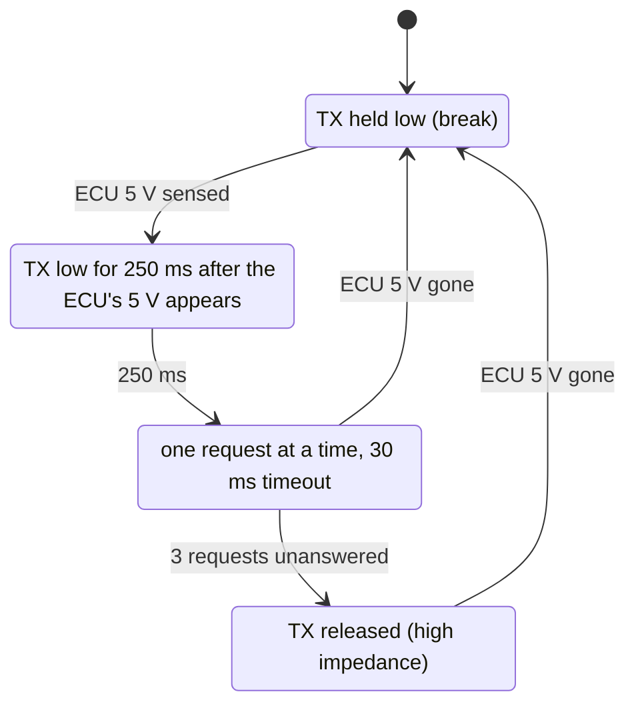

# MR2 17140: serial link

## Summary

The 17140 ROM has a factory **live-data link**: a 3-wire serial port. On request, it sends the RAM word at an address while the engine runs. It runs at 7812.5 baud, 8N1, on CPU pins 11 (RX) and 12 (TX). A tool switches it on with RX held low at reset. The link is read-only: it cannot change RAM, maps or code. A Pico 2 W logger firmware and a host decoder for the link are written and tested against the simulator.

| Item | Location |
|---|---|
| Code | `LinkEnable` `$F33B`, `SerialPeek` `$F403`, `LinkKeepAlive` `$F62E` in [`roms/mr2_17140/mr2_17140.asm`](../../roms/mr2_17140/mr2_17140.asm) |
| Simulator model | [`src/pcmre/emu/peek17140.py`](../../src/pcmre/emu/peek17140.py) |
| Tests | [`tests/mr2/test_peek17140.py`](../../tests/mr2/test_peek17140.py), [`tests/hardware/test_peek_logger.py`](../../tests/hardware/test_peek_logger.py) |
| Logger firmware | [`hardware/peek-logger/firmware/`](../../hardware/peek-logger/firmware/) (CI builds `peek_logger_pico2_w.uf2`) |

## Protocol

| Item | Value | Evidence |
|---|---|---|
| **Enable** | At reset, the ROM switches on the SCI only if **P23 (CPU pin 11, the SCI receive pin) reads low**. A tool holds its transmit line low (a break) through key-on, then releases it | [ROM:$F33B-$F343] CONFIRMED (code); [EMU:tests/mr2/test_peek17140.py::test_link_off_unless_p23_low_at_reset] |
| **Format** | RMCR = `$05`: NRZ, internal clock, E/128. With the 4 MHz crystal of the ECU (E = 1 MHz) this is **7812.5 baud, 8N1** | [ROM:$F2EB-$F2EF]; handbook RMCR table; crystal ([hardware](hardware.md#cpu-ic7)) LIKELY |
| **Pins** | P23 = RX (pin 11), P24 = TX (pin 12), and ground | handbook CONFIRMED; [EMU:tests/mr2/test_peek17140.py::test_link_on_with_rx_and_tx_only] |
| **Request** | One byte: the address | [ROM:$F403-$F40A] CONFIRMED (code) |
| **Reply** | Two bytes: the word at that address, **high byte first**. The ROM ignores a byte with an overrun or framing error | [ROM:$F40B-$F418] CONFIRMED (code); [EMU:tests/mr2/test_peek17140.py::test_reply_is_the_ram_word_high_byte_first] |
| **Address range** | **`$00`–`$FF` only.** The index register is always 0 when `SerialPeek` runs, so the byte is the full address. The registers and the RAM are readable. The ROM is not | [ROM:$F3D8-$F3E2, $F3F8-$F402] CONFIRMED (code) |
| **Writes** | **None.** The link cannot change anything in the ECU | CONFIRMED (code) |
| **Keep-alive** | Each reply sets `DiagFlags` (`$CC`) bit 0. Each time the counter `$6A` gets to `$FA` (approximately **1.0 s** in the simulator), the ROM clears the bit. If the bit was already clear, the ROM **switches the SCI off until the next reset** | [ROM:$F62E-$F641] CONFIRMED (code); [EMU:tests/mr2/test_peek17140.py::test_switches_off_after_a_second_without_requests, ::test_polling_twice_a_second_keeps_it_on] |
| **Rate** | One request per main-loop pass. The ECU waits for each reply. With the MC6801 timing of the CPU, the simulator gives approximately **100 words/s at 5000 rpm**, and more at lower rpm | [EMU:sim] LIKELY ([emulator validation](../emulator/validation.md)) |
| **Effect on the engine** | None. Requests at the maximum rate at 5000 rpm leave each spark time the same, and the injector pulses within 20 µs | [EMU:tests/mr2/test_peek17140.py::test_polling_flat_out_leaves_spark_and_injection_alone] |

Send the next request only after the reply. A second byte before the reply overruns the receiver, and the ROM ignores the two bytes. The keep-alive periods are fixed from reset. Thus the first request must arrive within approximately 1.03 s of reset. The link goes off 1–2 s after the last request.

## Readable variables

The ECU sends a word. For a byte variable at `addr`, request `addr` and use the high byte. The scalings come from [maps](maps.md), with the confidence given there.

| Address | Name | Reading |
|---|---|---|
| `$77` (word) | RpmWord | rpm = value / 0.32 (CONFIRMED [EMU]) |
| `$82` (word) | NEperiodSum | rpm ≈ 15,000,000 / value (the rpm limiter input, [program](program.md#speed-limit)) |
| `$46` (word) | Load | kPa ≈ (value − 123) / 6.14 (LIKELY, 256 counts per 5 V). The simulator default scale gives (value − 98.6) / 4.98. At sea level with the key on and the engine off, expect approximately 745 on the LIKELY scale and 603 on the default scale |
| `$4A` | MapRaw | 8-bit manifold pressure |
| `$44` / `$45` | TpsOpen / TpsZero | throttle above the learned closed position / the learned closed reading |
| `$53` | Coolant | raw coolant reading (no °C scale yet) |
| `$5F` / `$5E` | Tha / ThaCorr | intake air reading / its fuel correction |
| `$8C` | Mixture | mixture-screw (CO resistor) reading. `$80` = centre |
| `$88` (word) | InjPulse | injector pulse before the dead time, µs (CONFIRMED [EMU]) |
| `$8A` | InjDeadTime | battery-voltage dead time, µs |
| `$95`, `$B9` | rpm-limit flags, limit in use | `$95` ≠ 0: fuel cut on |
| `$A8`–`$AB` | ignition terms | spark sum × 15/128° per count (CONFIRMED [EMU]) |
| `$9E` / `$9F` | IgnEdge / IgnDelay | spark edge and delay |
| `$40`–`$43` | SelfTestMark / FaultBits2 | stored fault bits |
| `$99`, `$59`, `$5A` | ModeFlags, InjFlags, StateFlags | engine-state bits |
| `$02` | PORT1 / PORT2 | output pins (ADC select, injector, fault outputs); P16 (IDL) = bit 6 of the high byte |
| `$06` | PORT3 / PORT4 | **switch inputs**: P34 (J8 map select) = bit 4 of the high byte; P30 test terminal = bit 0 of the high byte; the PORT4 trim inputs = bits 2–3 of the low byte |

**Do not read** `$08`–`$1F`. A read of some of these registers is the first half of the sequence that clears a timer, serial or IS3 (IGF) flag.
- A read of `$0E`/`$0F` (P3CSR), then the ROM's own Port 3 read, can clear an IGF flag before the ignition interrupt counts it.
- Two missed IGF flags stop injection. Four can record the ignition fault (when `$6B` bit 7 is set) [ROM:$FE57-$FE6D, $FFB8] (handbook flag-clear rules) LIKELY.
- In the simulator the IGF flag stays only approximately 40 µs before the interrupt reads it. Thus the risk is small, but the real IGF timing decides it.

**Do not read** `$FF`. Its low byte comes from `$0100`, which is not memory in mode 7. Ports `$02`–`$07` and RAM `$40`–`$FE` are safe. The direction registers are write-only and read `$FF`.

## Uses

| Use | How |
|---|---|
| **Which ignition map the car uses** | Read `$06`. Bit 4 of the high byte is the level of P34 with the factory J8. It shows map A or B, and the fuel correction |
| **The kPa scale** | Read `$46` with the key on and the engine off. The manifold is then at barometric pressure (approximately 100 kPa at sea level). The reading gives the scale, and shows if the high-load staircase `$F1DA` is reachable |
| **Live logging** | At 100 words/s or more, 8 variables update approximately 12 times each second at 5000 rpm, and faster at lower rpm. This covers rpm, load, coolant, throttle, pulse width and advance |
| **Simulator comparison** | The same variables from the car and from the simulator, with the same inputs, show errors in the model |
| **Stored faults** | Read `$40`–`$43` |

**The link cannot** write RAM, change maps, read the ROM or run code. A change to the tune needs the CPU replacement ([emulator design](../emulator/design.md)). The link is the read side of a TunerStudio connection.

## Hardware

- **Levels:** the input threshold of the ECU is 2.0 V. Thus the 3.3 V output of the Pico 2 W drives it directly.
- **CAUTION:** The 5 V output of the ECU can go to the Pico 2 W only while the Pico 2 W has power. See [`CLAUDE.md`](../../CLAUDE.md) rule 1. Apply power to the Pico 2 W first. Install a series resistor, so that the ECU does not supply an unpowered Pico 2 W.
- **Connection point:** not known. The tracks from pins 11 and 12 to a connector pin or a test pad are not traced. On the spare ECU, the CPU socket makes wires on the solder side easy.

### The pins are outputs when the link is off

When the SCI is off, the two pins are normal Port 2 outputs. The main loop writes DDR2 = `$FE` in each pass [ROM:$F371-$F383].

- **Pin 12 (P24)** is the fault-code flasher output [ROM:$F769-$F7E9] CONFIRMED (code). That routine:
  - makes a flash pattern from the stored fault bits `$40`/`$42`;
  - makes the pattern only while P30 = 0 (the test terminal, LIKELY active low). P30 = 1 clears it;
  - sets PORT2 bit 4 from the sign of `$A1`.

  This is almost certainly the driver of the **check-engine lamp (`W`)**, which the 1984 EWD also connects to the check connector as `DG` (LIKELY). In the simulator, with the key on and the engine stopped, the line changes in a slow pattern [EMU:tests/mr2/test_peek17140.py::test_pin_12_flashes_only_with_the_test_terminal_shorted].
- **Pin 11 (P23)** is set or cleared by a timer compare against `$A6`. `$A6` is 8 with a stored fault and 0 without [ROM:$FC1C-$FC28]. It is another diagnostic output. The `VF` service-connector pin is a candidate (GUESS).

**Effect on a connection through the engine-bay connector:**
- **ECU to tool:** the reply bytes go out on pin 12, the same line as the lamp. If `W`/`DG` goes to the check connector, the data is there, but through the lamp driver. Thus it has 12 V levels, is possibly inverted, and is only as fast as that transistor switches. A divider or a clamp can read it (LIKELY).
- **Tool to ECU:** pin 11 must be **held low at key-on** and then receive bytes. If its track goes out through a driver transistor, an external tool cannot drive it. A series resistor only would permit it.
- **At each key-on**, the level on pin 11 depends on the board circuit while the pin is still an input. If that level is low, the link comes on for approximately 1 s, then goes off with no request.

Thus a full link through the factory connector is possible only if the board tracks permit it. The probable result is "receive yes, send no". In that case, the minimum change is one wire from pin 11 (and ground). It goes to a spare connector pin or a small socket in the case.

## The logger

| Pico 2 W | ECU |
|---|---|
| GP0 (UART0 TX) through 1 kΩ | CPU pin 11 (P23, SCI RX) |
| GP1 (UART0 RX) through 1 kΩ | CPU pin 12 (P24, SCI TX) |
| GP2, from a 10 kΩ / 15 kΩ divider (top on the ECU 5 V `VCC`) | ECU 5 V sense |
| GND | ECU ground |

- **Series resistors:** when the link is off, pin 11 is an ECU output (a fault-code line). The resistor limits the current between it and the Pico TX to a few mA. The logger releases TX (LOST) when the ECU stops its replies.
- **Output:** USB serial lines `D,<ms>,<addr>,<word>` (reply), `M,<ms>,<addr>` (no reply), `S,<ms>,<state>`. The command `v 77 46 53 …` sets the addresses to read. The logger refuses addresses outside `$02`–`$07` and `$40`–`$FE`.
- **Decoder:** `uv run pcmre peeklog capture.txt -o log.csv` gives one row per pass in physical units (rpm, kPa, µs, degrees). GUESS scalings have a mark.
- **Tests:** the link logic of the firmware (`link.h`) is compiled for the host and runs against the simulated ECU. It does these steps correctly [EMU:tests/hardware/test_peek_logger.py]:
  - It starts the link with the break and keeps it on.
  - It decodes rpm, load and pulse.
  - It releases the line when the ECU does not reply.
- **Hardware status:** the logger has not run on an ECU.

## Open items

These items are open ([open items](../project/open_items.md)):

- the destination of CPU pins 11 and 12 on the board
- a bench run of the logger on the spare ECU
- a Wi-Fi dashboard.
