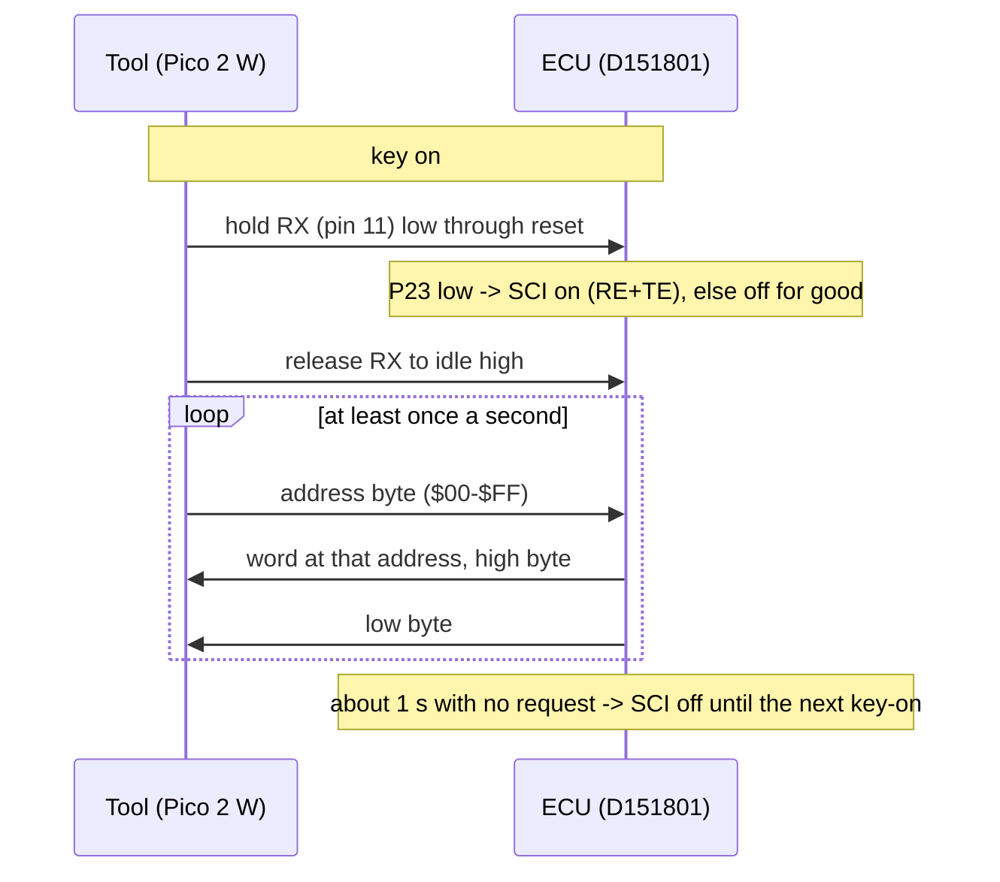
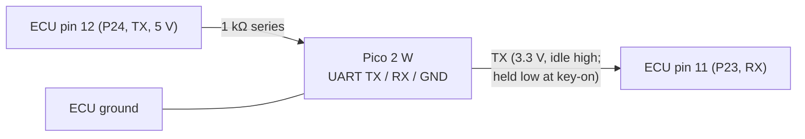

# MR2 89661-17140: the serial diagnostic link

The 17140 ROM contains a factory **live-data link**: a 3-wire serial port that answers "what is in RAM at this address?" while the engine runs. This gives logging and a dashboard straight from the ECU's own variables, with no extra sensors and no ROM changes.

**Code:** `LinkEnable` `$F33B`, `SerialPeek` `$F403`, `LinkKeepAlive` `$F62E` in [`analysis/mr2_17140/mr2_17140.asm`](../../analysis/mr2_17140/mr2_17140.asm).

**Simulator model:** [`analysis/emu/peek17140.py`](../../analysis/emu/peek17140.py).

**Tests:** [`tests/test_peek17140.py`](../../tests/test_peek17140.py).

## Protocol

| Item | Value | Evidence |
|---|---|---|
| **Enable** | At reset the SCI is switched on only if **P23 (chip pin 11, the SCI receive pin) reads low**. A tool holds its transmit line low (a break) through key-on, then releases it | [ROM:$F33B-$F343] CONFIRMED (code); [EMU:test_link_off_unless_p23_low_at_reset] |
| **Format** | RMCR = `$05`: NRZ, internal clock, E/128. With the ECU's 4 MHz crystal (E = 1 MHz) that is **7812.5 baud, 8N1** | [ROM:$F2EB-$F2EF]; handbook RMCR table; crystal [`hardware/aw11_ecu.md`](../hardware/aw11_ecu.md) LIKELY |
| **Pins** | P23 = RX (pin 11), P24 = TX (pin 12), plus ground | handbook CONFIRMED |
| **Request** | One byte: the address | [ROM:$F403-$F40A] CONFIRMED (code) |
| **Reply** | Two bytes: the word at that address, **high byte first**. A byte with an overrun or framing error is ignored | [ROM:$F40B-$F418] CONFIRMED (code); [EMU:test_reply_is_the_ram_word_high_byte_first] |
| **Address range** | **`$00`–`$FF` only**: the index register is always 0 when `SerialPeek` runs, so the byte is the whole address. The registers and RAM are readable; the ROM is not | [ROM:$F3D8-$F3E2, $F3F8-$F402] CONFIRMED (code) |
| **Writes** | **None.** The link cannot change anything in the ECU | CONFIRMED (code) |
| **Keep-alive** | Each reply sets `DiagFlags` (`$CC`) bit 0. Every time the counter `$6A` reaches `$FA` (about **1.0 s** in the simulator), the ROM clears the bit and, if it was already clear, **switches the SCI off until the next reset** | [ROM:$F62E-$F641] CONFIRMED (code); [EMU:test_switches_off_after_a_second_without_requests, test_polling_twice_a_second_keeps_it_on] |
| **Rate** | One request per main-loop pass, and the ECU waits for each reply. Simulated: about **200 words/s at 2000 rpm** and **130 words/s at 5000 rpm**, 4–10 ms per word | [EMU:sim] LIKELY. The real chip may be slower if its cycle counts are 6801-like (STATUS bench observations) |
| **Effect on the engine** | None seen: polling flat out at 5000 rpm leaves every spark time identical and the injector pulses within 20 µs | [EMU:test_polling_flat_out_leaves_spark_and_injection_alone] |

Send the next request only after the reply has arrived. A second byte sent while the first is unanswered overruns the receiver and is dropped.

## What it can read

The ECU sends a word, so for a byte variable at `addr`, request `addr` and use the high byte. Scalings come from [`maps.md`](maps.md); confidence as stated there.

| Address | Name | Reading |
|---|---|---|
| `$77` (word) | RpmWord | rpm = value / 0.32 (CONFIRMED [EMU]) |
| `$46` (word) | Load | kPa ≈ (value − 98.6) / 4.98 (GUESS, see the kPa conflict in STATUS) |
| `$4A` | MapRaw | 8-bit manifold pressure |
| `$44` / `$45` | TpsOpen / TpsZero | throttle above the learned closed position / the learned closed reading |
| `$53` | Coolant | raw coolant reading (scaling still to calibrate) |
| `$5F` / `$5E` | Tha / ThaCorr | intake air reading / its fuel correction |
| `$8C` | Mixture | mixture-adjust (CO) resistor reading; `$80` = centre |
| `$88` (word) | InjPulse | injector pulse before dead time, µs (CONFIRMED [EMU]) |
| `$8A` | InjDeadTime | battery-voltage dead time, µs |
| `$A8`–`$AB` | ignition terms | spark sum × 15/128° per count (CONFIRMED [EMU]) |
| `$9E` / `$9F` | IgnEdge / IgnDelay | spark edge and delay |
| `$40`–`$43` | SelfTestMark / FaultBits2 | fault-code bits |
| `$99`, `$59`, `$5A` | ModeFlags, InjFlags, StateFlags | engine-state bits |
| `$02` | PORT1 / PORT2 | output pins (ADC select, injector, idle-related outputs) |
| `$06` | PORT3 / PORT4 | **switch inputs**: P34 (J8 map select) = bit 4 of the high byte; the PORT4 trim jumpers = bits 2–3 of the low byte; P30 test terminal = bit 0 of the high byte |

**Avoid** `$08`–`$1F`. Reading some of these registers is the first half of the sequence that clears a timer, serial or IS3 (spark-confirmation, IGF) flag. In particular, a read of `$0E`/`$0F` (P3CSR) followed by the ROM's own Port 3 read would clear an IGF flag before the ignition interrupt counts it, and four missed IGF flags set the ignition fault [ROM:$FE57-$FE6D] (handbook flag-clear rules) LIKELY. Also avoid `$FF`: its low byte comes from `$0100`, which is not memory in mode 7. Ports `$02`–`$07` (other than the write-only direction registers, which read `$FF`) and RAM `$40`–`$FE` are safe.

## What this is good for

1. **Answering Q10 in the car, without the powered bench measurement.** Peek `$06`: bit 4 of the high byte is what P34 actually reads with the factory J8, so it shows directly which ignition map (A or B) and fuel correction the car runs.
2. **Settling the kPa scale.** With the key on and the engine off, the manifold is at barometric pressure (about 100 kPa at sea level). The current scale predicts Load ≈ 600. A different reading calibrates the scale and shows whether the high-load staircase `$F1DA` is reachable (STATUS conflicts log).
3. **Live logging and the phone dashboard.** At 130–200 words/s, a set of 8 variables updates about 20 times a second. That covers rpm, load, coolant, throttle, pulse width and advance, the P8 and Pi web-server plan.
4. **Checking the simulator against the real ECU.** The same variables, read from the car and from the simulator with the same inputs, show any modelling error.
5. **Reading the stored fault bits** (`$40`–`$43`).

**What it cannot do:** write RAM, change maps, read the ROM, or run code. Changing the tune still needs the P7 board. The link is the read side of a future TunerStudio connection.

## Hardware

- **Levels:** the ECU's input threshold is 2.0 V, so the Pico's 3.3 V output drives it directly. The ECU's 5 V output may only reach the Pico while the Pico is powered (CLAUDE.md rule 1). Power the Pico first, and fit a series resistor so an unpowered Pico is not back-fed.
- **Where to connect:** **open (Q11).** Pins 11 and 12 must be traced on the ECU board to see whether they reach a connector pin or a test pad. On the spare ECU the new socket makes fly-leads on the solder side easy.
- **Firmware:** a small Pico program: hold TX low (break) while waiting for the ECU's power, release it, then poll a variable list in a loop and stream the values over USB or Wi-Fi. Every hardware step needs the owner's confirmation before power is applied.

## Next

- Q11: trace chip pins 11 and 12 on the board (unpowered continuity).
- Write the Pico 2 W logger firmware and a host decoder, test them against the simulator model, then try the link on the spare ECU on the bench before the car.
