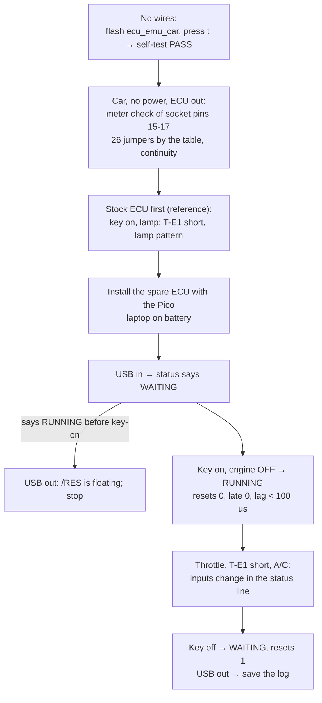
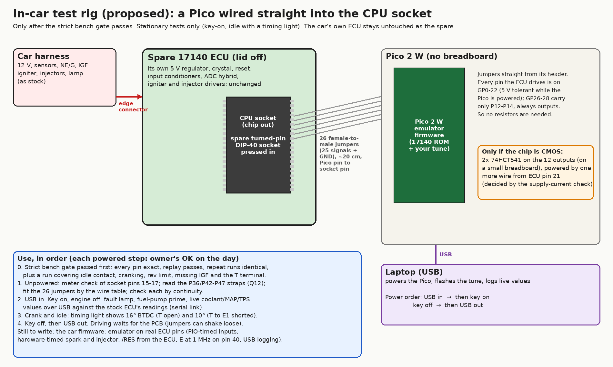

# Car test: key on, engine off

## Summary

In this test, the Pico 2 W is in the CPU socket of the spare ECU, in the car. It runs the 17140 ROM on the emulated CPU, on the real pins of the ECU board (firmware [`hardware/ecu-emu/car/`](../../hardware/ecu-emu/car/), `ecu_emu_car_pico2_w.uf2`). The firmware holds IGT (P11) and the injector (P21) at their engine-stopped level, so it cannot run the engine. The test shows the reset, the ADC readings, the switch inputs, the lamp and solenoid outputs, and the real-time margin. The car stays stationary, and the stock ECU is the reference.

## What the firmware does

- **Inputs:** PIO samples each input each 1 µs. Thus the NE, ADC-end and IGF edges keep their exact time.
- **Outputs:** a second PIO ring sends each output to its pin a constant 100 µs after the emulated CPU changes it.
- **Directions:** the pin directions follow the emulated DDRs.
- **Reset:** the emulated CPU starts from the /RES pin of the ECU board. /RES must be high for 2 ms before the CPU starts.
- **Clock:** E (pin 40) is 1 MHz while the emulated CPU runs.
- **USB:** a status line and the RAM variables each 0.5 s.

**The firmware cannot run the engine.** It holds IGT and the injector at the level that the real CPU drives while the engine is stopped. Both are high [BENCH:data/captures/chipdiff_17140_run5_6phase_2026-10-15.log] [EMU:tests/hardware/test_car_fw.py::test_koeo_no_spark_or_fuel] CONFIRMED. The emulator still calculates spark and injection, and the status line counts them. Neither pin changes. The firmware does not compile without the hold (`#error` in `main.c`). A build that runs the engine needs the strict bench gate ([roadmap](../project/roadmap.md)).

## Car rig

The car rig has no breadboard. A spare turned-pin DIP-40 socket ([BOM](../project/hardware_bom.md) A6) goes into the CPU socket of the spare ECU, with the notches aligned. 26 female-to-male jumper wires (about 20 cm) carry 25 signals and ground. Each wire goes from a header pin of the Pico 2 W (female end) to the same CPU pin of that socket (male end).

- **Why a spare socket:** the square pins of the jumpers stretch a turned-pin contact. Thus they go only into the spare socket, never into the socket of the ECU.
- **Pin map:** the pin map of the chip test, with these changes: NE, IDL and P17 go to GP15–GP17, and P12–P14 go to GP26–GP28. Thus each pin that the ECU board can drive is on a 5 V-tolerant GPIO ([design](../emulator/design.md#pins)).
- **Source:** [`hardware/ecu-emu/car/pins.h`](../../hardware/ecu-emu/car/pins.h). `uv run pcmre car-rig` makes the pictures, and `uv run pcmre car-rig --table` makes the table.

The picture shows the Pico 2 W from the top. Its header pins point down. Thus, with the board turned over, pin 1 is at the top right.

- Wire table (generated by `uv run pcmre car-rig --table`; `tests/hardware/test_car_rig.py` examines it):

  | ECU socket pin | Signal | CPU direction | Pico end |
  |---|---|---|---|
  | 1 | GND |  | GND (Pico pin 3) |
  | 6 | /RES | in | GP8 (Pico pin 11) |
  | 8 | P20 ADC end | in | GP12 (Pico pin 16) |
  | 9 | P21 injector | out | GP13 (Pico pin 17) |
  | 10 | P22 | in/out | GP20 (Pico pin 26) |
  | 11 | P23 RX | in/out | GP22 (Pico pin 29) |
  | 12 | P24 TX / fault lamp | out | GP21 (Pico pin 27) |
  | 13 | P10 NE | in | GP15 (Pico pin 20) |
  | 14 | P11 IGT | out | GP14 (Pico pin 19) |
  | 15 | P12 ADC select | out | GP26 (Pico pin 31) |
  | 16 | P13 ADC select | out | GP27 (Pico pin 32) |
  | 17 | P14 ADC select | out | GP28 (Pico pin 34) |
  | 18 | P15 ADC hold | out | GP6 (Pico pin 9) |
  | 19 | P16 IDL | in | GP16 (Pico pin 21) |
  | 20 | P17 | in | GP17 (Pico pin 22) |
  | 28 | P41 | out | GP11 (Pico pin 15) |
  | 29 | P40 | out | GP10 (Pico pin 14) |
  | 30 | P37 | in | GP7 (Pico pin 10) |
  | 32 | P35 G | in | GP5 (Pico pin 7) |
  | 33 | P34 J8 | in | GP4 (Pico pin 6) |
  | 34 | P33 | in | GP3 (Pico pin 5) |
  | 35 | P32 | in | GP2 (Pico pin 4) |
  | 36 | P31 | out | GP1 (Pico pin 2) |
  | 37 | P30 T terminal | in | GP0 (Pico pin 1) |
  | 39 | SC1 IS3 / IGF | in | GP18 (Pico pin 24) |
  | 40 | E | out | GP19 (Pico pin 25) |

Power and output levels

- **Power:** the Pico 2 W gets its power from the USB of the laptop. Connect USB before key-on and disconnect it after key-off. This is the "Pico first" order of the bench. Nothing takes current from the ECU supply.
- **Output levels:** the Pico 2 W drives 3.3 V. If the CPU is an NMOS part like the MC6801, the ECU board accepts 3.3 V and needs no buffers (LIKELY). If the lamp and the ADC operate in this test, the ECU board accepts the 3.3 V outputs. If not, two 74HCT541 buffers go between the Pico 2 W and the socket, with power from ECU pin 21 ([BOM](../project/hardware_bom.md) C1).
- **Straps:** the car firmware uses fixed strap values: P36 low, P42–P47 high (the values of the chip test). P36 only enables a self-test that runs with T shorted. P42 and P43 only trim the spark advance.

## Procedure

WARNING: Do not crank the engine. Keep the car stationary. Jumper wires can come loose.

CAUTION: Never apply 5 V to the pins of the Pico 2 W while it has no power. Connect USB before key-on. Turn the key off before you disconnect USB.

### Self-test (no wires)

1. Hold BOOTSEL and connect the Pico 2 W to USB. **(OWNER APPROVAL)**
2. Copy `ecu_emu_car_pico2_w.uf2` to the `RP2350` drive.
3. Open the serial port at 115200 baud (for example `screen /dev/tty.usbmodem* 115200`).
4. Make sure that it shows the help text, then `# ... WAITING for /RES` two times each second.
5. Make sure that nothing is connected to the pins of the Pico 2 W.
6. Press `t`.
   - The self-test drives each output pin with a pattern for 2 ms. It reads the pattern back through the pad of the pin.
   - It does not run if /RES reads high.
7. Make sure that it shows `self-test: PASS, pad delay N us, 0 bad samples`. N is a small constant, usually 0 to 2.
8. If the self-test fails, stop the test. The line gives the bad pins as a mask (bit n = GPn).
9. Disconnect USB.

### Preparation (no power)

10. Put the spare ECU on the bench. Make sure that its CPU is removed.
11. Push the spare turned-pin socket into the CPU socket. Align the notches.
12. Set the meter to Ω.
13. Measure the resistance from socket pin 15 to pin 21, in the two directions.
14. Do step 13 again for socket pin 16 and socket pin 17.
    - A pull-up gives the same value in the two directions.
    - A value that changes with the lead direction is a diode in a chip, not a pull-up.
15. If a value that is the same in the two directions is less than 3 kΩ, stop the test. Move that signal to GP9 in `pins.h` first.
16. Connect the 26 jumpers by the wire table. Put the female end on the Pico header and the male end in the socket.
17. Measure the continuity of each jumper, from the Pico pin to the socket pin.
18. Disconnect the charger from the laptop. The Pico ground becomes the car ground, and a charger can cause a ground loop.

### Stock ECU reference

19. Make sure that the stock ECU (the ECU of the car) is installed.
20. Turn the key on. Do not start the engine. **(OWNER APPROVAL)**
21. Record the state of the check-engine lamp.
22. Turn the key off.
23. Connect T to E1 at the check connector.
24. Turn the key on. **(OWNER APPROVAL)**
25. Record the lamp pattern for 15 s.
26. Turn the key off.
27. Remove the T-E1 connection.

### Test with the Pico 2 W

28. Install the spare ECU with the Pico 2 W.
29. Connect USB to the Pico 2 W. Do not turn the key. **(OWNER APPROVAL)**
    - Expect: `WAITING for /RES`, `RES=0`.
    - If it shows `RUNNING` before key-on, /RES is floating. Disconnect USB and stop the test.
30. Turn the key on. Do not start the engine. **(OWNER APPROVAL)**
31. Monitor the status line for 30 s.
    - Expect: `RUNNING`, `resets=0`, `traps=0`, `lost=0`, `late=0`, `lag_max` less than 100 us, `qfull=0`, `held: spark=0 inj=0`.
    - If not, record the line and turn the key off.
32. Look at the check-engine lamp.
    - Expect: the lamp is on, as with the stock ECU, and `lamp(P24)=0` in the status line. The ROM drives P24 low at key-on [EMU]. Low = lamp on (LIKELY).
    - If the lamp is off with `P24=0`, the ECU board does not see the 3.3 V output. Buffers are necessary ([BOM](../project/hardware_bom.md) C1). Turn the key off.
33. Read the ADC line.
    - Expect: 8 conversion times that are stable and different for each channel. Channel 0 (zero) is the shortest. Channel 7 (reference) is long. The counts increase.
    - If all 8 are equal, the ECU board does not see the ADC select lines (P12–P14). Buffers are necessary.
    - If all 8 are zero, no ADC-end edges arrive. Examine the P20 jumper (socket pin 8).
34. Push the throttle, then release it.
    - Expect: `IDL(P16)` changes.
    - If not, examine the P16 jumper (socket pin 19).
35. If the car has A/C, set the A/C switch on, then off.
    - Expect: `A/C(P37)` changes.
    - If not, examine the P37 jumper (socket pin 30).
36. Turn the key off.
37. Connect T to E1.
38. Turn the key on. **(OWNER APPROVAL)**
39. Record the lamp pattern for 15 s.
    - Expect: `T(P30)=0`, and the same lamp pattern as the stock ECU. The simulator gives a 0.5 s flash approximately each 5 s, the no-fault pattern [EMU].
    - If the pattern is different, record it and save the log.
40. Turn the key off.
41. Remove the T-E1 connection.
42. Make sure that the status shows `WAITING for /RES`, that `resets` increased by 1, and that all outputs are released.
43. Disconnect USB.
44. Save the full terminal log (`Ctrl-A H` in screen, or copy the text).

**Abort conditions:** turn the key off, then disconnect USB, if one of these occurs:

- a part becomes warm or has a smell;
- a relay chatters;
- the fuel pump runs for more than 2 s with the key on and the engine off;
- the status line stops.

## Reading the log

- **`#` lines** are for persons:
  - the run state and the counters;
  - the solenoid and lamp outputs, as the emulated CPU drives them;
  - the switch inputs, as the pins read them;
  - the held spark and injection counts;
  - the ADC conversion time of each channel, in µs at the pins.
- **`D,<ms>,<addr>,<word>` lines** are the RAM variables, in the format of the serial-link logger. Decode them with `uv run pcmre peeklog log.txt`. It gives MAP, coolant and intake raw values, engine speed and more ([serial link](../mr2/serial_link.md)).
- **`S,...` lines** are a short machine copy of the status.
- **`r`** prints a full RAM dump (`R,` lines).

## What the test answers

- **Q10, which ignition map the stock car uses:** `J8(P34)` in the status line is the level of P34 with the factory J8 installed. 1 = map `$F1EF` with fuel ×1.00. 0 = map `$F25D` with the `$F117` correction ([ignition maps](../mr2/ignition_maps.md)).
- **The kPa scale:** Load is RAM `$46` (the `D,…,46,…` lines). At key-on, engine off, near sea level, the proposed scale (Load ≈ 6.14 × kPa + 123) gives approximately 745. The old scale gives approximately 603.
- **Buffers:** if the lamp comes on and the ADC channels read differently, the ECU board accepts the 3.3 V outputs of the Pico 2 W.

Open questions: [open items](../project/open_items.md).

## What the test does not cover

- Spark and injection: both are held.
- The output timing of IGT and the injector. In this build, each output gets to its pin 100 µs after the emulated CPU changes it. This delay has no effect on the lamp, the solenoids and the ADC. The ROM subtracts its zero channel, so a constant delay cancels [EMU:tests/hardware/test_car_fw.py::test_glue_is_a_constant_delay] CONFIRMED.
- A build that runs the engine needs hardware-timed compares for IGT and the injector (the loopback firmware has them) and the strict bench gate.
- A crank test with the outputs held (NE, G and engine speed) is a different test with its own owner approval.
