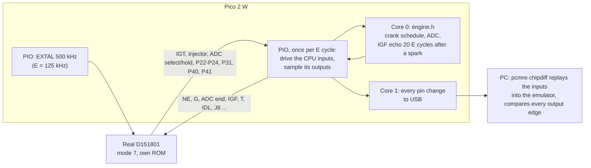
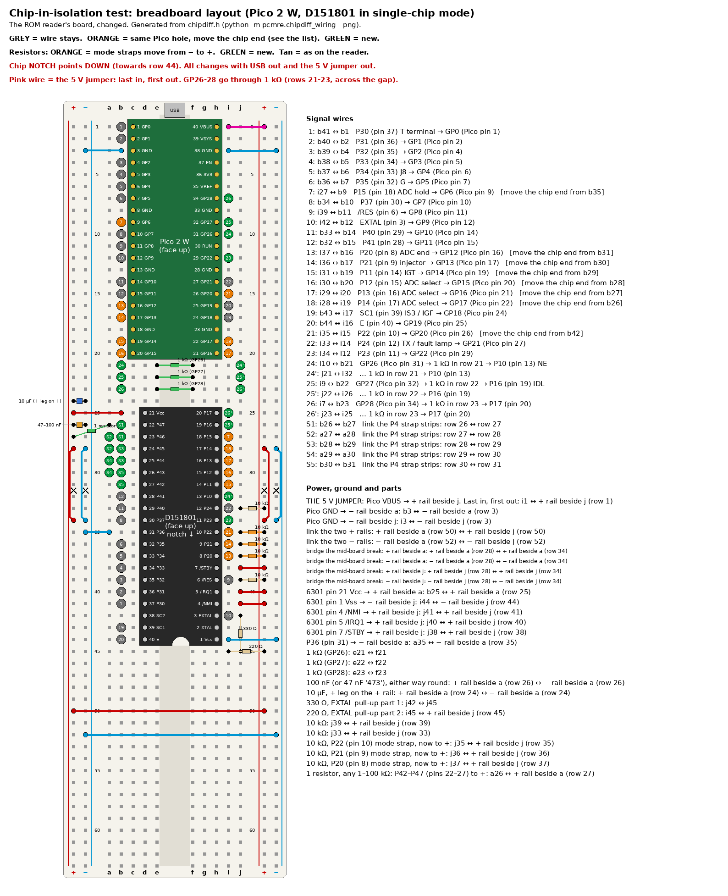

# Chip test

## Summary

The chip test compares the real CPU (D151801) with the emulator, pin by pin. The real CPU runs its own 17140 ROM in mode 7 on the reader breadboard. A Pico 2 W clocks it, plays the engine around it and logs each pin change. On the PC, `uv run pcmre chipdiff analyse` replays the inputs of the CPU into the emulator and compares each output edge. The test needs no ECU board, 12 V supply or dummy loads. The results are in [validation](../emulator/validation.md#step-4-chip-test).

## Method

1. The real CPU runs its own ROM in mode 7 on the breadboard.
2. The Pico 2 W plays the engine: crank signals, the ADC and the IGF echo. It uses the engine model (`engine.h`) and the schedule of the [loopback test](../emulator/validation.md#step-3-loopback-test).
3. The Pico 2 W logs each change on each pin, inputs and outputs. The time unit is the E cycle of the CPU.
4. On the PC, [`src/pcmre/emu/chipdiff.py`](../../src/pcmre/emu/chipdiff.py) replays the logged inputs into the emulator. It compares each output edge, pin by pin.

If all edges agree, the emulator is identical to the CPU, edge for edge.



### What the test covers

- **Covered:** all parts that the emulator replaces are inside the CPU:
  - the CPU core and its cycle timing
  - timer 1
  - the second timer
  - the ports and IS3.

  The test uses the real silicon for all of them.
- **Not covered:** the rest of the ECU board (sensors, ADC, igniter and injector drivers). The emulator does not replace it. In the car, the emulator uses the same board as the real CPU.
- **Model questions that the test answers:**
  - the second-timer function
  - the cycle count of each instruction
  - the reset latency
  - behaviour that the handbook does not give.

### Schedule

The schedule is `pcmre.emu.loopback_ref.SCHEDULE`. It has 8 phases of 6 s (E cycles of the CPU). The loopback test and `expected.h` use the same schedule.

| Phase | Engine speed | MAP | Condition |
|---|---|---|---|
| 1 | 200 rpm | 100 kPa | Cranking, idle contact closed |
| 2 | 800 rpm | 35 kPa | Warm idle, idle contact closed |
| 3 | 800 rpm | 35 kPa | Idle contact open |
| 4 | 2000 rpm | 50 kPa | — |
| 5 | 5000 rpm | 95 kPa | — |
| 6 | 7700 rpm | 95 kPa | Above the rev limit |
| 7 | 2000 rpm | 50 kPa | IGF missing (the safety cut of the ROM) |
| 8 | 800 rpm | 35 kPa | Idle contact closed, T terminal shorted |

The captures in `data/captures/` with "run3", "run4" and "run5" in their names use an older schedule: 800, 2000 and 5000 rpm, two times. `pcmre chipdiff` reads the schedule version from the log header.

### Clock and timing

- **Clock:** the Pico drives EXTAL at 500 kHz, the clock of the reader. Thus E = 125 kHz. The emulator counts time in E cycles, so the slow clock does not change the comparison. It gives the Pico 8 µs for each E cycle. A run of 8 phases (48 M cycles) takes about 6.5 minutes.
- **Each E cycle:** one PIO state machine waits for E to rise and drives the CPU inputs from a DMA ring. A quarter period later, it samples all pins into a second DMA ring.
- **Reactions:** core 0 finds the output edges in the samples, runs the engine model, and writes the input levels 8 E cycles ahead. The fastest reaction is the IGF echo, 20 E cycles after a spark. Thus it always occurs on time.
- **Reaction times on the model clock:**
  - The Pico samples a port-write output 3 cycles after the emulator time, and a compare output 2 cycles after. It times each reaction from the corrected edge.
  - ADC-start has a fixed delay of 20 cycles, in the model and on the Pico.
  - ADC-end and IGF have a delay of 30 cycles in this schedule (the simulator default is 20).
  - Each reaction that occurs late, ADC-start included, adds 1 to `late`. `late` must be 0.
- **Time zero:** the first E cycle after the PIO releases /RES. It is the same cycle in each run. If the real CPU needs a different number of cycles to its first instruction, all inputs move by the same quantity. `analyse` finds that offset first.
- **Latency:** the Pico samples the pins once per E cycle. Thus each output pin can have a constant offset from the emulator edge time. A constant offset is correct. An offset that changes, a missing edge or a different level is a real difference.

## Wiring

In mode 7, the bus pins of the reader become ports of the CPU:

- pins 37–30 (AD0–AD7) are P30–P37;
- pins 29–22 (A8–A15) are P40–P47;
- pin 39 (AS) is SC1 (IS3, the IGF input).

Thus most reader wires stay, and the test uses each reader GPIO again. The 26 GPIOs are in [`chipdiff.h`](../../hardware/ecu-emu/chipdiff/chipdiff.h).

<details>
<summary>Changes from the reader breadboard</summary>

Do all changes with no power (USB disconnected, 5 V jumper removed, CPU removed).

1. **Move 8 wire ends.** For GP6, GP12–GP17 and GP20, the Pico end stays. Move the CPU end from the old bus pin to the new port pin ("MOVE" in the table, orange in the picture).
2. **Mode straps:** find the three 10 kΩ resistors on pins 8, 9 and 10. Move their far end from the − rail to the + rail (mode 7 = HHH).
3. **Add 4 signals** ("NEW", green):
   - GP22 to pin 11 (P23).
   - GP26–GP28 to pins 13, 19 and 20 (P10, P16, P17), each through 1 kΩ across the centre gap in rows 21–23.
   - CAUTION: GP26–GP28 are ADC pins and do not accept 5 V. They drive only CPU inputs, and only through 1 kΩ.
4. **Straps:**
   - Pins 22–27 (P47–P42): join their six strips with five short jumpers. Connect **one** resistor (1–100 kΩ) to +. They are only inputs (the ROM sets DDR4 = `$03`), so one pull-up is enough. The resistor limits the current if the CPU is in a bus mode by mistake.
   - Pin 31 (P36): one wire to − (input only, DDR3 = `$02`).
   - Pin 11 (P23): no part. The firmware sets the internal pull-up of GP22. Thus the CPU reads it high at reset and the serial link stays off.

   These levels are the defaults of the simulator.

No change:

- pin 1 to GND
- pins 21, 7 (STBY), 4 (NMI) and 5 (IRQ1) on the 5 V rail
- 100 nF and 10 µF across pins 21 and 1
- XTAL (pin 2) open.

**New parts:** three 1 kΩ resistors and one resistor of 1–100 kΩ.

| Chip pin | Signal | Direction (CPU) | GPIO | Notes |
|---|---|---|---|---|
| 3 | EXTAL | in | GP9 | No change: open-drain, 470 Ω pull-up |
| 6 | /RES | in | GP8 | No change: open-drain, 10 kΩ pull-up |
| 40 | E | out | GP19 | No change. PIO uses it as its clock |
| 37 | P30 (T) | in | GP0 | No change |
| 36 | P31 | out | GP1 | No change |
| 35 | P32 | in | GP2 | No change. Held high |
| 34 | P33 | in | GP3 | No change. Held high |
| 33 | P34 (J8) | in | GP4 | No change. 1 = map `$F1EF` |
| 32 | P35 (G) | in | GP5 | No change |
| 30 | P37 | in | GP7 | No change |
| 29 | P40 | out | GP10 | No change |
| 28 | P41 | out | GP11 | No change |
| 39 | SC1 / IS3 (IGF) | in | GP18 | No change |
| 12 | P24 (TX, fault lamp) | out | GP21 | No change. Keeps its 10 kΩ pull-up |
| 13 | P10 (NE) | in | GP26 through 1 kΩ | New |
| 14 | P11 (IGT) | out | GP14 | New (was A12) |
| 15 | P12 (ADC select) | out | GP15 | New (was A13) |
| 16 | P13 (ADC select) | out | GP16 | New (was A14) |
| 17 | P14 (ADC select) | out | GP17 | New (was A15) |
| 18 | P15 (ADC hold) | out | GP6 | New (was AD6) |
| 19 | P16 (IDL) | in | GP27 through 1 kΩ | New |
| 20 | P17 | in | GP28 through 1 kΩ | New. Held high |
| 8 | P20 (ADC end, mode bit 0) | in | GP12 | New (was A10). 10 kΩ pull-up. The Pico holds it high during reset |
| 9 | P21 (injector, mode bit 1) | out | GP13 | New (was A11). 10 kΩ pull-up |
| 10 | P22 (mode bit 2) | out | GP20 | New (was R/W). 10 kΩ pull-up |
| 11 | P23 | out | GP22 | New. The internal pull-up of the Pico keeps it high at reset |

</details>

### Breadboard layout



Grey wires are the same as on the reader. Orange wires keep their Pico hole and move their CPU end. Green wires are new. The jumpers S1–S5 go between holes a and b to join pins 22–27. Their one resistor goes from a26 to the + rail.

<!-- generated: uv run pcmre chipdiff-wiring; tests/hardware/test_chipdiff_wiring.py examines this table -->

| Wire | Change | From | To | What |
|---|---|---|---|---|
| 1 | keep | b41 | b1 | P30 (pin 37) T terminal → GP0 (Pico pin 1) |
| 2 | keep | b40 | b2 | P31 (pin 36) → GP1 (Pico pin 2) |
| 3 | keep | b39 | b4 | P32 (pin 35) → GP2 (Pico pin 4) |
| 4 | keep | b38 | b5 | P33 (pin 34) → GP3 (Pico pin 5) |
| 5 | keep | b37 | b6 | P34 (pin 33) J8 → GP4 (Pico pin 6) |
| 6 | keep | b36 | b7 | P35 (pin 32) G → GP5 (Pico pin 7) |
| 7 | MOVE | i27 | b9 | P15 (pin 18) ADC hold → GP6 (Pico pin 9)   [move the chip end from b35] |
| 8 | keep | b34 | b10 | P37 (pin 30) → GP7 (Pico pin 10) |
| 9 | keep | i39 | b11 | /RES (pin 6) → GP8 (Pico pin 11) |
| 10 | keep | i42 | b12 | EXTAL (pin 3) → GP9 (Pico pin 12) |
| 11 | keep | b33 | b14 | P40 (pin 29) → GP10 (Pico pin 14) |
| 12 | keep | b32 | b15 | P41 (pin 28) → GP11 (Pico pin 15) |
| 13 | MOVE | i37 | b16 | P20 (pin 8) ADC end → GP12 (Pico pin 16)   [move the chip end from b31] |
| 14 | MOVE | i36 | b17 | P21 (pin 9) injector → GP13 (Pico pin 17)   [move the chip end from b30] |
| 15 | MOVE | i31 | b19 | P11 (pin 14) IGT → GP14 (Pico pin 19)   [move the chip end from b29] |
| 16 | MOVE | i30 | b20 | P12 (pin 15) ADC select → GP15 (Pico pin 20)   [move the chip end from b28] |
| 17 | MOVE | i29 | i20 | P13 (pin 16) ADC select → GP16 (Pico pin 21)   [move the chip end from b27] |
| 18 | MOVE | i28 | i19 | P14 (pin 17) ADC select → GP17 (Pico pin 22)   [move the chip end from b26] |
| 19 | keep | b43 | i17 | SC1 (pin 39) IS3 / IGF → GP18 (Pico pin 24) |
| 20 | keep | b44 | i16 | E (pin 40) → GP19 (Pico pin 25) |
| 21 | MOVE | i35 | i15 | P22 (pin 10) → GP20 (Pico pin 26)   [move the chip end from b42] |
| 22 | keep | i33 | i14 | P24 (pin 12) TX / fault lamp → GP21 (Pico pin 27) |
| 23 | NEW | i34 | i12 | P23 (pin 11) → GP22 (Pico pin 29) |
| 24 | NEW | i10 | b21 | GP26 (Pico pin 31) → 1 kΩ in row 21 → P10 (pin 13) NE |
| 24' | NEW | j21 | i32 | … 1 kΩ in row 21 → P10 (pin 13) |
| 25 | NEW | i9 | b22 | GP27 (Pico pin 32) → 1 kΩ in row 22 → P16 (pin 19) IDL |
| 25' | NEW | j22 | i26 | … 1 kΩ in row 22 → P16 (pin 19) |
| 26 | NEW | i7 | b23 | GP28 (Pico pin 34) → 1 kΩ in row 23 → P17 (pin 20) |
| 26' | NEW | j23 | i25 | … 1 kΩ in row 23 → P17 (pin 20) |
| S1 | NEW | b26 | b27 | link the P4 strap strips: row 26 ↔ row 27 |
| S2 | NEW | a27 | a28 | link the P4 strap strips: row 27 ↔ row 28 |
| S3 | NEW | b28 | b29 | link the P4 strap strips: row 28 ↔ row 29 |
| S4 | NEW | a29 | a30 | link the P4 strap strips: row 29 ↔ row 30 |
| S5 | NEW | b30 | b31 | link the P4 strap strips: row 30 ↔ row 31 |
| P36 | NEW | a35 | − rail beside a (row 35) | P36 (pin 31) → − rail beside a |

| Part | Change | From | To |
|---|---|---|---|
| 1 kΩ (GP26) | NEW | e21 | f21 |
| 1 kΩ (GP27) | NEW | e22 | f22 |
| 1 kΩ (GP28) | NEW | e23 | f23 |
| 100 nF (or 47 nF '473'), either way round | keep | + rail beside a (row 26) | − rail beside a (row 26) |
| 10 µF, + leg on the + rail | keep | + rail beside a (row 24) | − rail beside a (row 24) |
| 330 Ω, EXTAL pull-up part 1 | keep | j42 | j45 |
| 220 Ω, EXTAL pull-up part 2 | keep | i45 | + rail beside j (row 45) |
| 10 kΩ | keep | j39 | + rail beside j (row 39) |
| 10 kΩ | keep | j33 | + rail beside j (row 33) |
| 10 kΩ, P22 (pin 10) mode strap, now to + | MOVE | j35 | + rail beside j (row 35) |
| 10 kΩ, P21 (pin 9) mode strap, now to + | MOVE | j36 | + rail beside j (row 36) |
| 10 kΩ, P20 (pin 8) mode strap, now to + | MOVE | j37 | + rail beside j (row 37) |
| 1 resistor, any 1–100 kΩ: P42–P47 (pins 22–27) to + | NEW | a26 | + rail beside a (row 27) |

## Firmware and PC tool

[`hardware/ecu-emu/chipdiff/`](../../hardware/ecu-emu/chipdiff/) builds `ecu_chipdiff_pico2_w.uf2` (CI artefact). It uses the `engine.h` and `expected.h` of the loopback firmware. Its USB serial commands:

| Command | Conditions | Function |
|---|---|---|
| `rigcheck` | CPU removed, 5 V jumper removed | Finds lines that stay low and lines that are shorted together |
| `clock` | CPU installed, 5 V on | Measures the E frequency |
| `run [phases]` | CPU installed, 5 V on | Runs 1–8 phases of the schedule (default 8). Prints `BEGIN`, one line for each pin change (`<cycle hex> <pin word hex>`), then `END cycles=… late=… qfull=… dropped=…`. Prints `ABORT …` if the Pico was too slow for the CPU |

PC commands:

```
uv run --extra serial pcmre chipdiff capture /dev/ttyACM0 run.log --phases 8
uv run pcmre chipdiff analyse run.log
uv run pcmre chipdiff summary run.log
```

- `capture` sends `run` and saves the log. Its default is `--phases 6`, so give `--phases 8` for the full schedule.
- `analyse` finds the input offset and replays the logged inputs into the C emulator. For each output pin, it prints the edge counts (CPU and emulator), the latencies and the first difference.
- `summary` compares each phase with the emulator in closed loop: the emulator runs free with the same engine model, as in the car.
- `tests/hardware/test_chipdiff.py` runs the same pipeline with the emulator in place of the CPU. The result is an exact match, and a spark moved by one cycle makes it fail [EMU:tests/hardware/test_chipdiff.py] CONFIRMED.

## Procedure

The power order is the order of the reader. Power on: USB to the Pico, then the 5 V jumper **last**. Power off: the 5 V jumper **first**, then USB.

### Wiring (no power)

1. Disconnect USB from the Pico 2 W.
2. Remove the 5 V jumper. Remove both of its ends from the breadboard.
3. Remove the CPU from the breadboard.
4. Do the wiring changes in [Wiring](#wiring).
5. Measure each new and moved wire with a multimeter, against the generated table.

### Rig check

CAUTION: The CPU must be out of the breadboard for `rigcheck`. The pull-ups can supply an unpowered CPU through its input diodes.

6. Hold BOOTSEL and connect USB to the Pico 2 W. **(OWNER APPROVAL)**
7. Copy `ecu_chipdiff_pico2_w.uf2` to the `RP2350` drive.
8. Open the USB serial port of the Pico 2 W.
9. Type `rigcheck`.
10. If `rigcheck` does not show PASS, disconnect USB and correct the wiring.
11. Disconnect USB.

### Capture

12. Install the CPU with the notch in the same direction as for the ROM dump (towards row 44).
13. Connect USB to the Pico 2 W. **(OWNER APPROVAL)**
14. Install the 5 V jumper. **(OWNER APPROVAL)**
15. Type `clock`. Make sure that it shows approximately 125 000 Hz.
16. Close the serial terminal.
17. Run `uv run --extra serial pcmre chipdiff capture /dev/ttyACM0 run1.log --phases 1`. **(OWNER APPROVAL)**
18. Make sure that the `END` line shows `late=0`, `qfull=0` and `dropped=0`.
19. Run `uv run pcmre chipdiff analyse run1.log`.
20. Run `uv run --extra serial pcmre chipdiff capture /dev/ttyACM0 runA.log --phases 8`. **(OWNER APPROVAL)**
21. Run `uv run --extra serial pcmre chipdiff capture /dev/ttyACM0 runB.log --phases 8`. **(OWNER APPROVAL)**
22. Remove the 5 V jumper.
23. Disconnect USB.
24. Copy the logs to `data/captures/`.

## Pass criteria

The test passes when all of these are true:

- Each output pin has the same edges as the emulator, at a constant latency, over the full run (`analyse` shows PASS).
- The `END` line shows `late=0`, `qfull=0` and `dropped=0`.
- Two full runs give the same log.

If the test fails, the first different edge shows the instruction or timer behaviour to correct. Correct the C and Python models together. Then make `expected.h` again (`uv run pcmre loopback-ref`) and do the loopback test and the chip test again.

After the pass, the next test is the [car test](car_test.md).
