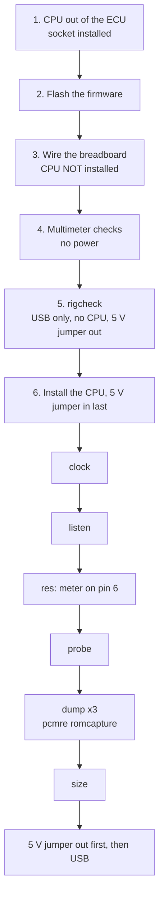
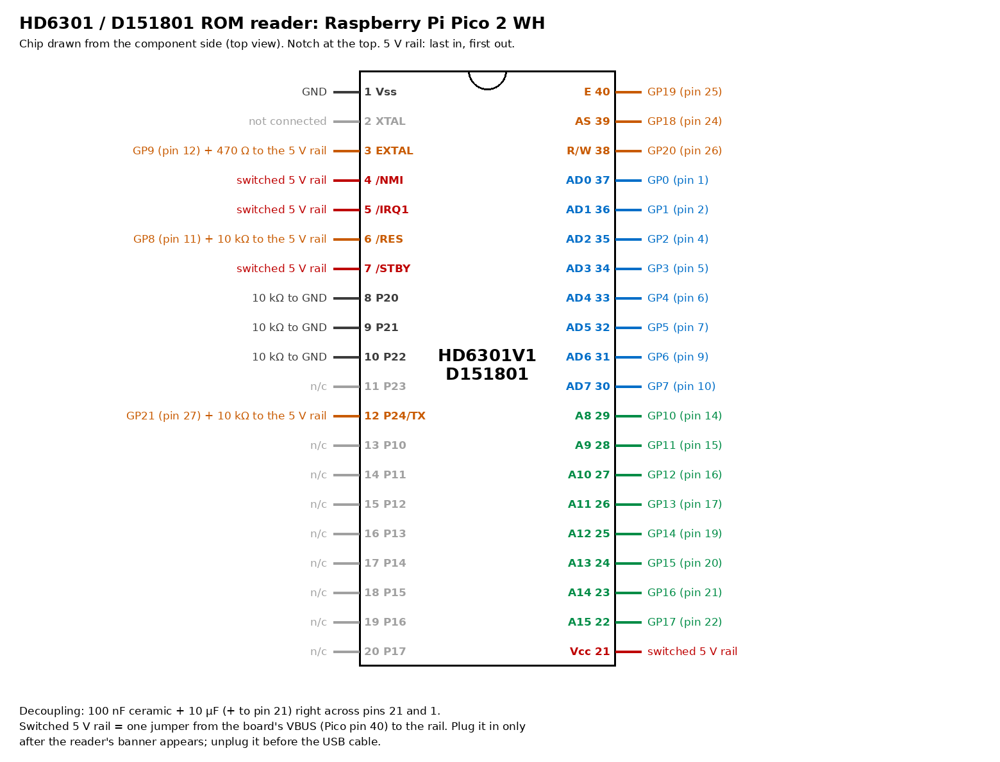
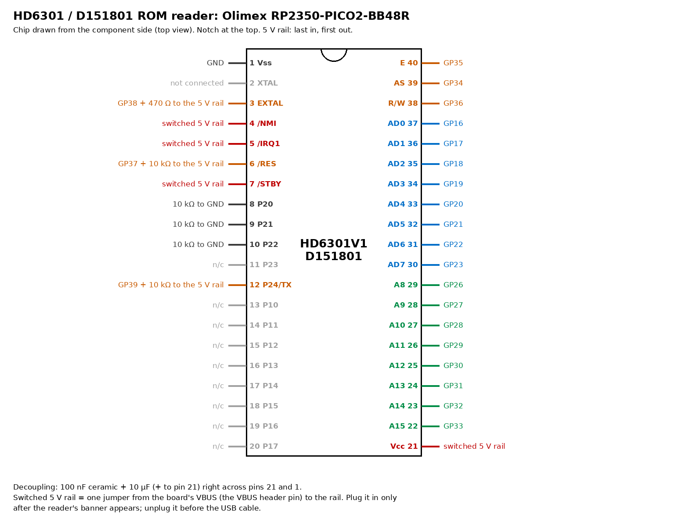
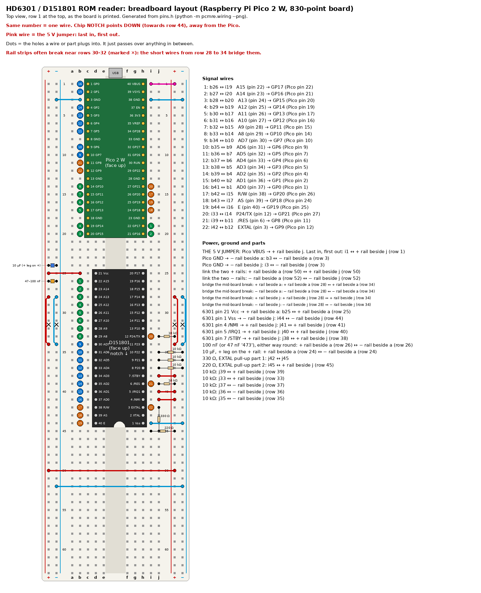

# ROM dump

## Summary

The reader reads the 4 KB ROM out of the CPU (D151801) of a Denso ECU. It is one Pico 2 W and a few resistors on a breadboard, with no level shifters. The RP2350 pins accept 5 V while the Pico 2 W has power. The 17140 ROM is dumped: [`roms/mr2_17140/89661-17140.bin`](../../roms/mr2_17140/89661-17140.bin), SHA-256 in [`89661-17140.bin.sha256`](../../roms/mr2_17140/89661-17140.bin.sha256). Use this procedure to dump the ROM again, or to dump the 17030 or the 17070. The firmware is [`hardware/rp2350-reader/`](../../hardware/rp2350-reader/).

## Result of the 17140 dump

| Item | Result |
|---|---|
| Runs | 3 runs of 4097 bytes, 0 bytes different, 0 late cycles |
| Mode | Mode bits 0 in each run (mode byte `$18`) |
| Second copy (bus snoop) | 4095 of 4095 bytes agree with the SCI copy (`$FFFF` is not compared) |
| Word sum | `$AA55` |
| Vectors | `$FFF4` = `$FE36`, `$FFF6` = `$FEB4`. All other vectors (`$FFF0`–`$FFFE`) = `$F2BE` |
| SHA-256 | `0cfc1fdd36fc4514cf0693e18ef7e4b47594a4b78f72beadd30766a36f271f6e` |

Evidence: [BENCH:data/captures/89661-17140_dump_2026-10-13.txt] CONFIRMED.

## How the reader works

The Pico 2 W does four tasks:

1. It clocks the CPU (EXTAL).
2. It holds the CPU in reset until the clock is stable.
3. It supplies a 43-byte program to the CPU in mode 0 (external vectors).
4. It receives the ROM through the SCI of the CPU, and it also monitors the bus as a second copy.

The firmware also supports the Olimex RP2350-PICO2-BB48R, with a different pin map. Parts: [BOM](../project/hardware_bom.md) section A.



## Safety rules

WARNING: The RP2350 pins accept 5 V only while the RP2350 has power. Connect USB first and the 5 V jumper last. Remove the 5 V jumper first and USB last.

CAUTION: Install or remove the CPU only with USB disconnected.

CAUTION: Connect the mode pins (8, 9, 10) to GND through 10 kΩ. Never use a bare wire.

CAUTION: The CPU is sensitive to static electricity. Touch a grounded point, or use a wrist strap, before you touch the CPU.

## 1. Remove the CPU from the ECU

1. Photograph IC7. Record the notch end.
   - The notch is at the X-TAL end. Pin 1 is corner B in [`step1-ic7-corners.jpg`](../images/mr2_board/guide/step1-ic7-corners.jpg) ([IC7 pin numbering](../mr2/hardware.md#ic7-pin-numbering)).
2. Mark pin 1 on the board with a pen.
3. Remove the conformal coat from the 40 solder joints on the bottom side. Use IPA and a stiff brush.
   - Coat on a joint stops the solder melting cleanly.
4. Add a small quantity of fresh solder and flux to each joint.
5. Heat each joint and remove the solder with the pump.
6. Remove the remaining solder with braid.
   - Do one row, then the other row.
   - Let the board cool after each group of 10 joints.
7. Make sure that each pin moves freely in its hole. Do the joint again if a pin does not move.
8. Do not use force to lift the CPU.
9. If pins do not come free, use Chip Quik low-melt alloy along the two rows. Keep it molten and lift the CPU evenly.
10. If you used low-melt alloy, remove **all** of it from the pads with braid and fresh solder.
    - Low-melt alloy that stays on the pads makes weak joints.
11. Install the turned-pin DIP-40 socket with its notch at the CPU notch end. Solder it.
12. Make sure that socket hole 1 has continuity to the ECU ground.
13. Make sure that socket hole 21 has continuity to the ECU +5 V.
14. Measure continuity between each pair of adjacent CPU pins (1–2, 2–3 … 39–40). All must be open.
    - A small piece of solder or copper between two pins connects two bus lines. `listen` then shows those two address bits at 0 when they are different.
15. Put the CPU in anti-static foam or foil, with pin 1 marked.

## 2. Flash the firmware

1. Get the UF2 file for the board:
   - GitHub → **Actions** → the latest **ci** run → **Artifacts**: `rp2350_reader_pico2_w` (Pico 2 W) or `rp2350_reader_olimex_rp2350_pico2_bb48` (BB48R);
   - or build it from [`hardware/rp2350-reader/firmware/CMakeLists.txt`](../../hardware/rp2350-reader/firmware/CMakeLists.txt).
2. Hold **BOOTSEL** (BB48R: the boot button) and connect USB. **(OWNER APPROVAL)**
3. Copy the `.uf2` file to the `RP2350` drive. The board starts again as the reader.
4. Open a serial terminal on its port (any baud rate):
   - PuTTY on Windows (COMx);
   - `screen /dev/tty.usbmodem*` on macOS;
   - `uv run --extra serial python -m serial.tools.miniterm <port> 115200` on any system.
5. Push Enter. Make sure that the reader shows this text:

```
HD6301 ROM reader on Raspberry Pi Pico 2 W(H)
Wiring: AD0 GP0, A8 GP10, AS GP18, E GP19, R/W GP20, RES GP8, EXTAL GP9, SCI GP21
RES is held low. Plug the 6301 5 V jumper in only now; unplug it before USB.
Commands: rigcheck  clock  listen  res  probe  dump  size  help
>
```

6. Disconnect USB before you connect wires.

## 3. Wire the breadboard (CPU not installed)

Put the board at one end of the breadboard. Leave space for the CPU across the centre gap. On the Pico 2 W, use the [breadboard layout](#breadboard-layout-pico-2-w-830-point-board). Connect the wires to the CPU holes, not to the CPU.

"The 5 V rail" is a separate rail strip. **One** jumper from VBUS of the board supplies it. This is the **5 V jumper**. It stays out until section 6.

<!-- generated: uv run pcmre wiring (from pins.h); tests/hardware/test_wiring.py examines these tables -->

**Raspberry Pi Pico 2 W**



| 6301 pin | Signal | GPIO | Pico pin | Also |
|---|---|---|---|---|
| 3 | EXTAL | GP9 | 12 | 470 Ω to the 5 V rail |
| 6 | /RES | GP8 | 11 | 10 kΩ to the 5 V rail |
| 12 | P24/TX | GP21 | 27 | 10 kΩ to the 5 V rail |
| 22 | A15 | GP17 | 22 |  |
| 23 | A14 | GP16 | 21 |  |
| 24 | A13 | GP15 | 20 |  |
| 25 | A12 | GP14 | 19 |  |
| 26 | A11 | GP13 | 17 |  |
| 27 | A10 | GP12 | 16 |  |
| 28 | A9 | GP11 | 15 |  |
| 29 | A8 | GP10 | 14 |  |
| 30 | AD7 | GP7 | 10 |  |
| 31 | AD6 | GP6 | 9 |  |
| 32 | AD5 | GP5 | 7 |  |
| 33 | AD4 | GP4 | 6 |  |
| 34 | AD3 | GP3 | 5 |  |
| 35 | AD2 | GP2 | 4 |  |
| 36 | AD1 | GP1 | 2 |  |
| 37 | AD0 | GP0 | 1 |  |
| 38 | R/W | GP20 | 26 |  |
| 39 | AS | GP18 | 24 |  |
| 40 | E | GP19 | 25 |  |

The 5 V jumper goes from Pico pin 40 (VBUS) to the 5 V rail.

**Olimex RP2350-PICO2-BB48R** (GPIO numbers as printed on the board). CAUTION: never use GP40–GP47. They do not accept 5 V.



| 6301 pin | Signal | GPIO | Also |
|---|---|---|---|
| 3 | EXTAL | GP38 | 470 Ω to the 5 V rail |
| 6 | /RES | GP37 | 10 kΩ to the 5 V rail |
| 12 | P24/TX | GP39 | 10 kΩ to the 5 V rail |
| 22 | A15 | GP33 |  |
| 23 | A14 | GP32 |  |
| 24 | A13 | GP31 |  |
| 25 | A12 | GP30 |  |
| 26 | A11 | GP29 |  |
| 27 | A10 | GP28 |  |
| 28 | A9 | GP27 |  |
| 29 | A8 | GP26 |  |
| 30 | AD7 | GP23 |  |
| 31 | AD6 | GP22 |  |
| 32 | AD5 | GP21 |  |
| 33 | AD4 | GP20 |  |
| 34 | AD3 | GP19 |  |
| 35 | AD2 | GP18 |  |
| 36 | AD1 | GP17 |  |
| 37 | AD0 | GP16 |  |
| 38 | R/W | GP36 |  |
| 39 | AS | GP34 |  |
| 40 | E | GP35 |  |

**The other CPU pins (both boards)**

| 6301 pin | Name | Connect to |
|---|---|---|
| 1 | Vss | GND (any GND pin on the board) |
| 21 | Vcc | switched 5 V rail; 100 nF and 10 µF from pin 21 to pin 1, at the chip |
| 7 | /STBY | switched 5 V rail (/STBY high: run) |
| 4 | /NMI | switched 5 V rail (/NMI inactive) |
| 5 | /IRQ1 | switched 5 V rail (/IRQ1 inactive) |
| 8 | P20 | 10 kΩ to GND (mode bit 0) |
| 9 | P21 | 10 kΩ to GND (mode bit 1) |
| 10 | P22 | 10 kΩ to GND (mode bit 2) |
| 2 | XTAL | not connected (XTAL) |
| 11, 13–20 | P23, P10–P17 | not connected |

<!-- end generated -->

The 10 µF capacitor has polarity. Its + leg goes to pin 21 (the 5 V side). Keep the legs of the two capacitors short.

### Breadboard layout (Pico 2 W, 830-point board)

This is one tested layout of the tables above, hole by hole.



- **The Pico 2 W** is face up across the centre gap in columns **c and h**, with USB at the row-1 end. Its pin 1 (GP0) is in **c1**. Thus holes a–b and i–j are free in each of its rows.
- **The CPU** (section 6 only) is face up in columns **d and h**, rows 25–44, with its **notch towards row 44**. Its pin 1 is **h44** and pin 21 is **d25**. In this direction, its bus pins are next to GP0–GP15 of the Pico 2 W.
- **Rails:**
  - Use the + and − strips that have the red and blue marks on the board. On the left, the + strip is on the outside and the − strip is next to column a. On the right, the + strip is next to column j and the − strip is on the outside. If the board is different, use the red and blue marks, not the position.
  - A dot in the picture shows a hole that a wire or part goes into. A wire that crosses a strip without a dot only goes over it.
  - Many 830-point boards have a break in each rail strip near the middle (rows 30–32 approximately). The layout bridges all four strips with a short wire from row 28 to row 34 (wires B…). Make sure that each strip has continuity from row 1 to row 63.
  - The two + rails are the switched 5 V rail. Only the **5 V jumper** from VBUS supplies them.

<!-- generated: uv run pcmre wiring (breadboard); tests/hardware/test_wiring.py examines this table -->

| Wire | From | To | What |
|---|---|---|---|
| 1 | b26 | i19 | A15 (pin 22) → GP17 (Pico pin 22) |
| 2 | b27 | i20 | A14 (pin 23) → GP16 (Pico pin 21) |
| 3 | b28 | b20 | A13 (pin 24) → GP15 (Pico pin 20) |
| 4 | b29 | b19 | A12 (pin 25) → GP14 (Pico pin 19) |
| 5 | b30 | b17 | A11 (pin 26) → GP13 (Pico pin 17) |
| 6 | b31 | b16 | A10 (pin 27) → GP12 (Pico pin 16) |
| 7 | b32 | b15 | A9 (pin 28) → GP11 (Pico pin 15) |
| 8 | b33 | b14 | A8 (pin 29) → GP10 (Pico pin 14) |
| 9 | b34 | b10 | AD7 (pin 30) → GP7 (Pico pin 10) |
| 10 | b35 | b9 | AD6 (pin 31) → GP6 (Pico pin 9) |
| 11 | b36 | b7 | AD5 (pin 32) → GP5 (Pico pin 7) |
| 12 | b37 | b6 | AD4 (pin 33) → GP4 (Pico pin 6) |
| 13 | b38 | b5 | AD3 (pin 34) → GP3 (Pico pin 5) |
| 14 | b39 | b4 | AD2 (pin 35) → GP2 (Pico pin 4) |
| 15 | b40 | b2 | AD1 (pin 36) → GP1 (Pico pin 2) |
| 16 | b41 | b1 | AD0 (pin 37) → GP0 (Pico pin 1) |
| 17 | b42 | i15 | R/W (pin 38) → GP20 (Pico pin 26) |
| 18 | b43 | i17 | AS (pin 39) → GP18 (Pico pin 24) |
| 19 | b44 | i16 | E (pin 40) → GP19 (Pico pin 25) |
| 20 | i33 | i14 | P24/TX (pin 12) → GP21 (Pico pin 27) |
| 21 | i39 | b11 | /RES (pin 6) → GP8 (Pico pin 11) |
| 22 | i42 | b12 | EXTAL (pin 3) → GP9 (Pico pin 12) |
| 5V | i1 | + rail beside j (row 1) | THE 5 V JUMPER: Pico VBUS → + rail beside j. Last in, first out |
| G1 | b3 | − rail beside a (row 3) | Pico GND → − rail beside a |
| G2 | i3 | − rail beside j (row 3) | Pico GND → − rail beside j |
| L+ | + rail beside a (row 50) | + rail beside j (row 50) | link the two + rails |
| L− | − rail beside a (row 52) | − rail beside j (row 52) | link the two − rails |
| Ba+ | + rail beside a (row 28) | + rail beside a (row 34) | bridge the mid-board break: + rail beside a |
| Ba- | − rail beside a (row 28) | − rail beside a (row 34) | bridge the mid-board break: − rail beside a |
| Bj+ | + rail beside j (row 28) | + rail beside j (row 34) | bridge the mid-board break: + rail beside j |
| Bj- | − rail beside j (row 28) | − rail beside j (row 34) | bridge the mid-board break: − rail beside j |
| Vcc | b25 | + rail beside a (row 25) | 6301 pin 21 Vcc → + rail beside a |
| Vss | i44 | − rail beside j (row 44) | 6301 pin 1 Vss → − rail beside j |
| /NMI | j41 | + rail beside j (row 41) | 6301 pin 4 /NMI → + rail beside j |
| /IRQ1 | j40 | + rail beside j (row 40) | 6301 pin 5 /IRQ1 → + rail beside j |
| /STBY | j38 | + rail beside j (row 38) | 6301 pin 7 /STBY → + rail beside j |

| Part | From | To |
|---|---|---|
| 100 nF (or 47 nF '473'), either way round | + rail beside a (row 26) | − rail beside a (row 26) |
| 10 µF, + leg on the + rail | + rail beside a (row 24) | − rail beside a (row 24) |
| 330 Ω, EXTAL pull-up part 1 | j42 | j45 |
| 220 Ω, EXTAL pull-up part 2 | i45 | + rail beside j (row 45) |
| 10 kΩ | j39 | + rail beside j (row 39) |
| 10 kΩ | j33 | + rail beside j (row 33) |
| 10 kΩ | j37 | − rail beside j (row 37) |
| 10 kΩ | j36 | − rail beside j (row 36) |
| 10 kΩ | j35 | − rail beside j (row 35) |

<!-- end generated -->

The unused port pins (11, 13–20) are CMOS inputs that are open. This is safe for short runs. A resistor of 47–100 kΩ from each pin to the 5 V rail keeps them stable. Never connect them directly to a rail.

## 4. Multimeter checks (no power)

1. Measure continuity from the CPU hole to the board pin, for each row of the board table (22 rows).
2. Measure continuity between adjacent CPU holes on each side (1–2, 2–3 … 39–40). If you get continuity, there is a short circuit.
3. Measure from CPU hole 3 to the 5 V rail. Expect 470 Ω (550 Ω with the 330 Ω + 220 Ω pair of the layout).
4. Measure from holes 6 and 12 to the rail. Expect 10 kΩ.
5. Measure from holes 8, 9 and 10 to GND. Expect 10 kΩ each.
6. Make sure that holes 21, 7, 4 and 5 have continuity to the 5 V rail.
7. Make sure that hole 1 has continuity to GND.
8. With the 5 V jumper out, measure from the 5 V rail to GND. Expect open, or a value that increases while the 10 µF charges.
9. Make sure that the + leg of the 10 µF capacitor is on the pin 21 side.

## 5. Rig check (USB only, no CPU, 5 V jumper out)

CAUTION: The CPU must be out of the breadboard. `rigcheck` cannot see the difference between a CPU with no power and an empty socket. Its pull-ups can supply the CPU through its input diodes.

1. Remove the 5 V jumper. Remove both of its ends from the breadboard.
   - A jumper with one end in the board can touch the rail or the strip and keep the rail on.
2. Connect USB. **(OWNER APPROVAL)**
3. Type `rigcheck`.
   - It pulls each bus line up gently, then pulls each line low in turn. It finds lines that stay low and lines that are shorted together.
4. Make sure that it shows `rigcheck: PASS (no stuck or shorted lines)`.
5. If it shows that the 5 V rail is on, remove the 5 V jumper.
6. If it shows a different failure, correct the wiring at the CPU pins that it gives. Then do this section again.

## 6. Install the CPU and apply power

1. Disconnect USB.
2. Install the CPU face up, across the gap, fully in the holes.
   - On the Pico 2 W layout, the notch points to row 44, away from the Pico 2 W.
   - Pin 1 goes in h44 and pin 21 in d25.
3. Connect USB. **(OWNER APPROVAL)**
4. Wait for the start text. The reader now holds /RES low, and the clock runs.
5. Install the 5 V jumper. **(OWNER APPROVAL)**

### `clock`

6. Type `clock`. Make sure that it shows:

```
E: 125000 Hz, high 50% of the time (want 125000 Hz, about 50%)
clock: PASS
```

   E is the output of the CPU at EXTAL/4. Thus this shows that the CPU has power and a clock. This measurement replaces an oscilloscope.

7. Measure the 5 V rail at CPU pin 21. Expect 4.75–5.25 V.
8. Measure /RES (pin 6). Expect approximately 0 V, because the reader holds it low.

### `listen`

9. Type `listen`.
   - The reader releases /RES for 5 ms and drives nothing. The log shows the first bus cycles of the CPU. `$FFFF`, `$FFFE`, `$FFFF` near the top is the reset-vector fetch. After that, the CPU runs from a floating vector. This is safe because nothing is driven.
10. Make sure that it shows a PASS line like this:

```
listen: vector fetch at cycle 1 reads $FEFF (floating bus, external as expected) -> PASS
```

   With nothing driven, the vector reads float and copy the address bus (`$FE`, `$FF`). This shows that the vector is external in mode 0.

11. If it shows **STOP** (an internal vector, `$F000` or more), do not run `probe` or `dump`. The CPU can drive its own vector, and two drivers on the bus can cause damage.
12. If it shows **UNCLEAR** (a different value), a floating line possibly changed. Examine the full log before you continue.
13. Save the full log in both cases.

### `res`

14. Type `res`. It releases /RES for 15 s with nothing driven.
15. During the 15 s, measure CPU pin 6 to GND. It must be 4.5 V or more.

### `probe`

16. Type `probe`. The reader supplies only the reset vector (`$C0C0`) and a 2-byte loop at `$C0C0`.
17. Make sure that it shows:

```
probe: vector served yes, $C0C0 fetched yes, late cycles 0 -> PASS
```

### `dump`

18. Close the serial terminal.
19. Run the capture tool:

```
uv run --extra serial pcmre romcapture <port>
```

   For a different ECU, add `-o roms/<name>/<file>.bin`. The reader does the dump **three times** (approximately 5 s each). It examines four items before it prints the ROM:
   - the latched mode is 0;
   - the three runs are identical;
   - how much of the snoop copy agrees (`$FFFF` is not compared, because the dummy cycles of the 6301 read it too);
   - the 16-bit word sum and the vectors.

   The tool then saves `roms/mr2_17140/89661-17140.bin` (or the `-o` file) and its SHA-256. It does not overwrite a different file that exists.

20. Open the serial terminal again.
21. Type `size`. It shows if `$E000`–`$EFFF` is also internal ROM. Expect a 4 KB ROM.
22. Remove the 5 V jumper.
23. Disconnect USB.

## Troubleshooting

| Symptom | Possible cause | Action |
|---|---|---|
| `clock` shows 0 Hz | 5 V jumper out; CPU not fully in; EXTAL does not get to pin 3 | Examine the jumper. Then do multimeter checks 1–7 for pins 3, 21 and 1 |
| `clock` frequency is wrong, or E is high almost all the time | EXTAL pull-up missing or wrong value; XTAL (pin 2) connected by mistake | 470 Ω from pin 3 to the rail; pin 2 open |
| `listen` shows no cycles | AS (39) or E (40) not connected; /RES does not go high | Examine pins 39, 40 and 6, and the 10 kΩ /RES pull-up. Run `res` and measure pin 6. If it is less than 4.5 V, change its pull-up to 4.7 kΩ |
| `listen` shows STOP or UNCLEAR | The vector did not float, or came late | Do not run `probe` or `dump`. Examine the log |
| `listen` shows continuous unusual activity, never `$FFFE` | Wrong mode: a strap is missing ([upstream issue #4](../project/upstream_notes.md)) | Pins 8, 9 and 10 each 10 kΩ to GND |
| `probe` FAIL with `$FFFE` at cycle 3 or later | The CPU fetches its vector after the window of the handbook | Examine the log. Do not change the window: outside it, the vector is internal |
| `late cycles` more than 0 | The RP2350 did not answer before E rose. It stopped driving for the remainder of that run, so the run fails | Record it. It must not occur at 250 kHz |
| `wrong mode` in `dump` | A mode strap is wrong | As for "continuous unusual activity" |
| `runs differ` | A loose wire or a bad connection | Install the CPU and jumpers again, then do the dump again. Never accept a dump with different runs |
| `ABORT: bus stopped` | The 5 V jumper came out, or the CPU lost its clock | /RES is already held low. Examine the jumper and the wiring |

## After the dump

1. Make sure that the hashes are correct.
2. Make sure that the snoop copy and the SCI copy agree.
3. Make sure that `uv run pcmre xref` disassembles the image with no errors.
4. Run `uv run pcmre ingest` to make the first report on the new ROM.
5. Store the CPU with pin 1 marked. The [chip test](chip_test.md) uses the same CPU and breadboard.
