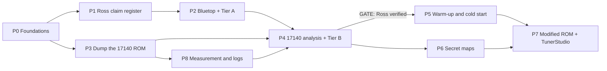

# Roadmap

## Summary

This page gives the goals, the rules, the tools and the phases of the project. The subject is the 17140, the ECU of the mk1 Toyota MR2 (UK market). Phases P0 to P3 are done, and the 17140 ROM is dumped. Phases P4, P6, P7 and P8 are in progress, and P5 waits for the "Ross verified" gate. The [open items](open_items.md) page gives what each open gate still needs.

## Goals

0. Make sure that the findings of [Ross](../ross/claims.md) are correct for the 17140. Work on goal 1 starts only after this.
1. Know warm-up and cold start well enough to predict the effect when the IACV and the cold start injector (CSI) are removed.
2. Find and describe the "secret" fuel and ignition maps.
3. Run a modified ROM on the ECU, with TunerStudio for the tune. A Pico 2 W replaces the CPU and runs the ROM on the emulator.

Start hypothesis for goal 1

On the AW11 4A-GE, the start injector time switch and STA operate the CSI. The ECU does not operate it. The IACV is a wax valve that coolant heats. The ECU does not operate it either.

- The 1984 wiring diagram connects starter → CSI → time switch, with no ECU connection ([factory data](../mr2/factory_data.md)) [PDF:EWD p16–17] LIKELY for the 17140.
- The 1988 US repair manual shows an ECU that drives the idle-up VSV from `V-ISC` during cranking and for 10 s after start. The 17140 board has a `VISC` pad.
- The 17140 ROM has no output that follows coolant temperature. Two outputs can possibly move idle air: P31 and PORT2 bit 2 [ROM:$F3A2-$F3CC, $F478-$F49F]. Which board pins they drive is open question Q2.

Thus the ECU possibly does not "know" that the IACV and the CSI are removed. The real question is how the ECU strategies react to less idle air and less cranking fuel. These strategies are:

- idle-stability advance
- coolant enrichment and advance
- after-start enrichment
- cranking fuel.

## Ground rules

The full rules are in [`CLAUDE.md`](../../CLAUDE.md). In short:

1. **Pico 2 W first.** The Pico 2 W does every hardware task that it can. Buy a part only if the Pico 2 W cannot do the task, and write the reason in the [parts list](hardware_bom.md).
2. **Modern tools.** Use the tools in the table below. Legacy tools are for cross-checks only.
3. **Source-of-truth order:** ROM bytes, then bench or car measurement, then factory documents, then Ross, then the `cap.asm` notes, then upstream notes and forums. Write each conflict in [open items](open_items.md).
4. **Evidence.** Each claim has an evidence tag and a confidence level ([writing rules](../style.md)).
5. **One defs file for each ROM.** The map pages, CSV files, XDF and TunerStudio INI come from it.
6. **Do not change the original dumps.**
7. **Safety.** Each powered step needs the approval of the owner. Do not run the engine on code that has no test. Keep the stock ECU as the known-good ECU.
8. **Verifier.** Each gate needs the approval of a Verifier that did not do the work.

## Tools

| Purpose | Tool | Legacy (cross-check only) |
|---|---|---|
| Disassembly, source, cross-reference, call graphs | `pcmre` (Python, [tool guide](../../src/pcmre/README.md)). Ghidra is optional, for the owner to browse a ROM. It is not a gate | IDA 4.9 (`cap.idb`) |
| Assembler | Macroassembler AS (`asl`), `cpu 6301` | `dasm`, TASM |
| Simulator | `pcmre.emu`: the CPU, the D151801 peripherals and an engine model, in Python | — |
| Emulator | `hardware/ecu-emu/core`: the same model in C, for the Pico 2 W and the PC | — |
| Scripts and tests | Python 3.12, `uv`, `pytest`, `ruff`; GitHub Actions runs the tests and builds the firmware | `.bat` files |
| Firmware | pico-sdk with PIO, CMake; each firmware builds to a UF2 | EPROM reader, RS232 |
| Signal capture | Pico 2 W pin logs (chip test, serial link); sigrok/PulseView for other captures | — |
| PCB | KiCad; factory-assembled boards | ExpressPCB |
| Map edits | TunerStudio for the live tune through the Pico 2 W. TunerPro RT (XDF) for a raw ROM file | — |

## Phases

| Phase | Purpose | Gate | State |
|---|---|---|---|
| P0 | Foundations: `pcmre`, `asl`, cross-reference, CPU core | `roms/bluetop/cap.s` reassembles to the same bytes as `cap.bin`; `dasm` agrees; the CPU core agrees with MAME; Verifier approval | Done |
| P1 | Ross claim register: claims, figures, data, diagrams | — | Done ([claims](../ross/claims.md), [diagrams](../ross/diagrams.md)) |
| P2 | Bluetop analysis and Tier-A claims | Each Tier-A claim has a status with ROM and simulator evidence; Verifier approval | Done ([AE86 pages](../ae86/architecture.md)) |
| P3 | Dump the 17140 ROM with the reader | Three identical dumps; word sum `$AA55`; Verifier approval | Done: `roms/mr2_17140/89661-17140.bin`, 4 KB ([procedure](../procedures/rom_dump.md)) |
| P4 | 17140 analysis and Tier-B claims | "Ross verified": no Tier-A or Tier-B claim is PENDING; verification report; Verifier approval | In progress: each claim tested on the 17140 has a status. The gate is open |
| P5 | Warm-up and cold start (goal 1) | The predicted effects of IACV and CSI removal, compared with a cold start log from the car | Not started: waits for the P4 gate |
| P6 | Secret maps (goal 2) | Both map sets, the switch in the ROM, and the strap on the board, with Verifier approval | In progress: P34 (jumper J8) selects the map set [ROM:$FDC9-$FDD5]. The stock level of P34 is open (Q10) |
| P7 | Modified ROM and TunerStudio (goal 3) | Strict bench gate (chip test) before the engine runs on the emulator; Verifier approval | In progress: the emulator agrees with the simulator; chip test runs done; car firmware for key on, engine off is built |
| P8 | Measurements of the ECU board and the car | — | In progress: serial-link logger firmware and decoder written, not used on hardware yet |

P0 to P3: what each phase made

- **P0:** the HD6301 decoder, the IDA listing import, `asl` source that reassembles to the same bytes, the cross-reference generator, and the CPU core of the simulator.
- **P1:** the [claim register](../ross/claims.md) with tiers, the 16 figures of the Ross articles in `docs/ross/figures/`, the digitised curves, and the [Ross diagrams](../ross/diagrams.md).
- **P2:** the Bluetop [architecture](../ae86/architecture.md), [fuel chain](../ae86/fuel_chain.md), [simulation](../ae86/simulation.md), [versions](../ae86/versions.md) and [ignition table](../ae86/ignition_table.md); `roms/bluetop/defs.yaml` and its XDF.
- **P3:** the [reader](../procedures/rom_dump.md) and the 17140 ROM dump.

Claim tiers:

| Tier | Meaning |
|---|---|
| A | Strategy or structure, possibly the same on the Bluetop |
| B | A value of the 17030 or the 17140 |
| C | Needs a bench measurement |
| X | Opinion |

P4: 17140 analysis

- Labelled source and cross-reference from `roms/mr2_17140/symbols.yaml` (`uv run pcmre symlisting mr2_17140`).
- Pages: [program](../mr2/program.md), [maps](../mr2/maps.md), [ignition maps](../mr2/ignition_maps.md), [serial link](../mr2/serial_link.md).
- Tier-B claims to examine on the ROM:
  - density map sites
  - the speed correction
  - the 17 × 8 ignition sites
  - the idle ignition table
  - T-VIS at 4650/4250 rpm
  - the 6300 rpm global step
  - the mixture screw
  - double injection above 6000 rpm
  - the IGF fuel cut.
- Port audit of `VISC` and `FPU`: each write to the port bits behind them, with its conditions.
- Mark Ross's 17030 values `DIFFERS-BY-ECU` where the 17140 is different.
- Deliverable: a verification report in `docs/ross/`, with a status and evidence for each claim, and diagrams of the verified chains.

P5: warm-up and cold start

Examine:

- cranking fuel (STA);
- after-start enrichment and its decay;
- coolant enrichment and advance;
- idle-stability advance;
- decel fuel cut against coolant temperature;
- the P31 and PORT2 bit 2 outputs (Q2).

Then run whole-ROM simulations of starts at −5 °C, 10 °C and 20 °C, each with normal and less idle air. The deliverable gives a state diagram of the cold start. It also gives the predicted effects of IACV and CSI removal with confidence levels, and changes that a modified ROM can make. Compare the predictions with a cold start log from the car (serial link).

P7: modified ROM

1. Port audit of the 17140 ROM ([program](../mr2/program.md)). Done.
2. Emulator in C on the Pico 2 W ([design](../emulator/design.md)). Done; it agrees with the simulator ([validation](../emulator/validation.md)).
3. Chip test: the real CPU against the emulator ([procedure](../procedures/chip_test.md)). The strict bench gate is open.
4. Car rig in the spare ECU ([procedure](../procedures/car_test.md)): key on, engine off first; then the timing light at idle; then short drives with a log.
5. Map edits only, with the word sum balanced at `$FFEE` (`uv run pcmre checksum`).
6. TunerStudio: the Pico 2 W gives the calibration area and the live RAM values over USB or Wi-Fi, with an INI from `roms/mr2_17140/defs.yaml`. "Burn" writes to the flash of the Pico 2 W. If TunerStudio fails, use TunerPro RT with the XDF.
7. A factory-assembled board: RP2350, 74HCT buffers, DIP-40 plug.

## Hardware approach

The Pico 2 W is the only project board. Its GPIO pins accept 5 V only while the board has power. The [parts list](hardware_bom.md) gives each part and its reason.

| Task | What the Pico 2 W does | Page |
|---|---|---|
| Reader | Supplies the clock and the external memory of the CPU in mode 0, and reads the ROM over the SCI and the bus | [ROM dump](../procedures/rom_dump.md) |
| Chip test | Runs the engine model around the real CPU in mode 7 on the reader breadboard, and logs each pin change | [chip test](../procedures/chip_test.md) |
| Serial-link logger | Reads RAM values from the ECU over the serial link | [serial link](../mr2/serial_link.md) |
| Car rig | Replaces the CPU in the spare ECU, with 26 jumper wires into the CPU socket | [car test](../procedures/car_test.md) |
| Final board | An RP2350 on a DIP-40 plug that emulates the CPU in the car, with the tune in its flash | [emulator design](../emulator/design.md) |

The final board is not ordered. Its outline needs the clearance above the CPU socket, and the engine does not run on the emulator before the strict bench gate.

## Agent roles

| Role | Work |
|---|---|
| **Lead** | Gives the tasks, keeps the [open items](open_items.md) current, and writes each conflict |
| **Verifier** | Examines the work of a phase again from the evidence, and can lower a confidence level. Each gate needs its approval. An agent does not approve its own work |

Other work (tools, code analysis, maps, hardware guides) can go to the Lead or to other agents.
